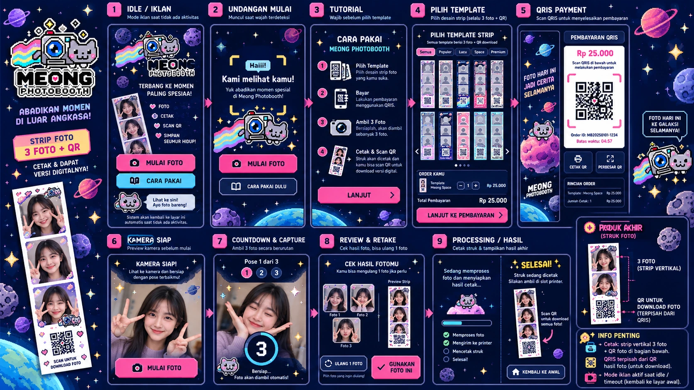
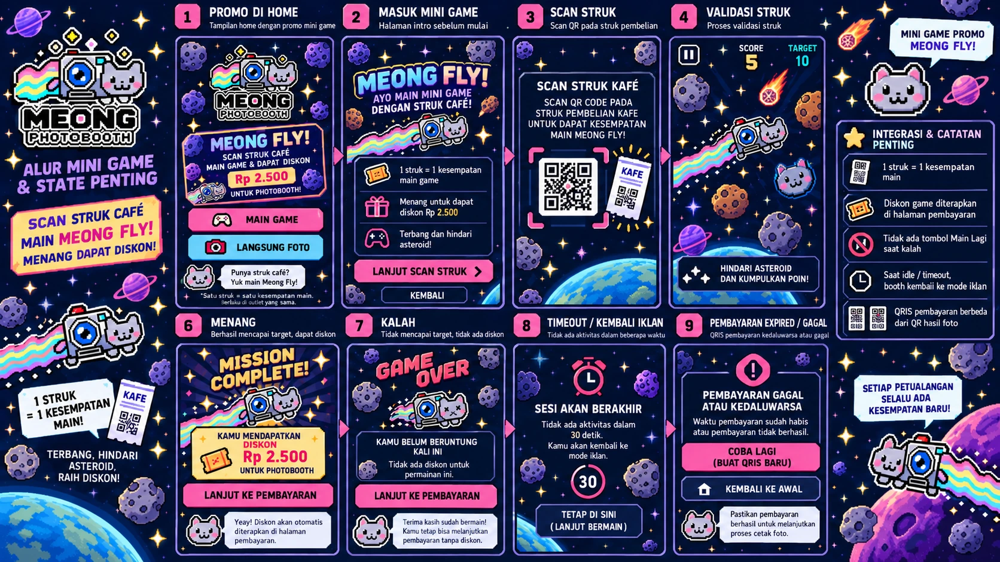

# FEAT-022 - Meong Photobooth portrait kiosk GUI v2 (working specification)

**Date:** 2026-10-21
**Status:** APPROVED FOR STAGED DEVELOPMENT; NOT PRODUCTION READY
**Working branch:** feature/portrait-kiosk-v2-next (derived from feature/portrait-kiosk-gui; master unchanged)
**Stable base SHA:** 27f3801b235d81dc0a49ab201f3e143b62314413 (master)
**Owner authorization:** Greenfield Kivy GUI and fresh audio lifecycle, portrait-first 10.1-inch, work only on a new branch; do not merge to master without separate approval.

## Canonical status and approved artboards — 2026-10-21

**Authoritative docs for this feature:**

- **This file** — FEAT-022 scope, delivery stages, branch status, timing and release gates.
- [Approved visual reference and corrected page-by-page flow](portrait-kiosk-v2-visual-spec.md) — the **two actual last approved mockups** and annotations that supersede incorrect/missing flow arrows.
- [Technical engineering contract](portrait-kiosk-v2-technical-design.md) — actual source modules vs proposed adapters, visit-state and payment/recovery invariants.
- [Image asset provenance and checksums](assets/portrait-v2/README.md) — two verified full-resolution artboards committed as high-quality WebP.
- [QA evidence](test_checklist.md) and [source state](FEATURE_STATUS.md) — verified tests are not equivalent to speaker/camera/printer hardware certification.

### Approved photobooth artboard

### Approved Meong Fly artboard

### Core owner decisions (binding over mockup text)

**Single shared entry:** Idle advertising displays real local video/image content and both **MULAI FOTO** and **MAIN MEONG FLY** CTAs. Optional face invitation is a non-modal overlay **on that same advertising screen**, with both actions; a separate promo home must **not** replace advertising.

**Once-per-visit tutorial gate:** Direct photo visitors and visitors finishing Meong Fly must complete the mandatory four-step illustrated tutorial **once per active visit** before reaching template selection. Set tutorial_seen only after explicit acknowledgement; reset at safe end/abandonment for the next customer; never reset consumed receipt attempts.

**Meong Fly end:** Provide a dedicated game-entry / rules screen before the receipt step. One unique valid cafe receipt grants exactly one chance; no replay on loss or win. A Win proposes a **Rp2.500** discount, Lose no discount. **Both outcomes go to the tutorial if unseen and then the 12-template gallery, not straight to payment.** Any win discount only becomes payable after server-side validation in the future authorised checkout; current game is DEMO-only.

**Template and final print:** Use the 12 existing 80 × 240 mm (1:3) masters, each exactly **three photo slots and one photo-download QR**. Physical copy quantity is not extra capture count. The final photo-folder QR is not the QRIS payment QR. Preserve camera/photo orientation, existing print quantity behavior and safe Drive delivery.

**Audio and timeout:** New page-owned Audio Manager v2, no reused legacy GUI playback lifecycle; idle video can own its own audio; payment ads are muted; never cut off a paid/unknown payment, active capture or uncertain print with a generic browsing timeout. Capture and result states must remain truthful if devices/network fail.

**Visual reference vs functional acceptance:** The two artboards are approved **styling and content direction**, but illustration-level omissions and mistakes (no Meong Fly CTA on idle, stand-alone mini-game home, result button to payment, sample Rp25.000 QRIS total, decorative receipt scans, unverified print strip styling) are explicitly **not** final routing/pricing/working behavior. The detailed visual document resolves every one.

### Source truth today — do not confuse target pages with implemented pages

| Subsystem | Current portrait v2 source | Not yet delivered |
| --- | --- | --- |
| GUI | New independent Kivy window, Pixel Arcade Space colors/stars/large touch CTA | Complete final visual parity for every target screen |
| Advertising | AdCatalog and AdvertisementPlayer idle media, two entry actions | Camera-driven face trigger; invitation only a manual preview |
| Visit navigation | advert/tutorial/templates/game_preview, visit-scoped tutorial_seen and safe browse idle | Integrated game results, session entitlement, real payment states |
| Tutorial | Mandatory four-step illustrated page, explicit completion | End-to-end integrated game return with retained discount |
| 12 strip templates | Real catalog preview, count per template and DEMO cart quote | Checkout service adapter and live ordered captures/printing |
| Mini game | Explicit **unavailable** placeholder behind entry CTA | Real mini-game/receipt input/POS validation and discount |
| Audio | New PortraitAudio, SDL2-first desktop WAV fallback, diagnostics and unit tests | **Actual Windows speaker audibility** and game/camera/payment audio buses |
| Payment/camera/result | No real v2 transaction, capture, print or Drive call | Camera mirror/retake/3-shot, QRIS, printing and delivery integration |

**Current evidence:** [portrait v2 GitHub Actions run 39548798578](https://github.com/pratikto/PhotoBooth/actions/runs/39548798578) on code-and-approved-artwork SHA **6e7f29a7**: **21/21 Python navigation/fake audio tests PASS**, compile PASS, Kivy widget smoke PASS, **12 synthetic screenshot states** at 800×1280 and 452×900, two workflow jobs SUCCESS. This supersedes the earlier "CI pending" entry. **Windows speaker, physical portrait/touch, real face detector, merchant/POS receipt, Midtrans, camera, thermal paper and Google Drive end-to-end remain NOT VERIFIED**. After later docs-only commits the application source remains unchanged; do not count docs pushes as new physical QA.

### Staged QA/release gates

1. **First:** verify actual Windows music speaker output, idle ad video + audio, touchscreen responsiveness and owner acceptance of refreshed visual composition at 10.1-inch portrait.
2. **Then (separately approved implementation):** integrate actual face invite and reuse safe camera/capture/retake/print/Drive core via adapters, with full regression.
3. **Then:** bring the standalone mini-game, demo single-use receipt and corrected tutorial/template routing; confirm no replay, no fake real discount.
4. **Then:** integrate protected server-side discount with QRIS Mock/Sandbox only after eligible partner and order-recovery rules are defined; no real charges without approval.
5. **Lastly:** full Windows/merchant/privacy/reliability acceptance, branch PR review and explicit **owner approval before any master merge or release**.

**Rollback:** Continue running legacy python main.py on master; never force-merge, delete historical branches, rewrite v1 media, or reset uncertain payment/print customer state.

## Product and design baseline

- Meong camera-cat official logo, gray camera, blue lens, rainbow, retro pixel-space style consistent with Meong Fly; do not replace the mascot.
- Target 10.1-inch portrait touch display, e.g. 800 x 1280; also handle 450 x 900 simulation and responsive resizes. Keep hit targets comfortably large.
- Advertising is the default/return screen: reuse trusted local scheduled image/video playlist and its fallback; real face detection invitation remains on **the same advertising screen**, not a separate welcome page.
- From advertising, offer direct photo and optional Meong Fly. No separate replacement mini-game home. The prototype game entry must be visibly labelled unavailable until approved integration.
- Mandatory illustrated tutorial **once per active visitor** before template picking (including after game Win/Lose if not seen). Mark seen on explicit completion, not screen appearance; reset on safe end/abandonment/return to advertising for the next visitor. See DEC-003 addendum in docs/meong-fly-tutorial-gate-20261021 at commit 980af997.
- Real templates are the 12 approved 80 x 240 mm thermal strips, exactly three photos + one photo-download QR; template quantity means paper copies. Do not invent selectable 2- or 4-pose layouts. Preserve full strip ratio (1:3) in a portrait display.
- Main flow target: advertising/invitation -> tutorial once -> 12-template picker/quantities -> payment -> three captures -> selective one-photo retake/review -> photo-strip composition -> print/Drive share -> advertising.
- Game target: advertising/invitation -> Meong Fly -> unique receipt claim -> attempt -> Win/Lose -> tutorial if unseen -> template picker -> normal payment. Result never navigates straight to payment. Win promo Rp2,500 is demo-only until trusted order-side validation and Midtrans tests; lose gets no discount, no retry with same receipt.
- QRIS payment QR and photo-download QR are separate.
- Maintain photo workflow and already working camera, mirroring, template/masks, print transports, Drive and data-store business logic. No printer/purchase workflow rewrites as a consequence of a visual refresh.
- Preserve payment/capture/printing safe lifetimes: browsing inactivity may return to ads, but never kill a paid or uncertain transaction.

## Rebuild boundary

Greenfield means **all customer-facing page layout, page navigation, style components and audio lifecycle are new**. The following existing non-UI services may be reused through adapters: approved logo/receipt artwork, template previews and quotes, local advertisement catalog/player, camera, print and Drive backends. Reusing the already tested advertisement media decoder does not mean reusing the v1 screen arrangement.

The existing python main.py path remains unchanged, running v1. The separate opt-in prototype launcher is python tools/run_portrait_v2.py. Stage-one screens must never silently create transactions, accept payment or print; unsupported CTAs must be explicitly disabled or clearly marked as a demo.

## Staged delivery and gates

| Gate | Deliverable | Definition of Done / evidence |
| --- | --- | --- |
| P0 | New package and visit-state controller | No v1 modifications; pure tests of tutorial-once, idle reset and blocked game integration |
| P1 | New audio controller | Dedicated page-owned music/SFX, unload/stop rules and mock tests; audible Windows speaker validation remains pending |
| P2 | Portrait Kivy shell | Idle advert/player, inline invitation preview, tutorial, real 12-template gallery/copy cart; active buttons, touch/resize review at 450x900 and 800x1280 |
| P3 | Safe backend/photo flow integration | Same exact three captures, retake constraints, print copies and Drive QR; hardware QA required |
| P4 | Mini game + QRIS integration | Receipt verification, single attempt and discount checks tied to authoritative order state; mock and provider Sandbox tests required |
| P5 | Complete Windows kiosk regression | Camera/audio/print/video/device/privacy tests and explicit owner release approval |

## Known blockers/risks

- BUG-001/007 v1 music audible failure: a rewritten audio controller is not proof it is fixed; run on actual Windows speaker with provider diagnostics and genuine WAV playback.
- BUG-009 cloud retention remains unresolved in v1; do not falsely advertise permanent photo URLs.
- QRIS Sandbox lives only on feature/qris-payment and needs careful reconciled integration. No real financial transactions authorized.
- Meong Fly remains on feature/meong-flappy-challenge as a standalone demo. Do not pull it into the kiosk without separate staged integration and hardware checks.
- Duplicate FEAT-021 labels exist on unrelated Meong Fly and Background Studio branches. FEAT-022 is **provisionally reserved for this portrait GUI rebuild**, pending reconciliation of the unified feature register before any merge.
- Never merge to master, delete other feature branches, or claim Windows/thermal/merchant QA on source-only evidence.

## Rollback and evidence

The stable master/v1.0.0 remain unchanged; remove/switch away from feature/portrait-kiosk-gui to return to existing functionality. Each stage gets a separate commit with relevant tests and documentary evidence. Incomplete automated/device checks must remain clearly labelled pending.

## First-stage QA snapshot (2026-10-21, branch-only)

Initial new GUI/audio source has **16/16 Kivy-independent tests PASS** and successful Linux/Xvfb real-widget and 12 portrait screenshot states (six states at 800x1280 and 452x900) in [CI run 39522764587](https://github.com/pratikto/PhotoBooth/actions/runs/39522764587); artifact `meong-portrait-v2-screens` ID 12312581205. Screenshot inspection confirms functional layout/legibility at both virtual sizes, but pixel-arcade visual refinement to the full owner's reference remains incomplete. 452 width is used solely because raw screenshots at 450 suffer Xvfb OpenGL RGB alignment; the screenshot generator rejects obviously corrupted rows. This does not demonstrate physical 450x900 or 10.1-inch touchscreen behavior. Windows speaker sound, real video audio, face presence, mini-game, server-priced discounts, Midtrans provider and photo/thermal/Drive end-to-end remain untested or intentionally disconnected. `python main.py` is untouched, and PR #10 stays draft, NOT MERGED.

## 2026-10-21 — Next-stage branch: desktop PCM audio provider hardening

**Branch:** `feature/portrait-kiosk-v2-next`, created from the existing `feature/portrait-kiosk-gui` prototype instead of discarding its P0–P2 work. **No merge to master and no change to legacy `photobooth/audio.py`.**

**Scope completed in source, not device-certified:**

- `photobooth/kiosk_v2/audio.py` now prefers a Kivy SDL2 native PCM WAV sound handle on Windows/Linux/macOS where `KIVY_AUDIO` was not explicitly overridden. An explicit operator provider override remains respected; the ordinary Kivy `SoundLoader` is a fallback.
- Reject a provider that returns a missing, non-finite or non-positive audio duration and unload its handle before trying the next provider. Continue to fail soft when all native loaders are unavailable.
- When a native playback request leaves a handle reporting `stop`, expose a failure instead of claiming music started. This is only provider-state evidence; it **cannot prove audible speaker output**.
- `tests/test_kiosk_v2_audio.py` adds fake-provider priority/fallback/rejected-handle and stopped-after-play regression checks. Existing tutorial/ads ownership, mute, page transitions and cleanup behavior must remain unchanged.
- The branch-only CI workflow now runs on `feature/portrait-kiosk-v2-next` as well.

**Traceable source commits:** CI trigger `ab551ba3`; audio code `2b743da0`; audio tests `caad0e0d`. **Subsequent verified CI:** [run 39548798578](https://github.com/pratikto/PhotoBooth/actions/runs/39548798578) on SHA 6e7f29a7 passed 21/21 Python tests, Kivy widget smoke, and 12 synthetic portrait screenshots; two jobs SUCCESS. Previous prototype [run 39522764587](https://github.com/pratikto/PhotoBooth/actions/runs/39522764587) remains historical. Neither run verifies audible Windows speaker output, genuine video sound, touch hardware or the unconnected payment/photo services.

**Required physical Windows gate:** On the operator machine, run `git switch feature/portrait-kiosk-v2-next`, `git pull origin feature/portrait-kiosk-v2-next`, `python -m unittest tests.test_kiosk_v2_flow tests.test_kiosk_v2_audio tests.test_kiosk_v2_widgets -v`, then `python tools/run_portrait_v2.py`. Confirm with ears that music plays automatically on Tutorial and Templates without needing the Settings/Test Music button, that it stops during video ads, that the explicit test button audibly restarts it, that changing windows/resuming does not double playback, and that the Windows output device/volume mixer is correct. Record exact Windows version, Python/Kivy, branch commit SHA, provider, speaker result, and whether video retains its own audio. Do not mark BUG-001/007 fixed until audible owner acceptance.

**Next approved integration gate:** Preserve existing advertising/touch/template flow and collect physical audio/touch observations first. Real face triggering, mini-game receipt and discount, QRIS, camera/retake, printer and Drive integrations still require staged follow-up testing and remain disconnected from the v2 opt-in prototype. Do not delete payment/receipt history, and do not merge to `master` without owner approval.

