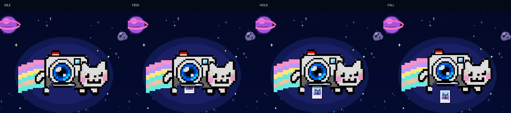
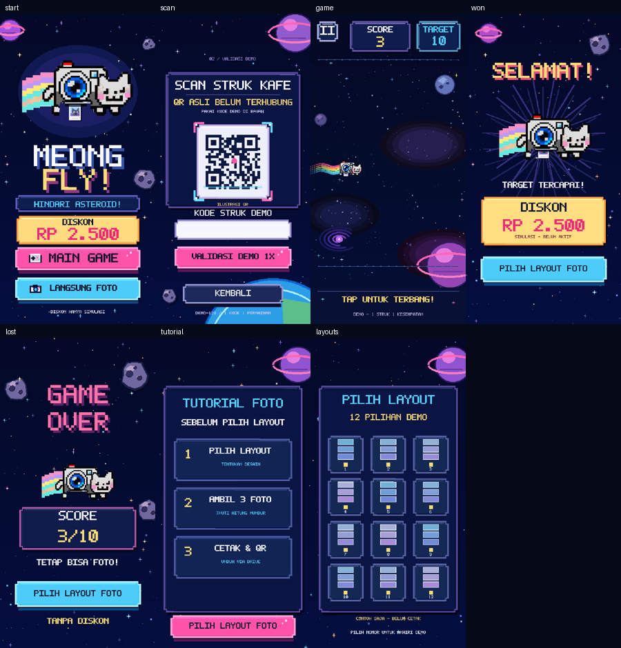

# FEAT-021 Visual v5 Phase 1 — Linux renderer evidence

Date: 2026-10-21. Runtime source commit: `a83eee8b1f4f8ae7dd55d411e36e28bea33eab7d` on `feature/meong-flappy-challenge`. Baseline: `3368e123ef709bf1ee9f110e505bc0619d3833f4`. Source commit was published via GitHub connector after CLI push lacked credentials; its tree equals locally tested tree `04289a50e146a81c4bda5e4ebbb5aecce7a115aa`. No remote history rewrite.

**Result: 91 PASS, 0 FAIL, 0 ERROR, 0 SKIP** in Linux Python 3.12.14, Kivy 2.3.1, SDL2, Mesa llvmpipe OpenGL 4.5. See [raw log](unittest-linux.log). [Capture metadata](capture.json) records a clean working tree at the tested runtime commit. The evidence companion changes documentation and evidence only.

Commands:

```sh
KIVY_NO_ARGS=1 python -m unittest discover -s tests -p 'test_meong_fly*.py' -v
KIVY_NO_ARGS=1 python -m tools.render_meong_fly_phase1 --output /tmp/meong-final-captures
```

Twelve deterministic **Kivy FBO** frames rendered: Start idle/feed/hold/fall, Scan/Game/Win/Lose/Tutorial/Layouts at 450×900, plus Gameplay at 800×600 and 1200×800. Temporary ledger, fixture score 3 (10 on Win), stationary game pose, no live asteroid round. These are not a user playthrough, Windows screenshots, device FPS measurement or proof of collision feel. Raw frames are reproducible with the tool. This folder preserves cropped/assembled evidence below; no artwork was substituted in the captures.

## Four-stage print inspection



Each panel is the top 450×360 crop from an actual 450×900 Kivy FBO, with a 40-pixel external label band. Times: idle .30, feed .96, hold 1.32, fall 1.74 seconds. Observed: single camera, partial bottom-leading paper through lower slot, full attached photo, detached photo below the camera. No second static silhouette or lens-covering photo in these fixtures. Geometry tests cover tilt and release continuity; moving Windows video is still required.

## Scene regression overview



Seven Kivy captures reduced to half size for overview. Result CTA remains PILIH LAYOUT FOTO, no retry, tutorial/layouts remain generic demo-only. This sheet is not a replacement mockup and does not imply owner approval. Typography, galaxies/asteroids and defeat expression still visibly differ from the owner's neon poster and remain subsequent-phase work. The game fixture contains no obstacles; verify actual moving gameplay separately. Static Scan capture does not establish caret/keyboard usability.

## Gate status

| Gate | Evidence/status |
| --- | --- |
| Single compositor; authored slot/crop/tilt; hold/release; pause; scene reset; count/safe floor; UV/depth; viewport; texture cache | Automated PASS on Linux (13 new checks plus existing suite) |
| Existing receipt, score, collision geometry, terminal/tutorial/layout and TextInput canvas tests | Linux automated PASS |
| Phase 1 screenshot inspection | Linux Kivy fixtures reviewed; four stages distinguishable, slot under lens, film clear of CTA |
| Exact Windows automated suite and manual typing/gameplay | NOT RUN |
| Moving slot alignment ≤1 logical pixel on Windows | NOT MEASURED |
| Target-device ≥30 FPS, stalls and memory | NOT MEASURED |
| Owner visual acceptance; BUG-013 closure | PENDING / OPEN |

Windows commands after pulling the feature branch (record `git rev-parse HEAD`):

```powershell
python -m unittest discover -s tests -p "test_meong_fly*.py" -v
python -m photobooth.meong_fly_demo
```

Use a fresh DEMO code. Inspect Start printing, gameplay tilt/feed/pause/fall, both terminal CTAs and tutorial gate, resize, then reject reuse after relaunch. Record SHA, Windows/GPU/runtime, screenshots, four-stage video and measured FPS. No production printer/camera/QRIS validation is implied.

Rollback: `git revert a83eee8b1f4f8ae7dd55d411e36e28bea33eab7d` on the same feature branch; preserve receipt data. Evidence/docs companion may be reverted separately. No reset/force-push/master changes.
