# Meong Photobooth — QA index

Updated **25 October 2026**. Current evidence and older snapshots are listed
separately. [Canonical test ledger](../test_checklist.md) · [source status](../FEATURE_STATUS.md).

## Current acceptance packages

- [Automatic print and background Drive](portrait-v2-print-drive/README.md):
  latest print/Drive increment; nine original v1 services unchanged; explicit
  profile, native auto-print and verified result QR, background queue resume;
  [eleven-item paper/phone/lifecycle form](portrait-v2-print-drive/windows-checklist.html).
  Actual Windows/paper/Drive acceptance remains pending.

- [Operator Device Health](portrait-v2-operator-health/README.md): earlier operator
  source `ea394e8`, 780 full local PASS/zero skips, matching three-job CI SUCCESS
  with one optional native model-assets skip covered locally, 119 verified PNGs;
  [eight-item form](portrait-v2-operator-health/windows-checklist.html).
- [P5 baseline/runbook](portrait-v2-p5/README.md): `9433010`, 688 full local
  PASS/zero skips, matching CI, 109 verified PNGs;
  [26-item form](portrait-v2-p5/windows-checklist.html) for new Windows/Sandbox
  integration. It remains applicable after the operator increment.
- [Sandbox source/provenance/runbook](portrait-v2-sandbox/README.md): isolated
  merchant keys/backend, server quote/grant/ACK/recovery; no trusted game promo.
- [Later P3 preview/button owner acceptance](portrait-v2-preview-redraw/README.md):
  16/16 and twenty cycles with missing source/device metadata preserved.
- [Original game reuse](portrait-v2-meong-reuse/README.md) and
  [readable native typography](portrait-v2-readable-type/README.md): source history.
- [Documentation consistency audit](documentation-consistency-2026-10-25.md):
  this English reconciliation; [earlier consolidation](gui-v2-docs-2026-10-25.md)
  preserves the prior 19-branch snapshot.

Owner preflight **`0dc6555` → READY_FOR_MANUAL_TEST** is
[recorded](portrait-v2-p5/owner-preflight-2026-10-25.json), not merchant/hardware
acceptance. Historical unknown-HEAD reports are not attributed to newer commits.
The operator form adds no repeat old photo/game twenty-cycle run; P5 new Sandbox
cycle gates remain separate. Active forms are in English, retaining actual UI
labels and stable test IDs/storage keys. Older forms retain their original language
and source-specific questions; use them only for that recorded scope.

## Historical records

Dated folders preserve original raw outputs, manifests, screenshots and owner
reports. Their “current/latest”, OPEN/PENDING, no-integration statements and next
steps apply only to the recorded stage. Later owner acceptance/source status can
supersede them without changing the evidence. Prior successful CI counts do not
certify the latest Windows booth/provider or close BUG-009.

<details>
<summary>V1 QA index and dated evidence — historical reference</summary>

## Historical verified Kiosk GUI CI — 2026-10-18

**[Full regression repair, test-by-test triage and verification](KIOSK-GUI-REGRESSION-2026-10-18.md):** [Actions run 39144464476](https://github.com/pratikto/PhotoBooth/actions/runs/39144464476) at `f129dd9e` **SUCCESS**, Python 3.12 / Xvfb on GitHub Linux: **232 cases (230 PASS, 2 SKIP, 0 FAIL, 0 ERROR)** and **87 GUI renders / 0 errors**. The now-retained CI artifact includes all unittest tracebacks to make later failures diagnosable. Source changes were restricted to tests, one diagnostic runner, and the GitHub workflow; **no production photobooth source or deployed payment system changed**. This clears the previously failing **CI quality gate at the tested SHA**, not the Windows hardware/release gates.

## Current acceptance follow-up — FEAT-001 / BUG-011 (2026-10-18)

**[FEAT-001 pricing + BUG-011 Windows RAW / physical copy-count acceptance](FEAT-001-BUG-011-acceptance.md)** is the current detailed QA record for DEMO pricing and per-template paper copies. It traces the missing `EndDocPrinter` fix, one-job/multi-cut ESC/POS batching, **15/15 focused CI PASS**, and **latest OWNER TESTED PASS** for correct physical printed quantities on Windows. Precise per-case 1/2/3 physical count logs and local printer checkout SHA remain unavailable; **full Kiosk GUI CI has since PASSED at both `f129dd9e` and later `c40f33f5`** (separate synthetic evidence). BUG-011 remains **MONITORING**, not formally CLOSED. This current document supersedes older screenshot descriptions saying that picker quantity denotes separate capture sessions.

> **Historical test archive — status reconciled 2026-10-18:** Results and screenshot references below describe dated synthetic, rendered or mocked test runs and prior code revisions. They do **not** certify present Windows printer output, QR-slip printing, music/Uji button responsiveness, video playback or the proposed per-print-copy tariff. Consult [current feature status](../FEATURE_STATUS.md), [bug tracker](../bug_tracker.md) and [test evidence](../test_checklist.md) before marking anything verified.


The latest [MEONG brand and cyclic carousel](meong-carousel.md) covers the bright
blue/cyan/pink product theme, native swipes, wrapped navigation, and large monitors.

The latest [approved 80 mm receipt integration](receipt-templates.md) covers all
twelve real designs, shaped photo masks, exact review crops, and the detail viewer.
Older milestone notes below retain their original sample-template dimensions.

The [full-logo folder QR follow-up](branded-qr.md) records the approved MEONG
branding, QR decoding checks, and updated result-screen examples.

Layout baseline: `c518e91df5a8311a08a167043e0f1e74aa50555c` on `feature/kivy-gui`.
The frame-recovery follow-up starts from `a6707e6c7168248c7b80b1b36c8042cd7de1f20f`.
The screen-action/selection follow-up starts from `26e27a722ab965e62d78b572b9c1b1e39634e6ff`.
The faithful-review follow-up starts from `1f5f3cda5a6bcba7718afa415e13726a54ec7b32`.
The upload-revision follow-up starts from `c99924aec2460a25211c6d21b020999b12f20034`.
The disabled-label follow-up starts from `12f7cc003deb2f9fa5e7148beec2228b13ffdaaa`.
The complete-status follow-up starts from `ca51189f48073da8a5f6775c06b771e56403d27e`.
The alpha-compositing follow-up starts from `2806e28e733ca91a9a9e05fb238a9ef175ccc4dd`.
The manual-retake follow-up starts from `42a184c1ff1bf7973570f097c9d6d709f92429ef`.
The open-palm follow-up starts from `f9a5491e0ac93a6bec811c2c56fcd32f7ba51f0d`.
The photo-retention follow-up starts from `ceaa41ca6b596a766bcf6a03818e43afa2de240d`.
The original working copy was left untouched. Source files in the separate
checkout were checked against the freshly fetched GitHub blobs before editing.

The previous 800x600 layout put a 420px payment card inside a roughly 210px
viewport. The QR was clipped, the review selection buttons were below the visible
area, and the order total could disappear with a full cart. The revised layout
fits the desktop stage at both supported sizes and gives long lists their own
scrolling area. Payment back-navigation also retains the customer's quantities.

| Check | 1200x800 | 800x600 |
| --- | --- | --- |
| Welcome and start action fit | Passed | Passed |
| Cart total visible with all four templates | Passed | Passed |
| Last template controls reachable by scrolling | Passed | Passed |
| Payment demo QR decoded from screen pixels | Passed | Passed |
| Camera preview and countdown fit | Passed | Passed |
| Three review selectors and both actions visible | Passed | Passed |
| Folder QR decoded from screen pixels | Passed | Passed |
| Offline notice and completion timer fit | Passed | Passed |
| Existing cart survives a window resize | Passed | Passed |
| Real pointer taps respect disabled camera/payment controls | Passed | Passed |
| Waiting-camera and used-retake messages fit | Passed | Passed |
| Preview and waiting overlay stay inside their image slot | Passed | Passed |
| Selected-card feedback matches nonzero quantities | Passed | Passed |
| Empty quantities disable the decrement control | Passed | Passed |
| Review pixels match the saved photo crop before/after retake | Passed | Passed |
| Disabled status labels meet the project's 4.5:1 text-color threshold | Passed | Passed |
| Long status summary and full-message details remain reachable | Passed | Passed |
| Contact sheets preserve transparency without modifying source PNGs | Passed | Passed |
| Retake ready-state shutter and subsequent countdown fit | Passed | Passed |
| Palm hold/release/loading/fallback guidance fits with the button available | Passed | Passed |

The image sheets below contain the six main screens. The reproducible renderer
also includes countdown, bottom-of-gallery, retake-used, local-only, and next-session
states, camera-waiting capture/payment/review, empty/partly selected carts,
and a long-storage-status fixture, plus retake-ready/countdown and palm states: **48 full-size PNGs** in total.
The JSON [report](report.json) records each
render and the QR text decoded from its actual screen pixels. Full-size renders
are produced by the command below; only the compact sheets are committed here.

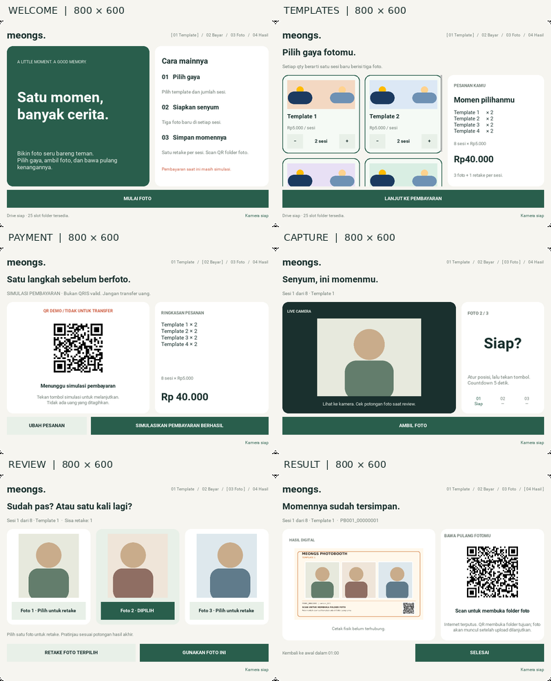

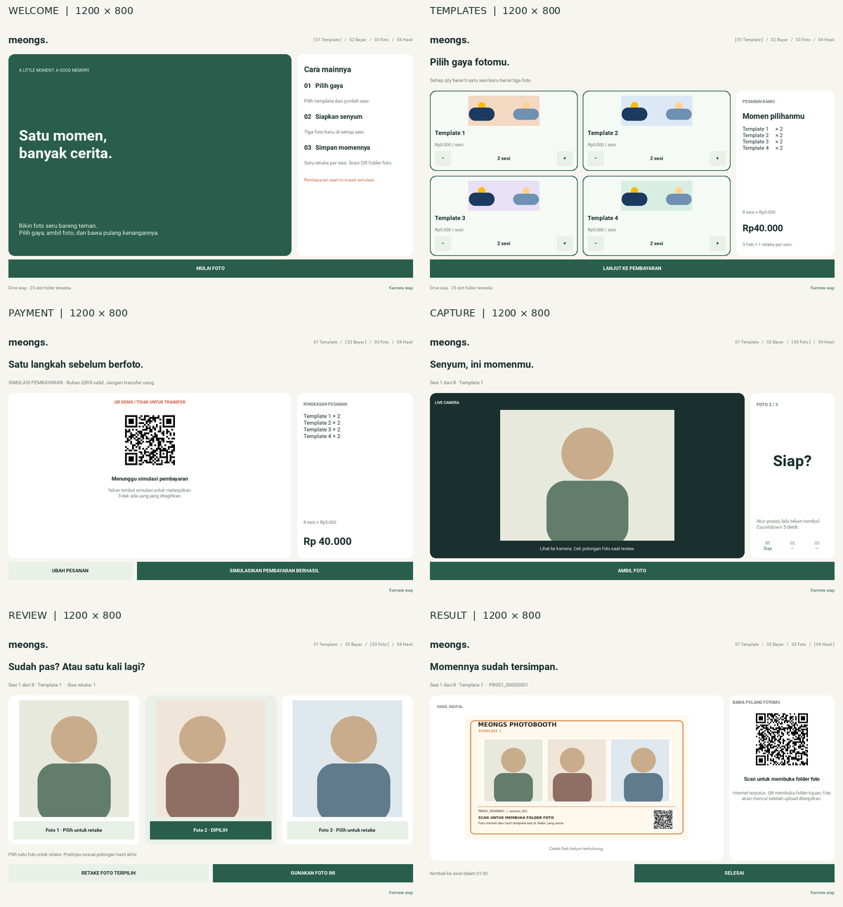

## Unavailable-camera and used-retake states

Previously, a stale camera mailbox left the badge marked ready and could leave
payment confirmation permanently disabled after a controller rejection. The
new tests first reproduced these failures, then checked recovery without losing
quantities, allocating a duplicate transaction, or consuming a failed retake.
A separate regression rejects a late release from an old payment after an order
edit. Actual Window pointer events also verify disabled controls at both sizes.

The preview no longer presents a frozen frame or a blank white null texture as
live video. Its waiting overlay is explicitly anchored within the camera slot.
Retake guidance distinguishes an unavailable camera from an exhausted allowance.

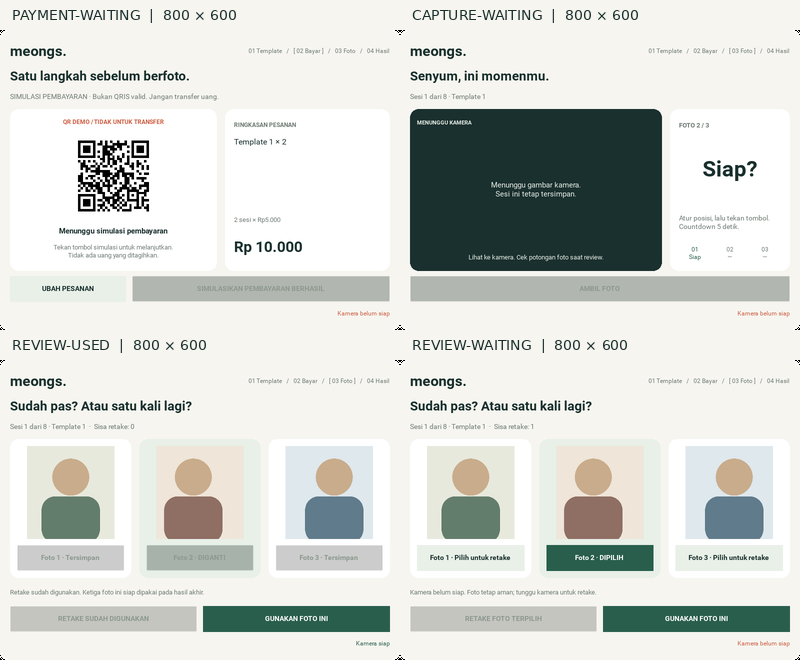

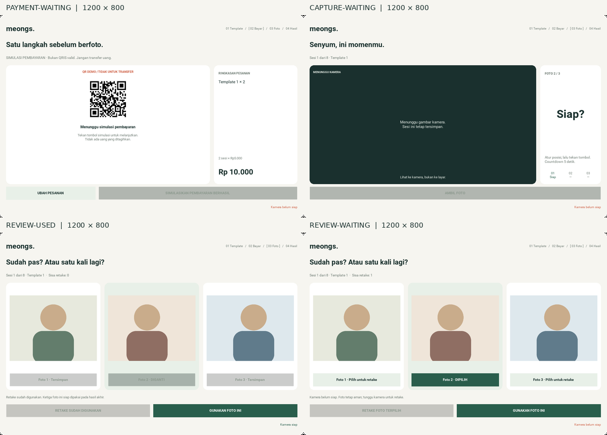

## Selection feedback and retired page actions

Nonzero quantities now receive a thin inset outline and pale tint, without
changing card dimensions. Returning to zero removes the visual selection and
disables decrement. The screenshots compare an empty cart, two sessions of one
template (Rp10.000), all four templates, and the last template after scrolling.
The report records selected IDs and quantities and asserts that they agree.

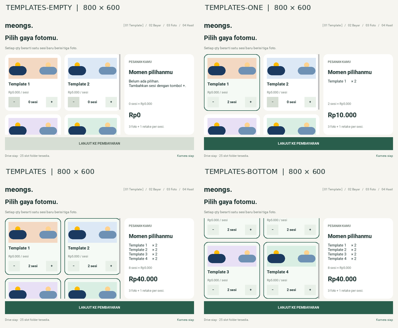

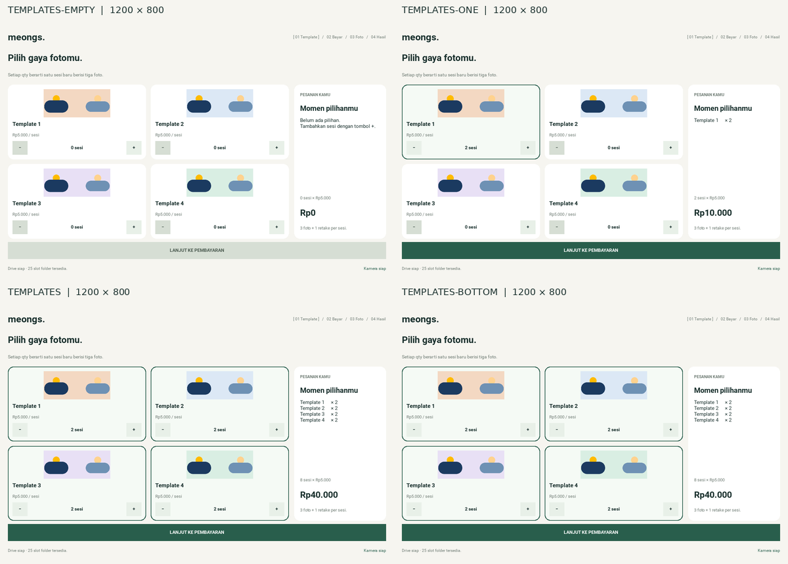

Regression tests first reproduced delayed **Ubah pesanan** restoring an old cart,
delayed **Selesai** ending a different transaction, and a disabled button delivering
a queued callback. Page actions are now bound to their exact screen revision.
Modal close is deliberately exempt from that page lifetime and is tested with
a real error popup while its underlying page changes.

The controller separately rejects completion during capture or at an intermediate
result. The test then advances both sessions and all 60 completion ticks, proving
that the final automatic return still works and does not wait for Drive upload.

## Faithful photo framing during review

The previous review thumbnails retained the camera aspect ratio, whereas the
saved result center-crops into 470x500 frames. A new GPU regression first failed
at both desktop sizes, before and after retake. Review now shares the exact crop
function used by composition. The overview and state sheets above show the new
portrait-shaped thumbnails without stretching or changing their action layout.

Tests compare actual GPU pixels against the three saved output frames, using
landscape, portrait, square, and replacement sources. They check raw files and
saved output bytes remain untouched by review. A separate compatibility check
proves that the extracted crop function keeps the established output pixels for
RGB, RGBA, and grayscale input. The existing composition geometry and QR footer
are unchanged. The live camera remains an uncropped view; its caption tells the
customer to inspect the final crop during review.

All six rendered review states (ready, quota used, and camera waiting at each
size) record `review_matches_output: true` and `review_frame_size: [470, 500]`
in [report.json](report.json).

## Save-retry and upload-revision safety

The real controller regression reproduces a retake JPEG/queue save followed by
a simulated metadata-write failure. The first bytes upload before the customer
retries with a different capture. Previously the replacement inherited the first
upload's `VERIFIED` flag and was skipped. Storage and worker merges now compare
an optional local `content_version`, not just the relative filename.

New tests cover that controller path, same-path raw/output replacement, legacy
records without a revision, a replacement committed before upload starts, late
success/resume callbacks, and late network/permission failures. They verify that
unchanged raw uploads stay verified, replacement bytes remain queued, and a
subsequent supported upload verifies the current checksum without duplicate work.
Nested callbacks reproduce overlaps deterministically; they are not live Google
service or operating-system disk-failure tests.

The Apps Script server's existing different-content conflict rule is preserved.
A dedicated 409 regression keeps that case `ACTION_REQUIRED` and retains the
local photo; it does not pretend that the conflicting upload succeeded. The
direct Drive API update path and Apps Script conflict policy remain distinct.
No deployment or credentials were changed.

The 32-screen render report and all six committed contact sheets were compared
byte-for-byte with freshly generated evidence and are unchanged. No layout
retouching was needed for this storage/retry correction. Main-screen and waiting
state sheets at both desktop sizes were also inspected visually.

## Disabled labels remain readable

The previous disabled treatment made useful captions almost disappear, including
the used-retake photo markers. A new real-widget test first failed in six
screen/desktop combinations, measuring 1.438–1.846:1 in its targeted samples.
Disabled controls now use an opaque, flat muted fill and darker ink, with no
change to geometry or callback gates. The test also re-enables the same camera
button and quantity controls, checking that primary/secondary colors return.

The report includes `disabled_text_contrast` for every fully visible disabled
button. The original 32 fixtures covered **28 labels**, and the two additional
long-status fixtures bring that to **34 labels**, measured at **5.141–5.221:1**.
It samples the exported screen's dominant inset background and strongest glyph
color, not just configured properties; this catches tint from Kivy's default
disabled atlas. Partly clipped gallery controls are excluded from color sampling
and remain covered by the separate gallery-scrolling checks. This is a focused
render regression, not an accessibility certification.

The updated state and selection sheets above show the new treatment. The two
six-main-screen overview sheets are byte-identical to the previous version.
All four changed sheets and both main-screen sheets were inspected visually.

The first rendering attempt also exposed an absolute-deadline startup race in
the evidence script: the welcome capture could run before its pending layout.
Each scene is now chained from its own setup/capture. After that harness fix,
all 32 renders passed without relaxing the layout, painted-QR, or crop checks.

## Complete status diagnostics

A long Drive/cache diagnostic previously needed 75px at 1200x800 and 105px at
800x600, exceeding the footer's respective 34px and 26px heights. The new
regression first reproduced missing elision at both sizes. Status now stays on
one line with an ellipsis, while a persistent **DETAIL** action opens the full
message in the existing scrollable dialog. The full public `status.text` is
unchanged for controller recovery; only its visual presentation is shortened.

The real-widget tests open and scroll a multi-kilobyte diagnostic, wait for actual
animated dismissal, then recover storage without losing the two-session cart or
replacing its main action. Another test resizes a message across its overflow
threshold and back, checking that details appear only when necessary without
rebuilding the order or oscillating. CPU font measurement avoids allocating an
oversized texture just to calculate a long message's natural width.

These new sheets compare the same Rp10.000 order with unavailable and ready
storage. The report records `status_shortened` and `status_details_visible` for
both long-status fixtures; all six earlier contact sheets are byte-identical.
The new sheets and actual full-size diagnostic dialogs were inspected visually.
Messages are synthetic fixtures, not real backend responses or credentials.

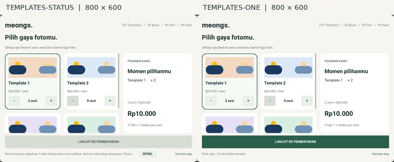

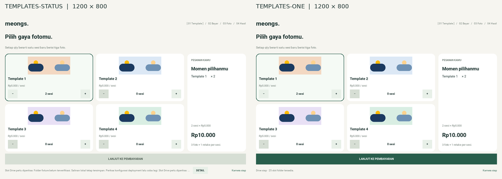

## Alpha-correct contact sheets

The real widget export is RGBA: its rounded shell has transparent corners with
hidden black RGB values. The old sheet builder pasted that image directly into
RGB without a mask, discarding transparency and exposing black corner marks.
The builder now composites onto the existing paper background before resizing.
This also handles partially transparent antialiased edges correctly. It changes
the evidence assembly only, not the application, full-size PNGs, or photo output.

A new regression first failed at both desktop sizes. It now checks transparent
and partially transparent pixels, opaque RGB compatibility, and source-byte
preservation. All eight regenerated sheets above were inspected visually. Their
only changed pixels are within 12x12 thumbnail-corner regions: 912 pixels per
overview sheet, 608 per state/selection sheet, and 304 per diagnostic sheet.
Every earlier sheet was also reproduced exactly from the new full-size renders
using the old assembly method, proving that actual widget pixels did not change.
The 34-render [layout/QR report](report.json) remains byte-identical.

## Retake waits for the customer

The review action previously opened the camera and immediately started its
five-second countdown. **RETAKE FOTO TERPILIH** now opens a ready-state preview
showing **Siap?** and an enabled **AMBIL FOTO PENGGANTI** button. Only pressing
that shutter starts the countdown. The selected target and remaining allowance
stay intact while the customer poses; saving consumes the allowance.

Two new controller regressions failed against the previous behavior, then passed
with the fix. They drive real widget callbacks with held timer scheduling and a
synthetic camera: opening retake schedules no timer or storage write, repeated
retired review releases cannot start capture, and a successful countdown replaces
only the selected photo while keeping the originals. Losing and recovering frames
on the ready screen enables the same shutter without starting its timer; recovery
during a running countdown cannot unlock it. Existing camera-failure and two-session
checks now use the new two-press path.

The two new states were rendered and visually inspected at both desktop sizes.
All 34 earlier render report entries remain unchanged; the report now contains
38 successful renders and no errors. Camera and Drive access still use fakes.

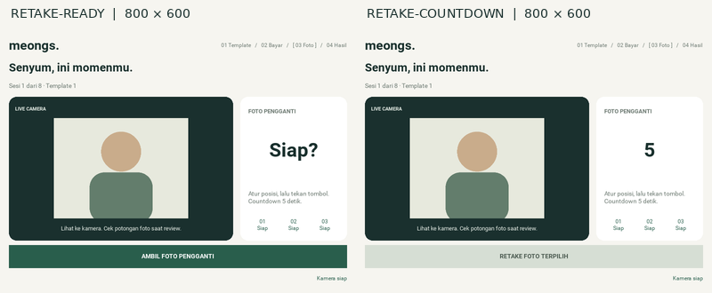

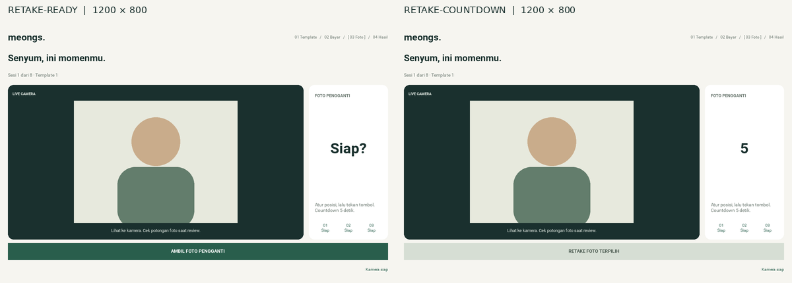

## Optional local open-palm shutter

The existing photo button is retained. A separate CPU worker recognizes
MediaPipe's `Open_Palm` category at a minimum score of 0.60. Consecutive fresh
observations spanning one second start the same five-second controller countdown
as a button press. The configured hold needs at least four observations and
rejects gaps greater than 0.4 seconds. After either input, a confirmed 0.4-second
non-palm interval re-arms gesture input; a held hand cannot trigger successive
photos. Gestures operate only within a prepared capture/retake page.

The worker has one pending frame and one latest result, processes at most ten
frames per second, and resizes only its inference input within 480x360. It
never performs SDK initialization, inference, downloads, or native cleanup on
the GUI thread. Page revisions plus worker generations invalidate old results,
including a disconnect and recovery that leaves the same page visible. Duplicate
camera-array references and consumed results cannot fabricate a sustained hold.
The model is optional: unavailable/loading states leave the normal button usable.

Added tests cover timing (including valid 300ms inference latency), release after manual capture, a button press during a
partial hold, stale/wrong-page results, camera loss, a blocked inference, dropped
mailbox frames, same-page invalidation, missing/broken native initialization,
verified offline model caching, checksum/size failures, and cancellation. The
real controller completes three captures with mixed inputs and a selected-photo
retake, preserving the per-session quota and original photo records.

Two opt-in tests use **actual MediaPipe 0.10.32 inference**, not a fake detector.
The model recognizes the public `left_hands.jpg` sample above the configured
threshold and rejects `fist.jpg`, `thumb_up.jpg`, `pointing_up.jpg`, and a blank
image. A second test feeds distinct copies of the palm fixture through the real
worker and actual GUI/controller: a one-second hold starts the timer, five ticks
save a photo, and the next photo button remains available. Camera acquisition is
synthetic and no live Drive service is contacted; recognition accuracy/latency on
the user's webcam, lighting, and device are still unverified.

Ten new palm renders cover ready, holding (70%), release required, loading, and
unavailable states at both desktop sizes. The renderer checks natural wrapped
guidance height and continued button availability. All were visually inspected;
the hold copy was shortened to fit a compact guide. The original 38 report
entries remain unchanged. Main-screen, waiting-camera, selection, and diagnostics
contact sheets remain byte-identical; the two retake sheets refresh the countdown
instruction to tell the customer to lower their hand and look at the camera.

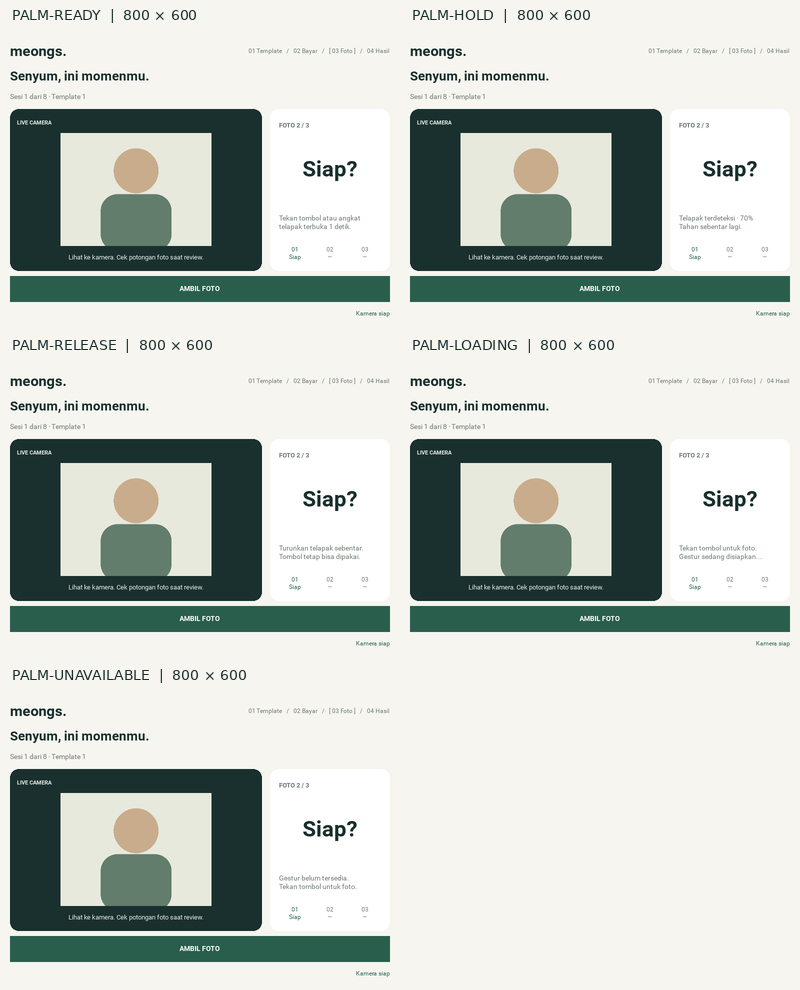

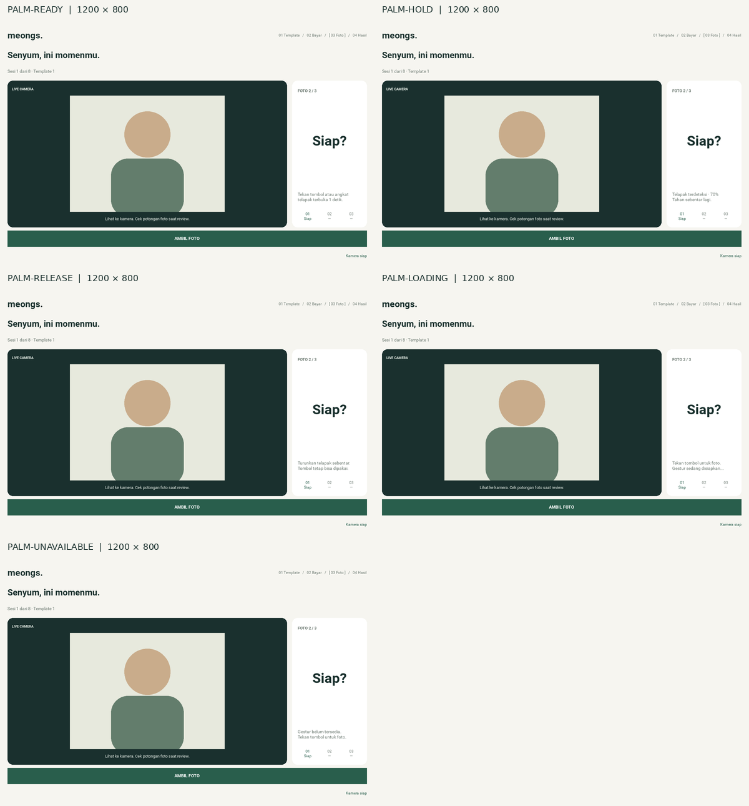

## Local and cloud photo retention

Photo bytes expire at 15 days on the booth and 30 days in Drive, measured from
the original transaction rather than pre-created slot age or upload attempts.
The result QR caption now shows **Tersimpan 30 hari di Drive**. Both full-size
result pages were inspected at 800x600 and 1200x800; the caption fits and the
QR still decodes. Only the two overview sheets change. The other ten sheets
and all 48 layout/QR report entries remain byte-identical.

The new retention checks exercise temporary real JPEG/PNG files, both exact
deadline boundaries, expired local-only/failed/verified queues, permanent Drive
deletion scope, old unused slots, clock registration, and retry immutability.
They also cover late upload/resume callbacks after purge, an abandoned review
trying to compose after 15 days, linked external directories, legacy migration,
and a backend whose cloud timer has not been activated. Manifests and counters
remain, expired image bytes disappear, and the next transaction ID is not reused.

The Apps Script tests execute the actual `Code.gs` in a Node VM using a scoped
in-memory Drive and synthetic timestamps. They cover permanent deletion, setup
and read-only preview, disabled cleanup before activation, authentication,
permission failures and retries, corrupt ledgers, expired uploads, and bounded
100-folder cleanup with a continuation cursor. No live Drive deletion or
Apps Script deployment was performed. The independent hourly cloud trigger
still requires the operator's [activation steps](../photo-retention.md).

## Reproduce

Earlier rounds used Python 3.12.14; the manual-retake and palm follow-ups used Python 3.12.3.
The retention follow-up also used Python 3.12.3 and Node 24.19.0. Both Python environments
used Kivy 2.3.1, OpenCV 5.0.0, SDL2 offscreen, and Mesa llvmpipe. No webcam,
payment provider, printer, or live Google service was contacted.

```bash
SDL_VIDEODRIVER=offscreen PHOTOBOOTH_TEST_GUI=1 python -m unittest discover -s tests -v
SDL_VIDEODRIVER=offscreen python tools/render_gui.py --output-dir /tmp/photobooth-gui-qa
node --test tests/test_apps_script_retention.cjs
```

The photo-retention run passed **90 Python tests**, including both native palm tests,
and **12 Apps Script tests**. Its controller/storage checks include two-session
orders, one retake per session, local PNG and manifest persistence, cached folder
allocation, an offline upload failure followed by retry, and skipping verified
uploads. Camera acquisition and Drive access use deterministic fakes. The layout
regression test verifies clipping ancestors and decodes the payment/folder QR from
the exported UI, which catches a hidden QR even when its source texture is valid.
The synthetic camera-recovery tests hold controller timers for deterministic
manual ticks; the pointer and layout tests use Kivy's real event and canvas loop.
Recovery means fresh frames resume on an existing handle. USB hotplug, driver
reopening, startup failure recovery, and real-device latency remain unverified.

To include native gesture tests, install `requirements-palm.txt` and set
`PHOTOBOOTH_PALM_TEST_ASSETS` to a local directory containing the pinned model and
four public test fixtures. Default runs skip the two native tests when these
assets are absent. They do not download assets during the suite:

```bash
PHOTOBOOTH_PALM_TEST_ASSETS=/tmp/photobooth-palm-assets SDL_VIDEODRIVER=offscreen PHOTOBOOTH_TEST_GUI=1 python -m unittest discover -s tests -v
```

The model is [version 1](https://storage.googleapis.com/mediapipe-models/gesture_recognizer/gesture_recognizer/float16/1/gesture_recognizer.task),
8,373,440 bytes, SHA-256 `97952348cf6a6a4915c2ea1496b4b37ebabc50cbbf80571435643c455f2b0482`.
Fixture URLs:
[left_hands.jpg](https://storage.googleapis.com/mediapipe-assets/left_hands.jpg),
[fist.jpg](https://storage.googleapis.com/mediapipe-assets/fist.jpg),
[thumb_up.jpg](https://storage.googleapis.com/mediapipe-assets/thumb_up.jpg),
[pointing_up.jpg](https://storage.googleapis.com/mediapipe-assets/pointing_up.jpg).
Neither native weights nor sample photos are committed to this repository.

**HISTORICAL — initial Tkinter-era fixture pricing, SUPERSEDED by FEAT-001 in v1:** At that older stage, tariff was Rp5.000 per session and quantity 2 totaled Rp10.000. In **current v1 DEMO**, one selected three-photo template plus two identical printed copies totals **Rp15.000**, not Rp10.000. QRIS
was explicitly simulated; printing was not connected in that historical Tkinter fixture, and `ui_tkinter.py` was
unchanged. These renders use generated geometric illustrations and fixture URLs;
they contain no customer images, credentials, or transaction data.

</details>
