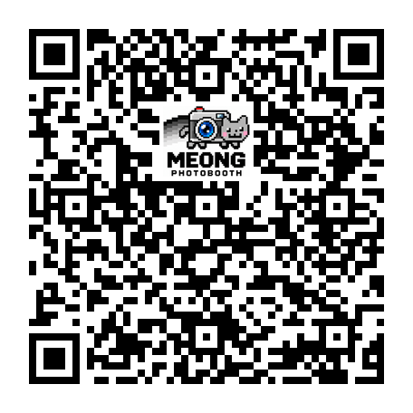
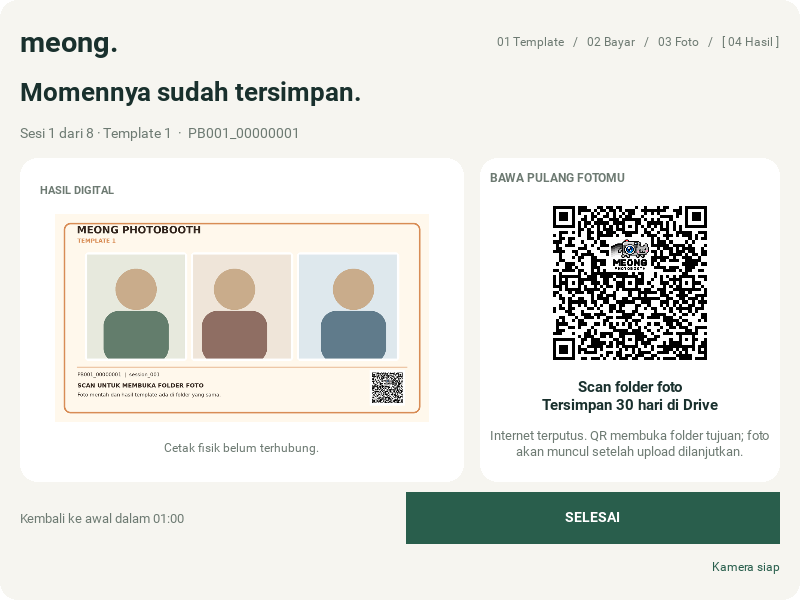
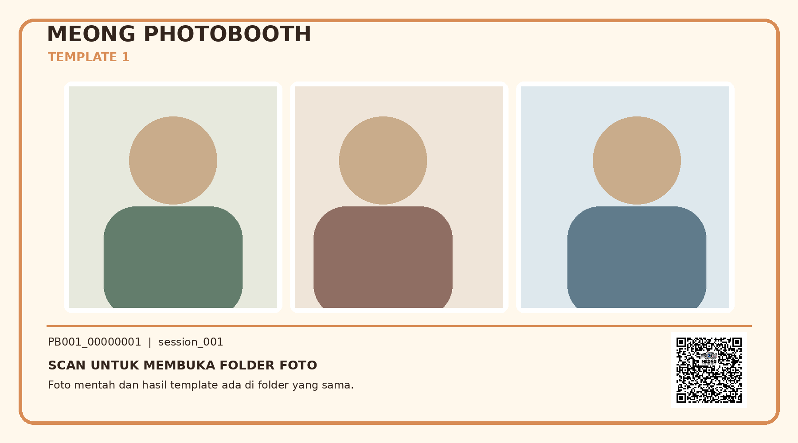

# Full-logo folder QR verification

This follow-up starts from `b7fa8b774915c95da79feeca67472edd78027a7e`
on `feature/kivy-gui`. It implements the selected complete **MEONG PHOTOBOOTH**
logo inside the customer folder QR. The asset includes the wordmark, camera-cat,
and grayscale trail. The name has no final S.

The shared helper supplies the result-screen QR and the QR within every newly
saved three-photo composition. Existing saved customer images are not rewritten.
The payment simulation explicitly requests an unbranded QR and keeps its demo
payload. Actual payment-provider QRIS artwork is not processed by this helper.

## Rendering behavior

- Generate from the transaction's existing cached URL, with no network calls.
- Use error correction H for branded codes and retain a four-module white border.
- Insert the full bundled logo on a small white plate inside the data area.
- Preserve finder, timing, alignment, and version-information patterns. When an
  alignment marker occupies the center, place the intact logo nearby inside the
  QR rather than obscuring the marker or cutting through the logo.
- Render the saved footer directly at an integer module scale within 210 pixels.
- Keep the approved accent colors in digital results. `monochrome=True` provides
  a one-bit logo for thermal print tests; the surrounding matrix is unchanged.
- Return independent image copies so one caller cannot corrupt a cached QR.



The example URL above is a fixture, not a real customer folder.

## Checks performed

Environment: Python 3.12.14, Kivy 2.3.1, OpenCV 5.0.0, Pillow 12.3.0,
SDL2 offscreen, and Mesa software rendering.

```bash
SDL_VIDEODRIVER=offscreen PHOTOBOOTH_TEST_GUI=1 python -m unittest discover -s tests -v
SDL_VIDEODRIVER=offscreen python tools/render_gui.py --output-dir /tmp/meong-branded-qr-qa
```

The Python suite completed **94 tests: 92 passed and 2 optional native-palm
tests skipped** because their optional model/fixture assets were not supplied.
The four new QR tests independently decode short and realistic Drive URLs at
display and final-footer sizes, in color and one-bit output. They also check
recognition cells, the quiet zone, separate payment-demo behavior, invalid
inputs, and cache isolation.

The composition regression decodes the QR from each of the four saved template
images and checks that the logo is present in the saved pixels. The controller
and GUI regressions cover the displayed QR, cached offline destination,
upload retry, and corrected window/header naming.

The real-widget renderer completed **48 views** across **1200x800 and 800x600**.
It checked that stages fit and decoded QR content from exported screen pixels.
The [render report](branded-qr-report.json) records those results. All artwork
uses synthetic portraits and fixture destinations; no real camera or cloud
service was contacted.





These are digital checks. Physical thermal output, camera hardware, and actual
QRIS payments have not been tested here. Printer transport remains a separate
integration; its real dot width and final printed QR need device verification.
