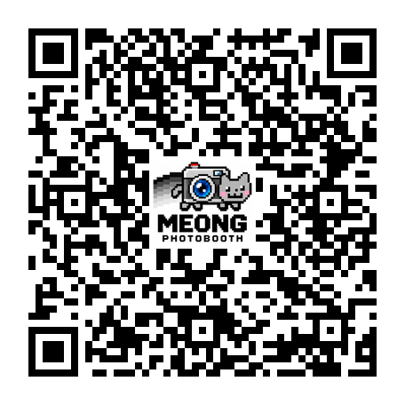
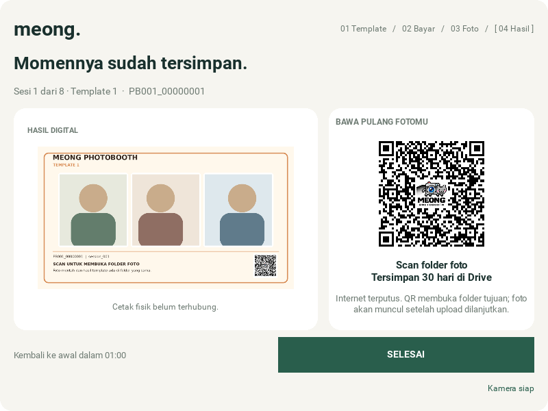

# Exactly centered full-logo QR

> **HISTORICAL QA SNAPSHOT (QR centering repair): This document preserves earlier fixture-based geometric/decode verification. The centered folder QR behavior remains current; full GUI synthetic CI subsequently passed at `c40f33f5`. Independent physical phone and thermal paper checks are separate; no real payable QRIS provider is implemented.**

The original marker-avoidance search placed the logo **72 pixels above center**
in a 456x456 QR for a representative Drive folder link. Existing scan-only checks
passed because that misplaced QR was still readable. This correction adds a
geometric pixel test and removes the position search.

The complete logo plate now has equal left/right and top/bottom margins in
whole QR modules. Only the artwork is resized. Its position does not change
with the destination, selected encoding mask, color mode, or output dot size.
The corner finders, timing patterns, and four-module white scan margin remain
outside the small plate. Some versions have a central alignment mark beneath
the plate; high error correction and actual decoding checks are used rather
than moving the artwork around it.

The default encoder mask is checked first. If the logo makes that valid mask
hard for a reader, the helper tries the permitted masks explicitly. Each
candidate retains the exact URL, QR version, pixel dimensions, and logo center.
OpenCV is already installed for the camera and independently decodes the actual
candidate. Unbounded display images also pass a nearest-filtered 180px preview
check. A passing result is cached to avoid repeat work during status polls.

The regression reconstructs the original matrix using the returned in-memory
version/mask facts, then measures the *changed pixels*. Both center coordinates
must agree with the image center within one pixel. It tests short and realistic
Drive links at default, 210px, and 384px bounds, in color and one-bit output.
A synthetic destination that needs a different mask prevents regression to
blindly pasting a centered logo without checking readability.

```bash
python -m unittest discover -s tests -p test_qr_code.py -v
SDL_VIDEODRIVER=offscreen PHOTOBOOTH_TEST_GUI=1 python -m unittest discover -s tests -v
SDL_VIDEODRIVER=offscreen python tools/render_gui.py --output-dir /tmp/meong-centered-qr
```

Validation completed: **95 Python tests** (93 passed, two optional native-palm
checks skipped), **48 real-widget renders** at 800x600/1200x800, and seven
compatibility tests using the separately prepared 12-design 80 mm receipt
catalog. That receipt work was tested in memory without modifying its files.
An additional 21-payload scan audit passed **336 decoder checks** with OpenCV
and ZXing, including 180px previews. All 126 measured logo placements had
**zero-pixel center offset**. The user's QR was checked locally in memory only;
its destination was not included in source, logs, or examples.





These examples use fixture portraits and a fixture URL. The user's screenshot,
photograph, and actual folder link are not included. Digital decoding does not
replace a physical phone-camera or thermal-printer test.
