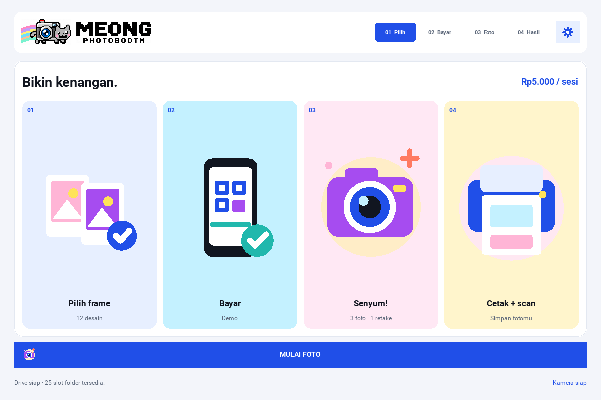
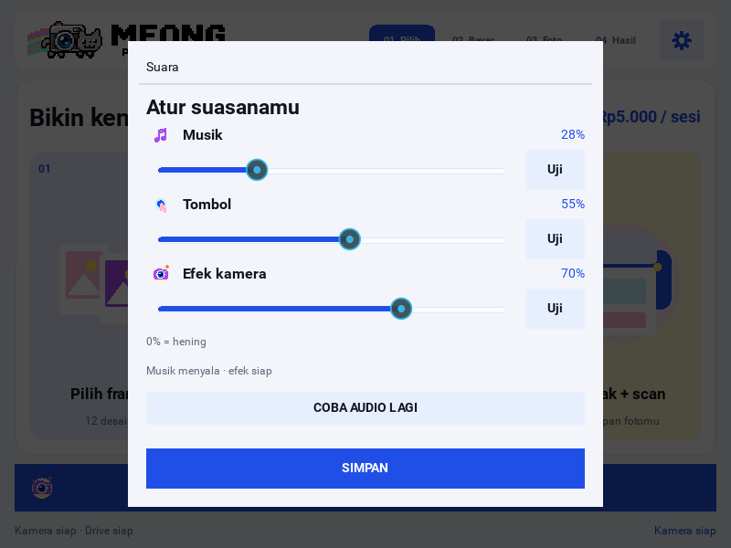

# Final MEONG logo and offline audio — 17 October 2026

> **Historical QA result (2026-10-17), not proof of audible sound today:** Native audio/GUI test passes below establish behavior in the noted test environment. Owner later reported that `python main.py` music/SFX are inaudible and Settings Music/Button `Uji` controls unresponsive despite a standalone sound probe being audible. See [BUG-001/BUG-007](../bug_tracker.md) and [test evidence](../test_checklist.md); neither bug is closed.


This update targets the existing `feature/kivy-gui` branch.

The final uploaded PNG is included unchanged. Every screen's header and every
new folder QR resolve the same asset. The header now retains the complete
wordmark width; M and G are no longer clipped. The source hash and native
playback facts are recorded in [logo-audio-report.json](logo-audio-report.json).

The original 40-second **Meong's Little Photo Garden** loop and four short cues
are shipped as PCM WAVs. Desktop playback prefers SDL2, checks actual load
success, preserves the loop across pages and lowers it during a countdown.
The **Suara** menu offers three independent gains, music/cue previews, live
playback/mute feedback and a retry action. Saved 0% settings remain muted.

## Validation

- Full regression run: **127 tests executed; 125 passed, 2 skipped**. The skips
  require the optional native palm-model assets.
- Final focused GUI run after adding the music-preview regression: **9 passed**.
  This includes one additional test for starting music through **Uji**, keeping
  the current song position and reflecting live mute changes.
- **72 actual Kivy widget renders** passed at 800×600, 1200×800 and 1920×1080,
  retaining layout, QR decoding and disabled-caption checks.
- A separate run through the real `KivyHost.run()` lifecycle loaded all five
  WAVs with **SoundSDL2**, automatically started the 40-second loop and checked
  the settings controls at both 1200×800 and 800×600.
- Bundled sample bytes match the deterministic synthesizer. Missing and
  truncated WAV recovery, independent mute/ducking, pause/resume and cleanup
  passed. The updated CI workflow enables native-provider audio regression.
- The final logo source matches the upload byte-for-byte. Folder QR tests
  independently decoded the new logo at screen and composition sizes in color
  and monochrome while checking its centered plate and white scan margin.

Audio checks used `SDL_AUDIODRIVER=dummy`. They establish actual native loading,
startup and playback state; they cannot measure sound from a physical speaker.
The selected speaker can be checked in the running app with gear → **Suara** →
**Uji**. Photography, Drive and printer hardware were not used in these checks.

## Screenshots






## Reproduce

From a checkout with `requirements.txt` installed, run on a Linux desktop or
Mesa offscreen environment:

```bash
PHOTOBOOTH_TEST_GUI=1 PHOTOBOOTH_TEST_AUDIO=1 PHOTOBOOTH_AUDIO=0 \
SDL_VIDEODRIVER=offscreen SDL_AUDIODRIVER=dummy KIVY_NO_ARGS=1 \
python -m unittest discover -s tests -v

PHOTOBOOTH_AUDIO=0 SDL_VIDEODRIVER=offscreen SDL_AUDIODRIVER=dummy \
python tools/render_gui.py --output-dir /tmp/meong-logo-audio-qa
```

The native audio test temporarily enables playback inside its own fixture.
Remove dummy/offscreen environment overrides when checking the actual booth.
