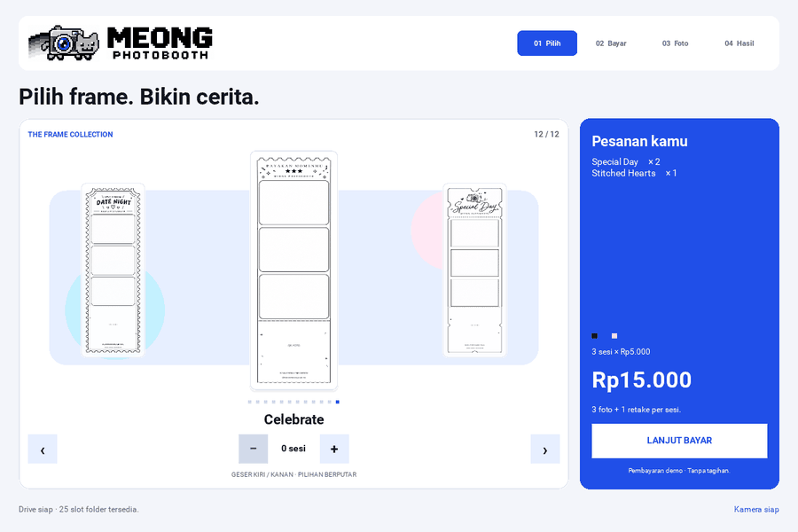
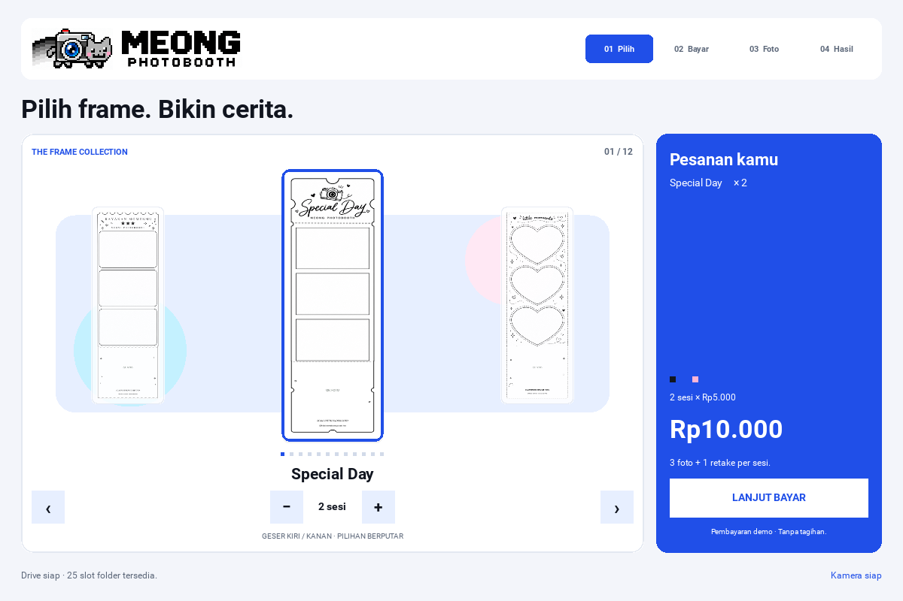
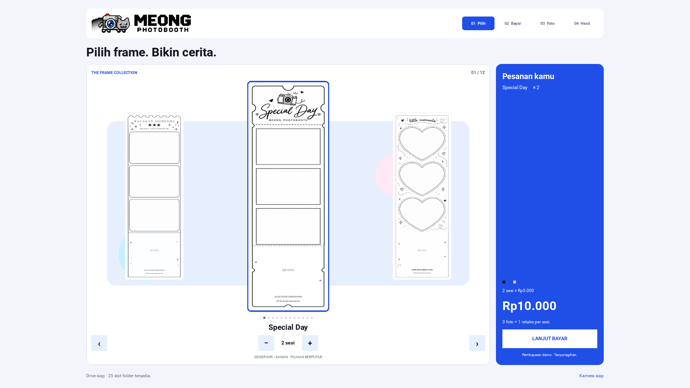
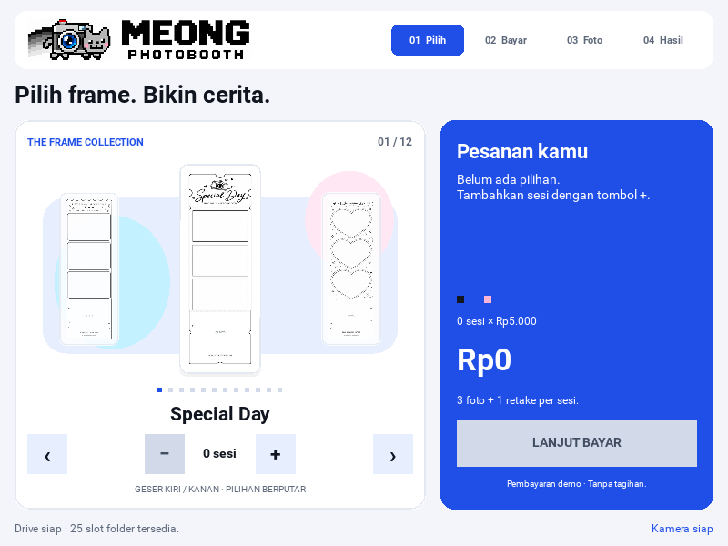
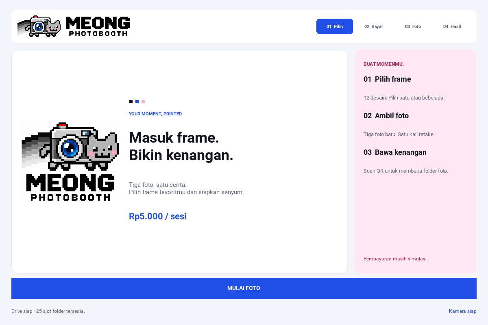

# MEONG brand and cyclic carousel

> **2026-10-19 v1 SOURCE FOLLOW-UP:** `feature/kivy-gui` has been promoted to `master` and tagged as the immutable [v1.0.0 source pre-release](https://github.com/pratikto/PhotoBooth/releases/tag/v1.0.0) (`07ce51d`). The findings/tests dated below remain **historical snapshots**; current source/bug/physical-device status is tracked in [FEATURE_STATUS.md](../FEATURE_STATUS.md), [bug_tracker.md](../bug_tracker.md) and [release notes](../releases/v1.0.0.md). Linux synthetic CI is not production hardware certification. QRIS remains DEMO and BUG-009 Drive cleanup is OPEN.


> **HISTORICAL GUI QA SNAPSHOT (initial carousel rollout): The 12-template carousel and 72-render evidence below remain useful; the **old Rp15.000 cart and capture quantity assumptions do not define current prices**. **CURRENT:** FEAT-001 is Rp5.000 per selected three-shot template/session + Rp5.000 for each identical print copy; 2 copies of one design = one capture session and **Rp15.000 DEMO**. Current full GUI CI [PASS at `c40f33f5`](https://github.com/pratikto/PhotoBooth/actions/runs/39145145762).**

The selector now presents one large receipt in the center with smaller previews
of its cyclic neighbors. Native horizontal swipes, arrow buttons, and mouse
wheel input browse the same twelve designs. The focused name, 01–12 counter,
pixel markers, and quantity row follow the current slide. Browsing does not add
a session or start payment. Independent quantities stay visible in the cart.

The visual system uses the existing camera-cat and original pixel wordmark.
Lens blue is the primary accent, with cyan and cheek pink in supporting surfaces.
The blue order panel, light progress tabs, and framed receipts share the same
palette. Header artwork is composed from display crops of the original logo;
the actual logo file and printed QR artwork are unchanged.











## Behavior and implementation

- The native Kivy Carousel owns swipe thresholds, touch grabs, snapping, and cyclic boundaries. Quantity buttons sit outside the drag surface.
- The desktop container stops grabbing vertical scrolling when its contents already fit. Quick horizontal swipes therefore reach the carousel immediately.
- Rapid duplicate arrow releases cannot keep restarting a pending snap. Committing the visible index unlocks navigation immediately.
- Going to payment retires the old carousel's animation, timers, and touch grab. Late arrow releases belong to the old screen revision and cannot edit the order.
- Payment-back preserves quantities and focus. A fresh customer starts at the first frame with an empty cart.
- Wide screens center content inside 1440 dp instead of stretching cards across the monitor. Desktop arrows, active quantities, total, and checkout remain visible at all three tested sizes.
- All new widgets, colors, logo handling, and lifecycle behavior are documented in English in `photobooth/ui_brand.py` and `photobooth/ui_kivy.py`.

## Validation

The Python suite passed **107 tests**, with **2 optional native gesture-model
checks skipped** and **125 subtests passed**. The seven new carousel tests use
actual Window-delivered pointer/swipe events, cover both cyclic endpoints and
all twelve forward destinations, confirm quantity isolation, test resize and
retired controls, and inspect the painted blue cart and unchanged logo bytes.

The renderer passed **72 real-widget scenes** at **800×600**, **1200×800**, and
**1920×1080**. Every desktop stage fits its viewport, and all 12 QR-bearing
scenes decode from the actual screenshot pixels. Disabled-button contrast and
review crop checks also passed. The complete [GUI report](meong-gui-report.json)
and [cyclic endpoint report](meong-carousel-report.json) are included here. The
animated proof is exported from the running Kivy widget tree; it is not a static
mockup or a simulated HTML screen. It verifies 12→01→12 while keeping the order
at Rp15,000. QR decoding, capture/readiness gates, retake, result composition,
retention, and offline/retry scenarios continue through the existing tests.

Repeat from the project root in the application's environment:

```bash
PHOTOBOOTH_TEST_GUI=1 SDL_VIDEODRIVER=offscreen KIVY_NO_ARGS=1 python -m pytest -q
SDL_VIDEODRIVER=offscreen KIVY_NO_ARGS=1 python tools/render_gui.py --output-dir /tmp/meong-gui
SDL_VIDEODRIVER=offscreen KIVY_NO_ARGS=1 python tools/render_carousel.py --output-dir /tmp/meong-loop
```

GUI validation uses software graphics, geometric photo fixtures, synthetic folder
URLs, and a fake camera/backend. No customer photos, credentials, real charges,
printer jobs, or live Google uploads are used. Physical device and Android
packaging checks remain separate from these desktop GUI checks.
