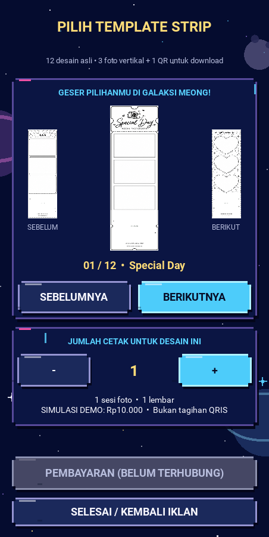
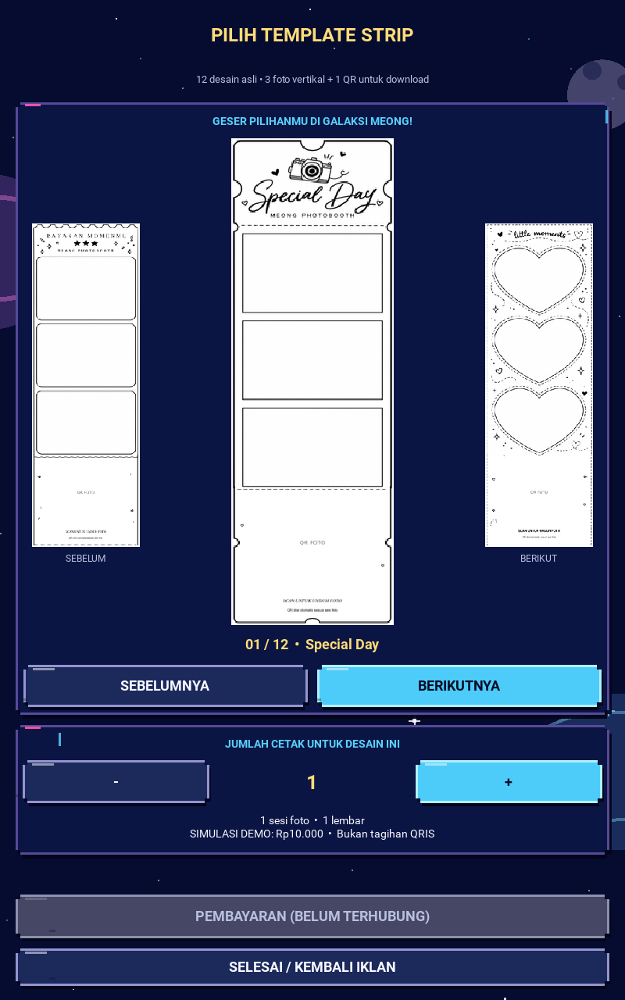

# P2.6–P2.8 final report — non-hardware PASS

**2026-10-22 · branch `feature/portrait-kiosk-v2-next` only.**
All authorized non-hardware gates are complete. Windows Acceptance Test remains
NOT RUN. No merge to master or production enablement occurred.

## Delivered changes and checkpoints

| Stage | Commit | Result |
| --- | --- | --- |
| P2.6 | `5fced9d5985d72bb89e046b2b0fe93f7cd247709` | Explicit readable disabled text and opaque muted button faces; scanner/payment remain unavailable |
| P2.7 | `5bb479890ad50b28287d8728bd6e4d12313eaa7e` | Retired button/swipe callbacks cannot mutate later visits; suspended input/timeout blocked; fresh idle period on resume; effects stop on suspend and advert/game handoff; 48dp minimum CTA height |
| P2.8 | `0fbf15829d1537a7f18990b492b1e5934f21c0f8` | Sequential screenshot timing; expected-route/dimension/row-integrity checks; clean-source and SHA-256 manifests |
| Interim documentation | `384b4743428425390cd03bf87b77ba563fdfe6a9` | P2.6 artifact review and exact-SHA CI metadata; superseded blocked status resolved by this report |

Final stable application/renderer rollback: **`0fbf15829d1537a7f18990b492b1e5934f21c0f8`**.
Pre-task rollback: `e888d9945bc8c0a4c74bd1a8de57e946acb26204`.
These identify known checkpoints, not authorization to rewrite branch history.
Legacy `python main.py` and master were not changed by this task.

## Test and CI evidence

- Final local navigation/audio/design/widget suites: **45 run, 45 PASS, 0 failures,
  0 errors, 0 skips**. Includes real Kivy touch dispatch, CTA bounds at both sizes,
  fourth-step tutorial scroll reachability, stale input, timeout reset and audio ownership.
- Native SDL2 dummy-device lifecycle previously passed; it is evidence of native
  playback/cleanup behavior, not audible speaker output.
- Exact-SHA CI: [P2.6 run 39616959017](https://github.com/pratikto/PhotoBooth/actions/runs/39616959017),
  [P2.7 run 39617634875](https://github.com/pratikto/PhotoBooth/actions/runs/39617634875),
  [P2.8 run 39618540570](https://github.com/pratikto/PhotoBooth/actions/runs/39618540570):
  each completed SUCCESS with both navigation/audio and desktop/widget/render jobs successful.
- Interim docs checkpoint independently passed [39684269848](https://github.com/pratikto/PhotoBooth/actions/runs/39684269848).
  The later documentation-only closure commit must not inherit a separate CI claim.

Full sanitized metadata, ZIP checksums, original images and manifest verification:
[remote evidence index](../portrait-v2-ci/README.md).

## Screenshot review

All three milestone artifacts were downloaded and their original pages reviewed
at **800×1280** and **452×900**: advertising, inline invitation, tutorial,
templates, copy cart and unavailable game preview. No obscured main CTA,
unreadable disabled action, unexpected rounded v1 shell or row corruption remains.
The compact tutorial intentionally scrolls; its fourth step is reachable and tested.
Transitions remain immediate and the starfield static, avoiding orphan animation loops.

Final original CI images: [P2.8 screenshots](../portrait-v2-ci/39618540570/).

P2.7/P2.8 ZIP digests both match the API. P2.8 manifests report the exact clean
checkpoint SHA with six states per viewport and matching PNG hashes. Eleven
P2.7/P2.8 images are pixel-identical; the compact tutorial differs only in the
fading four-pixel scroll indicator. Both were reviewed separately.

## Remaining bugs and limits

No known unresolved regression blocks the authorized P2.6–P2.8 synthetic scope.
Legacy BUG-001/007 audible Windows speaker issues and BUG-009 Drive retention
remain open. Actual 10.1-inch touch mapping, audible music, video audio/codec,
camera, thermal paper and Drive end-to-end are not certified by these results.
The optional Meong Fly entry remains an unavailable preview. No game, receipt
scanner, discount entitlement, live payment or production transaction was enabled.

The artifact network blocker is resolved after the second publish. No additional
network change or environment publication is needed for this QA closure.

## Windows Acceptance Test — NOT RUN, operator checklist

- [ ] Record exact tested SHA, Windows/Python/Kivy versions, display model,
      native portrait resolution, scaling/DPI, speaker/provider and test time.
- [ ] Run `python -m unittest tests.test_kiosk_v2_flow tests.test_kiosk_v2_audio tests.test_kiosk_v2_design_tokens tests.test_kiosk_v2_widgets -v`;
      record counts and any failure/skip.
- [ ] Launch `python tools/run_portrait_v2.py`; review all six pages at native
      800×1280 and the 452×900 compact simulation, including every label/CTA.
- [ ] Tap enabled CTA centers and edges, swipe the template gallery, check copy
      limits; disabled payment/scanner must not navigate or create an order.
- [ ] Scroll tutorial to step four, acknowledge once per visit, return/expire to
      advertising and confirm the next visit requires the tutorial again.
- [ ] Hear automatic tutorial/template music without pressing Test Music;
      confirm continuity and no GUI music/effects over idle ads or game preview.
      Check actual ad video audio independently on the selected output device.
- [ ] Suspend/resume while browsing/effects play, close/relaunch and rapidly tap;
      no duplicate sound, background timeout, stale navigation or orphan playback.
- [ ] Confirm exactly three photo slots + one download QR in the existing 12
      master previews. Prototype must not modify thermal output or capture count.
- [ ] Keep real game/scanner/discount/payment/camera/print/Drive integrations
      disconnected; physical end-to-end tests require their separate scope.
- [ ] Record original device screenshots and audible/touch observations with SHA;
      obtain owner acceptance before release, integration or promotion to master.
