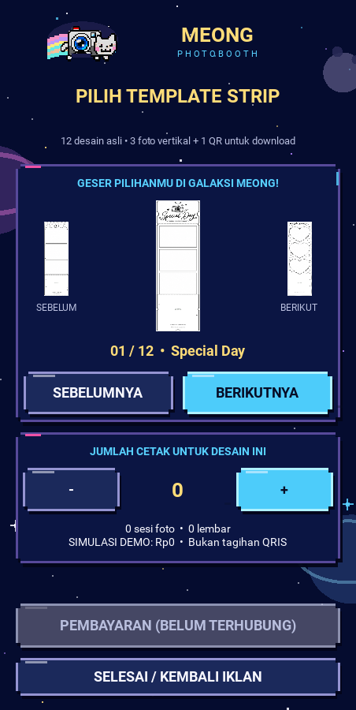
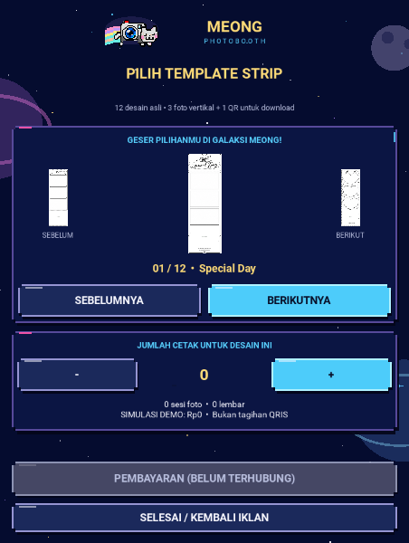

# Windows retest at 9a9e18e — 2026-10-22

Branch: `feature/portrait-kiosk-v2-next`. Pre-correction rollback checkpoint:
`9a9e18e91fe789cc305826352d282d5be5f2aadf`.

## Owner evidence and open failures

Owner supplied screenshots of the offline checklist: **27/32 checked** on
Windows 11, laptop speaker, tested HEAD `9a9e18e`. A01–A06, B06, C01–C04,
D01–D08 and E01–E06 are visibly checked. F01–F02 were not visible in supplied
screenshots; do not infer them from the total. B01–B05 are **not tested** because
the gallery preview was not visible at the owner's window size. These are not
five independently confirmed swipe failures.

Owner qualifies C/D results: a single flow works, but music **and** clicks become
silent after repeated complete visits. Repeated-use audio acceptance remains
**FAIL / OPEN**, despite the individual single-flow checkmarks. Actual display
resolution/scaling and the number of cycles before failure were not supplied.

## Audio correction

Reproduced the underlying mute condition with the real Kivy 2.3.1 SDL mixer:
channel 0 reused after retirement, `state=play`, WAV gain 0.6, **channel gain 0**.
WAV chunk gain and mixer channel gain are separate. ffpyplayer's Windows mixer
backend changes channel gain; retiring muted video leaves an idle channel that
Kivy SoundSDL2 can reuse without restoring its gain. This is a demonstrated
native failure mechanism, not a claim of reproducing the owner's entire Windows
session on Linux.

The v2 SDL2 wrapper restores gain **only on unused channels before WAV
allocation**, including automatic music loops. Playing video/GUI channels retain
their existing gains. It resolves the mixer already loaded by Kivy, opens no new
audio device, does not change the shared advertising player or v1 audio, and
preserves explicit KIVY_AUDIO overrides. If the native wrapper cannot load,
provider selection logs the failure and uses the existing Kivy fallback.

**54 focused tests PASS** (audio/flow/design/widgets plus native test). The native
regression reproduces the old muted state, then runs **20 cycles** through video
channel reuse, tutorial, gallery, silent game preview, image ad, suspend/resume,
and close. It samples actual **post-mix PCM** through SDL's dummy device, checks
nonzero music/click samples, verifies that a concurrent click does not unmute a
playing ad, and checks silence after close. [Transcript](audio-tests.txt).
Full regression: **289 run, 287 PASS, 2 optional native palm-model skips,
zero failures/errors**. [Transcript](audio-full-tests.txt). Compile and diff checks pass.
No physical speaker or actual Windows decoder was tested here.

## Live scaling correction

The previous fixed `dp` heights could consume the entire gallery preview on a
short/high-DPI window. A v2-only viewport now maintains a **452×900 dp content
budget**, scaling down the complete native page when needed, and letting extra
width/height flow into its normal layouts. No global Metrics changes, page
rebuilds, cart reset or decoder/music restart on resize. Existing 800×1280 and
452×900 composition is preserved at density 1. Small desktop windows have
proportionally smaller text and touch targets; kiosk acceptance still uses the
actual portrait touchscreen. Thin thermal lines use linear minification while
the logo keeps nearest filtering; original template artwork is unchanged.

Touch dispatch uses the inverse viewport transform. Swipe threshold scales with
the page, normalized window deltas still determine direction, and a resize
mid-drag releases the grab without changing selection. Real pointer tests cover
center/side previews, left/right, single-step, short/vertical rejection, scaled
copy-button taps, interrupted drag cleanup, cart preservation and no new audio
page handoff during resize.

- **55 focused tests PASS** (including the 20-cycle native PCM test).
- **290 full regression tests run, 288 PASS, 2 optional palm-model skips,
  zero failures/errors**, after the final source change.
- **2 additional fresh-process tests PASS at KIVY_METRICS_DENSITY=1.5**:
  live resize/swipe/cart and all-page CTA/tutorial-scroll checks.
- Compile and diff checks PASS. [Focused](final-targeted-tests.txt),
  [full](final-full-tests.txt), [150% density](dpi150-tests.txt).

**Thirty real Kivy PNGs reviewed**: six states each at 800×1280, 452×900,
360×640, 452×600 and 800×600. All main CTAs and three gallery previews remain
onscreen; compact tutorial scrolls through step four. Very small windows retain
small strip previews; enlarge the window to inspect fine template detail.
Screenshots are synthetic media evidence, not physical Windows display proof.

[Original PNGs and manifests](screens/). Each manifest records dimensions, SHA256,
base HEAD `16f7918` and tracked layout changes honestly. Exact rendered source
contents are recorded in [rendered-source-sha256.json](rendered-source-sha256.json).
The changes producing these renders are included in the layout source commit;
no claim of a clean capture checkout is made. CI captures a separate clean SHA.




## Checkpoints and rollback

- Before both corrections: `9a9e18e91fe789cc305826352d282d5be5f2aadf`.
- Audio correction / before viewport change: `16f79182b553291c13c1aa5e2834434e9799739f`.
  [Exact-SHA CI 39738222976](https://github.com/pratikto/PhotoBooth/actions/runs/39738222976)
  completed SUCCESS. This is synthetic CI, not Windows speaker acceptance.
- To undo a correction, use a reviewed `git revert` of its source commit on the
  same feature branch. Do not reset/force-push, create another branch or touch master.

## Clickable acceptance form and Submit

Open [windows-checklist.html](windows-checklist.html) locally in Windows. This
new retest version has **38 A–G items**, distinct from the original 38-item audit
and the earlier 32-item form. Its own storage key prevents old checkmarks from
silently passing the new repeat/resize gate. Fill **the actual HEAD after pull**.

**Submit Hasil** prepares a prompt with metadata, checks and notes. Use **Salin
prompt**, paste it into this chat and press Send. The offline file does not send
network requests or automatically post to this conversation. Editing results
updates the prepared prompt; download still exports a standalone report.

JavaScript syntax and DOM behavior checks PASS: 38 items, submit content, live
updates, save/restore, old-storage isolation, reset and storage-denied fallback.
[DOM transcript](checklist-dom-test.txt). Chromium file navigation was blocked by
its environment policy; no browser visual PASS is claimed for the HTML form.

## Windows acceptance still required

On the existing Windows checkout (close the GUI first):

```powershell
git switch feature/portrait-kiosk-v2-next
git pull --ff-only origin feature/portrait-kiosk-v2-next
git rev-parse --short HEAD
python tools/run_portrait_v2.py
```

- [ ] Repeat at least 20 complete visits, including image and video advertising;
      music and clicks must remain audible on every visit.
- [ ] Image ads have GUI music; video ads use source audio only; game preview has
      clicks but no GUI soundtrack.
- [ ] Minimize/restore and close/relaunch repeatedly; no duplicate/orphan audio.
- [ ] After layout correction: resize the live window, check all three previews,
      swipe left/right once per gesture, reject vertical/short gestures.
- [ ] Payment, scanner, real discounts and production transactions stay inactive.

The clickable form above includes Submit Hasil; paste its prepared prompt into chat.
