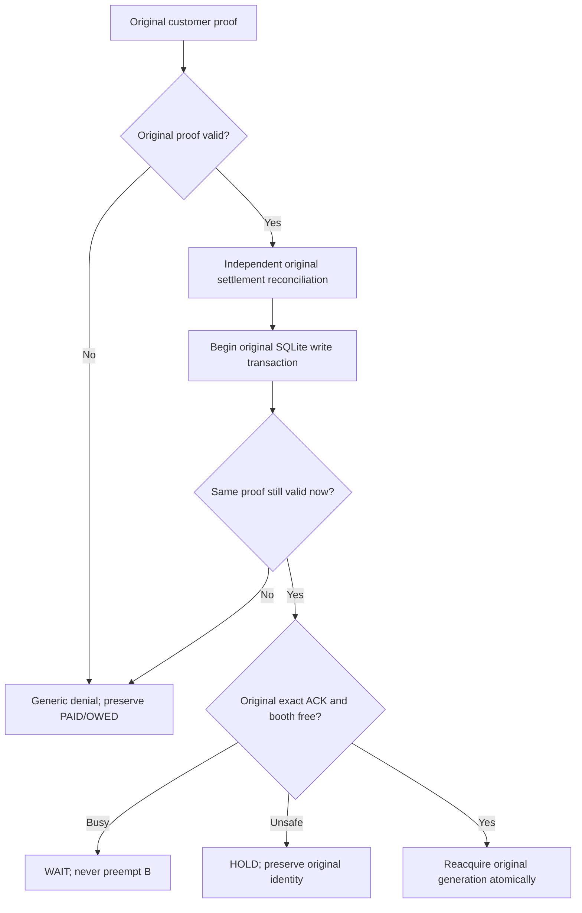

# Post-preview continuation — 5 November 2026

Authorized branch: `feature/post-preview-qris-checkout`. Starting remote source:
`5fc73bc025327a5ecf55a6673722cdb089e1eaeb`. Dates use Asia/Jakarta.

## Current verification checkpoint — final test source c20479d

All three functional/test micro-pushes were read back from the existing remote
ref and matched: `637b67d`, `fdf044d`, `c20479d`. Final runtime/test source:
`c20479d21ba601dfcb3b3cd3025977584a745ff1`. Subsequent worksheet/evidence edits
are documentation only. No branch was created/switched, no history rewritten,
and the original local `work` checkout/index/files remain unchanged.

- Final local registered backend: **544 PASS**, zero failures/errors/skips,
  88.852s, Python 3.12.14. This contains all eleven new methods, not eleven
  newly completed full acceptance cases.
- Same-source [CI 41901827925](https://github.com/pratikto/PhotoBooth/actions/runs/41901827925):
  Ubuntu backend **544 PASS**, zero failures/errors/skips, 136.085s; native Kivy
  **61 PASS**, zero failures/errors/skips, 95.589s. Both completed job logs were
  independently inspected. Windows backend **544 PASS**, zero failures/errors/
  skips, 475.961s; its completed job log was also independently inspected.
  **All 3/3 jobs COMPLETED SUCCESS**: 1,149 platform executions, not unique
  acceptance cases. Both new Windows DPAPI independent-process methods PASS;
  this is protected-byte evidence, not original-worker/device acceptance.
- Earlier source-matched CI runs `41900853098` and `41901102286` were superseded
  and CANCELLED by later micro-pushes. Neither is a failure or a passing run.
- Existing local native suite on `fdf044d`: 61 PASS/63.239s. Native CI above
  verifies the final source including the subsequent provider test increment.
- Apps Script syntax and offline Node VM suite PASS; no cloud deployment,
  account interaction or retention deletion.

Machine-readable [execution evidence](evidence/pp07-continuation-2026-11-05.json)
records exact commits, source file digests, counts, limitations and CI identity.

### Bounded resource observations

A separate same-process diagnostic reran the existing complete J21 journey
three times: **36 synthetic paid visits in 48.154s** with fresh unit-test roots
and cleanup, no owner root touched. `gc.collect()` preceded each sample;
`tracemalloc`, Linux `/proc/self/status`, `/proc/self/fd` and
`threading.enumerate()` supplied observed counters. See
[raw numeric samples](evidence/pp07-resource-probe-2026-11-05.json).

| After cycle | Paid visits in cycle | Python traced bytes | RSS bytes | Threads | Open descriptors |
| --- | ---: | ---: | ---: | ---: | ---: |
| 1 (warm-up included) | 12 | 7,406,059 | 190,418,944 | 1 | 4 |
| 2 | 12 | 7,483,601 | 196,927,488 | 1 | 4 |
| 3 | 12 | 7,541,756 | 197,115,904 | 1 | 4 |

Threads/descriptors did not grow in these samples. Traced bytes grew by 135,697
and RSS by 6,696,960 between first/last cleanup; these short measurements do not
establish a leak-free or unbounded-growth conclusion. This is neither multi-hour
soak nor real camera/background Drive/printer-worker/hardware acceptance.
Every repeated J21 assertion passed; repeated executions are not new PP cases.
To reproduce, run `CustomerJourneyMatrixTests` method
`test_j21_twelve_paid_visits_complete_without_folder_or_payment_contamination`
three times in one Python process, collecting the listed counters after each
fixture's unittest cleanup. Preserve source/environment and numerical results.

### Independent readiness after this continuation

| Gate | Current status |
| --- | --- |
| A — supervised synthetic device candidate | READY_FOR_SUPERVISED_SYNTHETIC_DEVICE_TEST, subject to owner preflight; matching source all 3 CI jobs SUCCESS |
| B — actual post-preview merchant Sandbox | PROVIDER_BLOCKED / integrated separate launch profile still NOT_IMPLEMENTED; actual credentials/webhook/account evidence absent |
| C — protected original restart/recovery | Full pilot original-worker restore NOT_IMPLEMENTED; Windows DPAPI protected-byte process contract AUTOMATED_VERIFIED, Ubuntu protector unsupported here; device/reboot/reinstall NOT_RUN |
| D — comprehensive software acceptance | Partial AUTOMATED_VERIFIED (11 new methods); all 112 full acceptance rows still NOT_RUN |
| E — owner physical acceptance | HARDWARE_PENDING: PILOT-01..24 NOT_RUN, PILOT-25/26 BLOCKED |
| F — production | NOT_APPROVED; actual refunds NOT_ENABLED |

### Owner worksheet corrections

The existing [26-case worksheet](PP07-SUPERVISED-WINDOWS-UAT.md) had a blind
`git switch` and unconditional venv recreation in its old example, despite newer
branch/environment safeguards. Its executable example now checks the correct
branch and clean tree, reuses the existing interpreter, and checks preflight
before devices. PILOT-17/24 now explicitly require virtual/isolated equipment,
never active production-printer disconnection, and explain that occupied-root
refusal is not full protected restoration. All **24 NOT_RUN + 2 BLOCKED** row
states are preserved and programmatically checked; no owner result is invented.

**Verification is complete for this milestone.** This final documentation-only
checkpoint preserves the matching functional CI; it does not rerun or cancel it.
Highest unfinished implementation remains the separately guarded actual
post-preview Sandbox launch/secure original-worker restore profile. Reuse the
now-tested transport and vault seams; obtain supported target OS protection and
actual merchant/account evidence before external transactions. Full PP coverage,
refund journal/capability gates and multi-hour device soak remain unfinished.

**Next implementation seam:** inspect `tools/run_post_preview_checkout_pilot.py`,
`photobooth/kiosk_v2/post_preview_checkout.py`, `post_preview_payments.py`,
`post_preview_claim.py`, `post_preview_isolation.py` and `credential_vault.py`.
Design a separate disabled-by-default Sandbox composition; keep the synthetic
launch command and protected-root refusal unchanged. Preserve the strict
synthetic-only gates until an independently verified supported OS escrow and
original-worker reconstruction path can replace them safely. Relevant cases:
PP-021..046/063..065/070..084. First focused command:

```text
python tools/run_kiosk_unittests.py test_post_preview_payments test_post_preview_readiness test_credential_vault test_post_preview_claim test_post_preview_isolation
```

Provider account/webhook reachability, target-platform protected storage and
original-worker restoration, new-order policy/security validation and owner
physical observations are independent prerequisites. No real Sandbox charge or
refund should be used to bypass any missing software or external acceptance.

The increment sections below preserve their delivery-time observations; the
verified checkpoint above supersedes their pending CI/next-verification notes.

## Increment 3 — actual Sandbox transport seam, isolated HTTP contract

**Increment 2 push verified:** `fdf044d52c9d219fa2856bb12ed2929410401802`.
On that exact source, the complete registered local backend ran **539 PASS,
0 failures/errors/skips (88.207s)**; native Kivy ran **61 PASS,
0 failures/errors/skips (63.239s)**. Apps Script syntax and the offline Node VM
suite PASS. Native execution used SDL offscreen/software GL, dummy audio and a
writable scratch Kivy/cache directory; an initial environment startup exited
without a test summary before that configuration was supplied (not a PASS).

Five new cases in `test_post_preview_payments.MidtransPostPreviewContractTests`
combine the existing frozen-photo/CCP ledger, trusted scoped readiness,
`PostPreviewPayments` in **sandbox** mode and the actual
`MidtransSandboxClient` JSON/request implementation. Its injected HTTP transport
is strictly local: no merchant request or usable credential exists. Assertions
retain the fixed Sandbox host, request shape, real HTTPError 404 behavior,
no invented provider idempotency headers, same original order after lost create
and service reconstruction, independently verified expiry through QR3/no QR4,
no PAID authority from create response, and late PAID/OWED after cancellation.
The suite adds evidence at a previously unexercised transport/coordinator seam;
it does not substitute the old prepaid GUI or enable the post-preview launcher.

**Executed focused evidence:** 5 new contract cases PASS in 0.692s; full affected
payment/readiness/process-crash scope **54 PASS in 7.309s**, zero failures/errors/
skips. Partial mapping PP-021/022/024/025/026/028/031/032/073/074/083.
The complete acceptance matrix remains NOT_RUN at full scope.

```text
python tools/run_kiosk_unittests.py test_post_preview_payments test_post_preview_readiness test_post_preview_payment_crashes
```

**Current next action:** inspect exact-source Windows/Ubuntu/native CI after this
micro-push and run final registered backend regression. Merchant Sandbox remains
blocked by missing guarded integrated launch profile, supported persistent
escrow/restore and actual merchant credentials/configuration/provider evidence;
passing fake HTTP cannot close those source or external dependencies. Refund
transport remains disabled. Physical tests remain owner-observed only.

## Increment 2 — independent-process protected-storage contract

**Increment 1 push verified:** `637b67d1a33042d32597eff43caf4fb47be51b81`
(the remote ref was read back and matched). This second increment is test-only;
no vault adapter, platform support, launch flag or payment route is enabled.

Two new cases in the existing CI-registered `test_credential_vault` module run
`tests.credential_vault_process_fixture` as independent Python processes. On
Windows the first child protects random nonredeemable bytes with current-user
DPAPI and exits; new children must restore the same digest without changing
ciphertext. Wrong original scope and corrupted ciphertext must fail closed.
Only OS-protected ciphertext is written; raw bytes/keys never enter commands,
environment variables, diagnostics or artifacts. No synthetic persistent key is
substituted. On unsupported Linux, fresh children must reject platform protection
before creating any file; these are executed denials, not skipped Windows passes.

**Local evidence:** Linux `python tools/run_kiosk_unittests.py test_credential_vault`
ran **9 PASS, 0 failures/errors/skips in 0.051s**, including both independent
unsupported-platform checks. The actual Windows cross-process DPAPI branches
remain **NOT_RUN locally**, awaiting the pushed Windows CI and later owner OS
acceptance. This is protected-byte evidence only: full original session/worker
restore, malicious OS account/reinstall and device acceptance remain unverified.
Partial mapping: PP-043/045/077/078/084/103; no full PP row promoted to PASS.

**Current next action:** run full registered backend/native regression on this
functional source; inspect the corresponding Windows/Ubuntu/native CI and record
exact SHA/results. Actual provider account and supported target-platform escrow
still gate merchant/restart acceptance. Continue provider transport contract
coverage with isolated fake HTTP, never a real charge or refund.

## Increment 1 — BUG-040 atomic returning-proof validity

**IMPLEMENTED / AUTOMATED_VERIFIED locally; matching-source CI pending.**
The synthetic candidate remains `READY_FOR_SUPERVISED_SYNTHETIC_DEVICE_TEST`;
this change does not enable actual merchant payments or persistent pilot restore.

`OriginalMockClaim.claim` verified the original CCP/Recovery Ticket before two
independent provider checks, then reacquired occupancy using that old verdict.
Four deterministic connected tests reproduce a proof expiring or being revoked
during the final settlement GET, with provider responses still within their
lease. All four originally FAIL: the old visit incorrectly becomes ACTIVE.

`OriginalCCPService` now shares its existing hash, role, booth, merchant, expiry,
revocation and rate-limit checks through a transaction-owned verifier. Claim
rechecks that exact original proof **after the last provider call, within the
same SQLite write transaction as occupancy acquisition**. No proof plaintext is
persisted, decrypted or redisplayed. Existing public verifier failure accounting
still commits before rejection. Invalidated proof cannot change the closed
original generation, create a reacquisition event, print, or mint another charge;
the original entitlement and PAID/OWED remain.



### Executed evidence

Source: starting SHA plus the code/tests in the commit containing this record.
Linux Python 3.12.14; cryptography 49.0.0 (within declared bounds), FastAPI
0.128.2, Pydantic 2.13.5, httpx 0.28.1. Synthetic photos/provider/vault/printer.

| Check | Outcome |
| --- | --- |
| Four new final-GET expiry/revocation cases before fix | 4 FAIL, 0 errors/skips |
| Initial fix placed before the last GET | 81 run, 77 PASS, 4 FAIL; corrected before delivery |
| Final claim/CCP/ticket/isolation/admission regression | 81 PASS, 0 failures/errors/skips, 13.437s |
| Exact-source Windows/Ubuntu/native CI | PENDING after functional push; never inferred from prior CI |
| Physical paper/camera/Drive/merchant acceptance | NOT_RUN / HARDWARE_PENDING / PROVIDER_BLOCKED |

```text
python tools/run_kiosk_unittests.py test_post_preview_claim test_post_preview_ccp test_post_preview_ticket test_post_preview_isolation test_post_preview_pilot_admission
```

The focused total includes existing imported fixture test classes; it is not 81
new scenarios. The four new methods map partial executable evidence to
PP-036/038/039/070/072/084/103. All 112 full acceptance rows remain NOT_RUN.

### Source delivery and workspace preservation

The attached checkout is the unrelated, clean local branch `work` at
`0fbf15829d1537a7f18990b492b1e5934f21c0f8`. It is not switched or staged.
Following the previously documented delivery method, development uses an exact
snapshot of the fetched authorized remote SHA, an external temporary Git index,
one explicit parent, and a normal fast-forward push to the existing authorized
ref. No branch creation, history rewrite, master merge or old-archive access.
Network-enabled managed execution restores Git transport; no proxy bypass.

### Independent readiness gates and external blockers

| Gate | Status / remaining evidence |
| --- | --- |
| A synthetic supervised device candidate | Preserve previous verified candidate; new local regression PASS, new CI pending |
| B actual post-preview merchant Sandbox | PROVIDER_BLOCKED: no merchant secret binding/runtime variable or verified public webhook supplied; integrated launcher remains synthetic-only |
| C protected cross-process pilot restore | NOT_IMPLEMENTED; Linux runtime has no configured session bus, Secret Service binding or visible TPM device; Windows DPAPI full original-worker restore/device acceptance pending |
| D comprehensive software acceptance | Partial AUTOMATED_VERIFIED; 112 full acceptance rows NOT_RUN |
| E owner physical acceptance | HARDWARE_PENDING; existing 26-case worksheet unchanged |
| F production | NOT_APPROVED; actual refunds NOT_ENABLED |

Environment observations establish only this runtime's available facilities,
not whether an owner's Windows/Ubuntu machine has a working protected vault.
No plaintext/key-file fallback, OS credential provisioning, payment/refund,
public upload, paper write or occupied-root reuse is introduced.

**Next engineering action:** add actual independent-process OS-protector
round-trip and corrupt/wrong-scope failure evidence to the existing credential
suite; on unsupported Linux prove fail-closed without creating a replacement
key. Then run the registered full source-matched backend/native regression and
inspect the pushed Windows/Ubuntu/native CI. This does not itself complete
original proof-gated worker restore or authorize reopening old pilot roots.

Reviewed authority: AGENTS, development protocol/architecture/handover/status/
bug register; device start/readiness/traceability/evidence; implementation
checkpoint; complete decision ledger; security state and refund/lost-proof
contracts; canonical 112 cases; supervised 26-case worksheet; original AR/UAH
and Midtrans provider contracts. Historical design-only restrictions and pending
CI notes retain their dated scope; the 4 November verified source is preserved.
