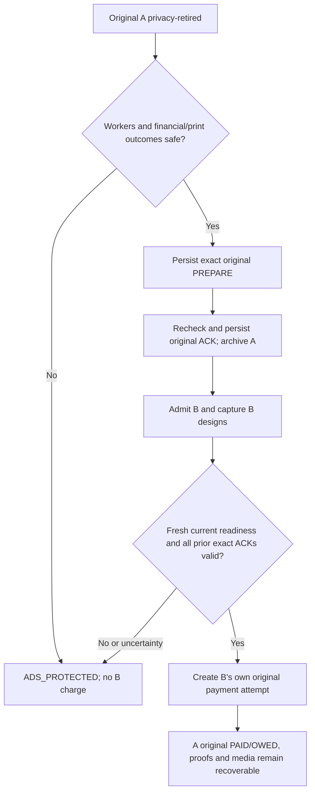

# PP-07 software continuation and device readiness — 4 November 2026

## Scope, authority and source

Authorized branch: `feature/post-preview-qris-checkout`. Starting remote HEAD:
`4b1c12ac173fa4cb64d7940a1679ff280b26f055`. The owner's 4 November execution
prompt authorizes implementation through device-test preparation. Existing
PP-D/RF-D/AR/UAH safety, legacy prepaid routes and external release gates remain.

Reviewed authorities include root `AGENTS.md`, development protocol/handover,
architecture, decisions/status, PP complete decision ledger, owner-approved
flow, state/security contract, refund/lost-proof and escalation policies,
acceptance matrix, consistency audit, implementation checkpoint, prior broad
simulation report and Windows pilot/26-case worksheet. Older design-only
restrictions describe their original epoch, not the current implementation task.

The attached Git checkout is clean but on stale `work` at `0fbf158`; it was not
modified or switched. A separate non-Git execution snapshot was built from
the exact authorized remote commit through the GitHub connector. Existing local
Git blobs were reused only when their content SHA matched the remote tree;
fetched source transport newlines were normalized against the Git blob SHA.
This snapshot is not a new branch and does not alter the owner's checkout.

## Increment 1 — BUG-036: ticket timeout independent of receipt worker

**Requirements:** PP-042 and PP-051; PP-D06; state/security invariant 10.

**Reproduction:** `PrivateCheckoutFixtureApp._poll_photos` returned as soon as
`PhotoJobs.busy` was true, before updating the Recovery Ticket countdown or
checking its automatic deadline. A slow receipt sender therefore froze the
display at 30 seconds and could leave the private QR visible beyond its window.
The existing manual-NEXT regression did not cover automatic expiry.

**Change:** process visible-ticket UI countdown and expiry before the worker-busy
return. Automatic expiry immediately retires the QR/code, just like NEXT.
Durable dismissal remains queued until the original receipt sender completes;
there is no second receipt, lost SENDING journal, forced release or overlapping
photo job. Closed/suspended UI still returns without rendering private content.

**New native regression:**
`test_ticket_countdown_and_auto_wipe_continue_during_blocked_receipt` holds the
actual synthetic receipt callback behind a threading event, advances only the
ticket's injected monotonic clock and tests both 800×1280 and 452×900. It checks
the 10-second label, automatic QR/full-code wipe, still-SENDING receipt, one
charge, and eventual single SUBMITTED receipt/DISMISSED screen with OWED intact.
No screenshots of live private test credentials are saved.

**Executed evidence:**

| Check | Result | Boundary |
| --- | --- | --- |
| New regression before fix | FAIL at both portrait sizes | Countdown stayed at 30 instead of 10 while receipt blocked |
| New regression after fix | PASS at both portrait sizes | Actual Kivy widgets; synthetic camera/provider/printer |
| Existing NEXT-during-blocked-receipt regression | PASS | Single original receipt and no code retention |
| Four visible-ticket-clock unit cases | 4 PASS | Actual visibility start, expiry/NEXT once, no timer reset |
| Focused total | 6 PASS; zero failures/errors/skips | Linux Python 3.12, SDL2 offscreen/software GL |
| Apps Script syntax and Node regression | PASS | Existing offline VM suite; no account/deployment/deletion |
| Matching-source CI for this increment | NOT_RUN at local checkpoint | Must inspect the resulting pushed source workflow separately |
| Physical/device/provider acceptance | HARDWARE_PENDING / BLOCKED | No real paper, merchant, upload, refund or customer media |

Focused runner arguments:

```text
python tools/run_kiosk_unittests.py
  test_post_preview_checkout_widgets.PrivateCheckoutWidgetTests.test_ticket_countdown_and_auto_wipe_continue_during_blocked_receipt
  test_post_preview_checkout_widgets.PrivateCheckoutWidgetTests.test_next_wipes_qr_while_original_receipt_sender_is_blocked
  test_post_preview_ticket_window
```

Local environment note: the existing Kivy virtual environment was retained.
An external scratch `sitecustomize` supplied the already installed cryptography
50.0.0 for offline execution; repository requirements still specify >=46,<50.
FastAPI 0.128.2/Pydantic 2.13.5 match the repository. Local results therefore
supplement, but do not replace, CI using the declared dependency bounds.
Restricted socket access initially stalled the in-process HTTP test client;
that run was stopped and repeated with local socket support. Neither that
infrastructure stall nor an initially omitted snapshot asset is a product bug.

## Increment 2 — BUG-037: exact isolation ACK permits the next checkout

**Requirements:** PP-059/063/064/069/071, PP-D18 and retained AR/UAH safe
ownership requirements. Acknowledged resource release and historical money/OWED
are independent axes; an archived purchase must not be deleted to admit B.

**Reproduction:** `OriginalWorkerReadiness` rejected any earlier post-preview
finance row for the booth. PP-06 could correctly isolate A, ACK and admit B to
capture, yet B's actual authenticated `/begin` always entered payment hold.
This occurred both after a verified cancelled-unpaid A and after safely
isolated PAID/OWED A. Prior N23 stopped at B's camera frame, missing this boundary.

**Minimal change:** observe all prior checkout drafts read-only. Each must be
closed/ISOLATED, with an ACK for its exact booth/draft and immediately preceding
generation, finite ordered PREPARE/ACK timestamps not in the future, no current
financial-review flag, no PENDING/UNKNOWN/nonterminal attempt and no original
receipt/strip SENDING/UNCERTAIN. Public Ads, a closed flag alone, an older
generation ACK, missing ACK or incomplete timestamp cannot satisfy readiness.
All existing current owner/worker, authenticated request, legacy release,
camera/media/Drive/printer checks remain. No payment/service/proof row is removed
or rewritten by this probe, and A's original claim and OWED remain intact.

**New verification:** seven backend integration cases cover paid A and terminal
unpaid A followed by B's actual HTTP checkout, plus wrong-generation, missing,
incomplete/future ACK and financial-conflict denials. Before the source fix,
the two legitimate handoffs fail READY; afterward all seven pass. Tests assert
the probe makes no ledger mutations, there are exactly two legitimate purchase
creates, no duplicate old receipt, and old financial views/OWED stay unchanged.

Native N25 now completes B's six captures, final preview, CCP and actual mock
payment admission after A's original ticket and safe isolation. It asserts a
new immutable group, two total charges (one per customer), exactly one old
receipt, no old Recovery Ticket in B's UI and A's preserved OWED.

| Executed check | Result | Scope |
| --- | --- | --- |
| Initial five handoff cases before fix | 2 FAIL, 3 PASS | Valid paid/unpaid safe handoffs incorrectly denied |
| Authority/isolation/claim/readiness/checkout-worker regression | 89 PASS, 0 failure/error/skip | Includes seven new handoff cases and original guards |
| Native N25 actual A→B checkout | 1 PASS, 0 failure/error/skip | Real Kivy/HTTP/SQLite with synthetic provider/camera/receipt |
| Increment-1 affected native/legacy regression | 59 PASS, 0 failure/error/skip | Before N25 addition; source-specific result |
| Baseline backend at original 4b1c12ac | 522 PASS, 0 failure/error/skip | Previous source; not a final new-source claim |
| New source matching CI | PENDING until inspected | No Windows result inferred from local Linux |



This does not make an old receipt SUBMITTED physical paper proof, forgive a
review/uncertain job, start real merchant payments, refund A, or authorize
proof-free access. Actual device/merchant/Drive/vault acceptance remains separate.

## Increment 3 — BUG-038: idle Drive daemon versus active request fence

**Requirements:** PP-057/062/063/064/071/078; PP-D18; exact paid folder and
worker ownership safeguards. No external Drive operation was executed.

**Reproduction:** real-test Drive mode starts a long-lived `BoothDriveWorker`
for reserves/uploads. Isolation checked `_thread.is_alive()` and therefore
rejected every handoff even while the worker was safely sleeping between
requests. Stopping the thread permanently is not a valid fix: the inherited
worker is one-shot and queued paid uploads/reserve maintenance must survive.

**Change:** reuse the same worker with a nonblocking cycle/request-boundary
mutex. `run_once()` owns it for every upload/reserve/content cycle.
`quiescent()` temporarily fences new cycles only when no cycle is active.
Original isolation holds this exact owner's fence until after SQLite commit or
rollback for PREPARE and ACK. A request starting between PREPARE and ACK blocks
ACK; there is no time-of-check gap. The worker is neither stopped nor replaced,
and queued immutable transaction work continues after the guarded section.
Already-ACKED operation replay remains idempotent. Existing camera/printer and
financial checks still independently block unsafe release. Supplied delivery
monitor/worker must belong to the exact ledger/workspace/client.

**Executed regression:** initial two new cases ERROR on the original
`Original Drive worker is still active` hold. After the fix, 85 affected
Drive/isolation/claim/authority/delivery tests PASS with zero failure/error/skip.
Three new event-synchronized real-thread tests demonstrate:

1. A live idle worker allows PREPARE/ACK and keeps running, with no restart or
   stop flag; repeat ACK does not create another release.
2. A deliberately blocked synthetic request between PREPARE and ACK blocks both
   repeated PREPARE and ACK, preserves PREPARED/closed=0, and permits the same
   ACK only after the request completes and the worker becomes idle.
3. A financial HOLD rolls back without creating an operation, releases the
   Drive fence and allows the same worker to continue; it is not mislabeled as
   an active-request error.

Existing Drive regression covers FIFO upload/retry/reserve behavior, original
folder binding and no print replay. This validates synchronization in software,
not real Google permission, customer file upload or owner hardware acceptance.

```mermaid
sequenceDiagram
    participant W as Original Drive worker
    participant I as Isolation coordinator
    participant L as Original SQLite ledger
    I->>W: Try request-boundary fence (nonblocking)
    alt Original API/upload cycle active
        W-->>I: Busy
        I-->>I: HOLD, no release ACK
    else Worker idle
        W-->>I: Exact worker fence acquired
        I->>L: Recheck workers, finance, paper and original generation
        alt All evidence safe
            I->>L: Commit PREPARE or ACK
        else Any ambiguity
            I->>L: Roll back; preserve original owner
        end
        I->>W: Release fence after commit/rollback
        W->>W: Resume same queued transaction work
    end
```

## Current readiness and next action

The prior 522/522/58 CI at `238012f7` remains historical source-specific evidence.
Current full backend and affected native checks must finish and new CI must be
inspected before claiming this new source has the same broad verification.

Next: complete baseline/affected integration verification; inspect remaining
restart, proof/isolation, native-template and bounded repeated-session gaps;
continue safe micro-increments. Reconcile stale current-looking status banners
and owner launch instructions as the device package is finalized.

Full PP-001–112 and the 26 owner physical cases are not promoted to PASS by these
subassertions. Synthetic pilot, actual merchant Sandbox, physical acceptance and
production release remain independent readiness states. Actual Midtrans,
POS80 paper, Drive public ACL/upload/retention, supported OS vault protection and
real refunds retain their external gates. No production activation is authorized.
