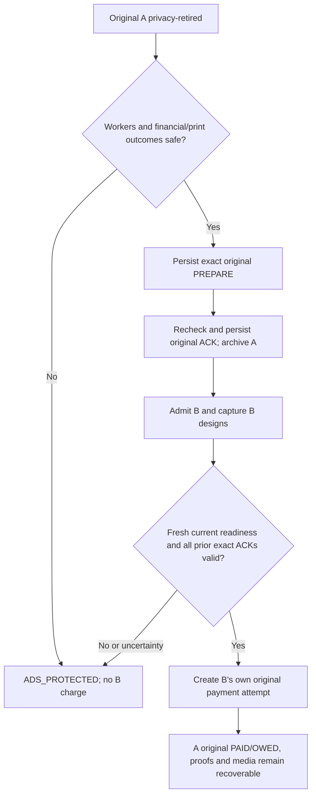

# PP-07 software continuation and device readiness — 4 November 2026

## Final verified checkpoint — supervised synthetic device candidate

**READY_FOR_SUPERVISED_SYNTHETIC_DEVICE_TEST**, subject to owner installation,
correct branch/interpreter preflight and the explicit no-real-money scope.
This is not actual merchant Sandbox, cross-process pilot recovery, full hardware
acceptance or production readiness.

**Tested source:** `06013545d31582b2db4ecf60384b4e2afaab98c3` (same runtime/test
fixes as functional 267fc437; bounded CI budget published).
**[CI 41826366906](https://github.com/pratikto/PhotoBooth/actions/runs/41826366906):
COMPLETED SUCCESS, all 3/3 jobs.** Actual logs independently inspected:

| Matching-source job | PASS | Failures | Errors | Skips |
| --- | ---: | ---: | ---: | ---: |
| Windows backend / original paid-first regression | 533 | 0 | 0 | 0 |
| Ubuntu backend / original paid-first regression | 533 | 0 | 0 | 0 |
| Native Kivy / private proof / photo and flow regression | 61 | 0 | 0 | 0 |

These are **1,127 platform executions**, not 1,127 unique journeys. This
continuation adds **14 test methods**: seven authority handoffs, three Drive
thread/fence cases, J21, N25, N26 and the blocked-receipt automatic-expiry case.
The 12-visit loop and two-size subcases are not counted as separate methods.

BUG-036–039 are source-fixed/automatically verified; owner physical checks remain
pending. No critical failure is hidden by removing a test or marking paper from
SUBMITTED. The previous 10-minute cancelled runs and fixture compatibility
failure remain below as dated history, superseded only by this verified source.

CI artifact `13318549684`, `meong-private-preview-synthetic`, is source-matched
to 0601354 and expires 11 November. Metadata/digest were inspected; archive ZIP
was not downloaded. Locally reproduced eight PNGs and both inspected final
preview images are recorded separately. See the evidence JSON for both artifacts.

**Current independent modes:** software verification PASS in the executed
scopes; supervised synthetic device candidate READY; physical webcam/touch/
speaker/POS80/test-Drive observations HARDWARE_PENDING; actual post-preview
merchant Sandbox and protected cross-process recovery still BLOCKED/not supplied
by this launcher; refunds NOT_ENABLED; full PP-001–112/owner acceptance NOT_RUN;
production NOT_APPROVED. Those software/integration limits are explicitly
retained, not attributed solely to absent hardware.

**Next owner action:** follow [Start here](POST-PREVIEW-DEVICE-TEST-START-HERE.md)
using the current authorized branch, reuse the working environment, run full
preflight and start a new private no-paper/no-cloud trial. Then optional owned
POS80 and approved test Drive each need their two consent flags. Record actual
results in the 26-case worksheet without sharing private QR/credentials.

**Next separate engineering stream:** guarded real-provider post-preview
mounting and supported persistent OS escrow/original-worker restore, with
merchant-specific verification and existing PP/AR/UAH regression, before actual
QRIS/restart acceptance. No payment, key fallback, refund or root reset is
enabled by this checkpoint. Routine synthetic device testing can begin without
another source-fix session for BUG-036–039.

## Current checkpoint — published CI budget at 0601354

The bounded workflow change is now **pushed and remote-verified** at
`06013545d31582b2db4ecf60384b4e2afaab98c3`, after documentation package
`6253dcf`. [Matching-source CI 41826366906](https://github.com/pratikto/PhotoBooth/actions/runs/41826366906)
has Ubuntu **533 PASS** and native Kivy **61 PASS** (logs inspected, no
failure/error/skip); Windows is still pending with its actual 15-minute budget.
All original functional fixes at 267fc437 are unchanged. Current next action is
to inspect this new Windows job, not rerun the superseded 10-minute attempts.
Older pending/unpublished statements below preserve the earlier delivery history.

The complete device guide, PP/AR traceability and revised repository continuation
prompt are published/prepared in the same documentation stream. The original
`work` checkout/index/working files remain unchanged. Direct Git delivery uses
an external temporary index, an exact verified parent and an explicit normal
fast-forward target ref; no local/remote branch creation, switch or force push.

## Windows retry and publication follow-up

The targeted retry (`126530625319`) was again cancelled at the 10-minute budget,
this time during late `test_checkout_backend` database setup; no backend summary
was emitted. Neither cancelled attempt is a Windows PASS. The test list remains
unchanged. Direct Git transport succeeds with the managed runtime's network
permission, unlike the earlier sandbox-isolated terminal call. This increment
therefore publishes the bounded Windows 15-minute/Linux 10-minute workflow via
Git plumbing, using a separate index and explicit fast-forward target ref.
The stale local `work` branch/index/working files are not switched or staged.
Prior connector timeout/internal-error attempts remain recorded below as history.
The workflow-budget commit needs its own actual CI result before a 3/3 claim.

**Current source:** `267fc437e082afc581066c9408901c42669480ee`.
Five functional/test micro-pushes are verified. Local full discovery and
subsequent opt-ins all have executed outcomes below. Matching CI Ubuntu backend
533/native 61 PASS; Windows cancelled at its 10-minute budget and is under a
targeted retry. **Do not claim a current 3/3 PASS until that retry is inspected.**
The proposed workflow timeout change did not publish successfully.

Start with the [complete device guide](POST-PREVIEW-DEVICE-TEST-START-HERE.md),
[112-case / AR traceability](PP07-SOFTWARE-TRACEABILITY-2026-11-04.md), and
[machine-readable executed evidence](PP07-EXECUTION-EVIDENCE-2026-11-04.json).
Sections below preserve each increment's then-current result rather than
retroactively labeling every checkpoint PASS.

## Scope, authority and source

Authorized branch: `feature/post-preview-qris-checkout`. Starting remote HEAD:
`4b1c12ac173fa4cb64d7940a1679ff280b26f055`. The owner's 4 November execution
prompt authorizes implementation through device-test preparation. Existing
PP-D/RF-D/AR/UAH safety, legacy prepaid routes and external release gates remain.

Reviewed authorities include root `AGENTS.md`, development protocol/handover,
architecture, decisions/status, PP complete decision ledger, owner-approved
flow, state/security contract, refund/lost-proof and escalation policies,
acceptance matrix, consistency audit, implementation checkpoint, prior broad
simulation report and Windows pilot/26-case worksheet. Older design-only
restrictions describe their original epoch, not the current implementation task.

The attached Git checkout is clean but on stale `work` at `0fbf158`; it was not
modified or switched. A separate non-Git execution snapshot was built from
the exact authorized remote commit through the GitHub connector. Existing local
Git blobs were reused only when their content SHA matched the remote tree;
fetched source transport newlines were normalized against the Git blob SHA.
This snapshot is not a new branch and does not alter the owner's checkout.

## Increment 1 — BUG-036: ticket timeout independent of receipt worker

**Requirements:** PP-042 and PP-051; PP-D06; state/security invariant 10.

**Reproduction:** `PrivateCheckoutFixtureApp._poll_photos` returned as soon as
`PhotoJobs.busy` was true, before updating the Recovery Ticket countdown or
checking its automatic deadline. A slow receipt sender therefore froze the
display at 30 seconds and could leave the private QR visible beyond its window.
The existing manual-NEXT regression did not cover automatic expiry.

**Change:** process visible-ticket UI countdown and expiry before the worker-busy
return. Automatic expiry immediately retires the QR/code, just like NEXT.
Durable dismissal remains queued until the original receipt sender completes;
there is no second receipt, lost SENDING journal, forced release or overlapping
photo job. Closed/suspended UI still returns without rendering private content.

**New native regression:**
`test_ticket_countdown_and_auto_wipe_continue_during_blocked_receipt` holds the
actual synthetic receipt callback behind a threading event, advances only the
ticket's injected monotonic clock and tests both 800×1280 and 452×900. It checks
the 10-second label, automatic QR/full-code wipe, still-SENDING receipt, one
charge, and eventual single SUBMITTED receipt/DISMISSED screen with OWED intact.
No screenshots of live private test credentials are saved.

**Executed evidence:**

| Check | Result | Boundary |
| --- | --- | --- |
| New regression before fix | FAIL at both portrait sizes | Countdown stayed at 30 instead of 10 while receipt blocked |
| New regression after fix | PASS at both portrait sizes | Actual Kivy widgets; synthetic camera/provider/printer |
| Existing NEXT-during-blocked-receipt regression | PASS | Single original receipt and no code retention |
| Four visible-ticket-clock unit cases | 4 PASS | Actual visibility start, expiry/NEXT once, no timer reset |
| Focused total | 6 PASS; zero failures/errors/skips | Linux Python 3.12, SDL2 offscreen/software GL |
| Apps Script syntax and Node regression | PASS | Existing offline VM suite; no account/deployment/deletion |
| Matching-source CI for this increment | NOT_RUN at local checkpoint | Must inspect the resulting pushed source workflow separately |
| Physical/device/provider acceptance | HARDWARE_PENDING / BLOCKED | No real paper, merchant, upload, refund or customer media |

Focused runner arguments:

```text
python tools/run_kiosk_unittests.py
  test_post_preview_checkout_widgets.PrivateCheckoutWidgetTests.test_ticket_countdown_and_auto_wipe_continue_during_blocked_receipt
  test_post_preview_checkout_widgets.PrivateCheckoutWidgetTests.test_next_wipes_qr_while_original_receipt_sender_is_blocked
  test_post_preview_ticket_window
```

Local environment note: the existing Kivy virtual environment was retained.
An external scratch `sitecustomize` supplied the already installed cryptography
50.0.0 for offline execution; repository requirements still specify >=46,<50.
FastAPI 0.128.2/Pydantic 2.13.5 match the repository. Local results therefore
supplement, but do not replace, CI using the declared dependency bounds.
Restricted socket access initially stalled the in-process HTTP test client;
that run was stopped and repeated with local socket support. Neither that
infrastructure stall nor an initially omitted snapshot asset is a product bug.

## Increment 2 — BUG-037: exact isolation ACK permits the next checkout

**Requirements:** PP-059/063/064/069/071, PP-D18 and retained AR/UAH safe
ownership requirements. Acknowledged resource release and historical money/OWED
are independent axes; an archived purchase must not be deleted to admit B.

**Reproduction:** `OriginalWorkerReadiness` rejected any earlier post-preview
finance row for the booth. PP-06 could correctly isolate A, ACK and admit B to
capture, yet B's actual authenticated `/begin` always entered payment hold.
This occurred both after a verified cancelled-unpaid A and after safely
isolated PAID/OWED A. Prior N23 stopped at B's camera frame, missing this boundary.

**Minimal change:** observe all prior checkout drafts read-only. Each must be
closed/ISOLATED, with an ACK for its exact booth/draft and immediately preceding
generation, finite ordered PREPARE/ACK timestamps not in the future, no current
financial-review flag, no PENDING/UNKNOWN/nonterminal attempt and no original
receipt/strip SENDING/UNCERTAIN. Public Ads, a closed flag alone, an older
generation ACK, missing ACK or incomplete timestamp cannot satisfy readiness.
All existing current owner/worker, authenticated request, legacy release,
camera/media/Drive/printer checks remain. No payment/service/proof row is removed
or rewritten by this probe, and A's original claim and OWED remain intact.

**New verification:** seven backend integration cases cover paid A and terminal
unpaid A followed by B's actual HTTP checkout, plus wrong-generation, missing,
incomplete/future ACK and financial-conflict denials. Before the source fix,
the two legitimate handoffs fail READY; afterward all seven pass. Tests assert
the probe makes no ledger mutations, there are exactly two legitimate purchase
creates, no duplicate old receipt, and old financial views/OWED stay unchanged.

Native N25 now completes B's six captures, final preview, CCP and actual mock
payment admission after A's original ticket and safe isolation. It asserts a
new immutable group, two total charges (one per customer), exactly one old
receipt, no old Recovery Ticket in B's UI and A's preserved OWED.

| Executed check | Result | Scope |
| --- | --- | --- |
| Initial five handoff cases before fix | 2 FAIL, 3 PASS | Valid paid/unpaid safe handoffs incorrectly denied |
| Authority/isolation/claim/readiness/checkout-worker regression | 89 PASS, 0 failure/error/skip | Includes seven new handoff cases and original guards |
| Native N25 actual A→B checkout | 1 PASS, 0 failure/error/skip | Real Kivy/HTTP/SQLite with synthetic provider/camera/receipt |
| Increment-1 affected native/legacy regression | 59 PASS, 0 failure/error/skip | Before N25 addition; source-specific result |
| Baseline backend at original 4b1c12ac | 522 PASS, 0 failure/error/skip | Previous source; not a final new-source claim |
| New source matching CI | PENDING until inspected | No Windows result inferred from local Linux |



This does not make an old receipt SUBMITTED physical paper proof, forgive a
review/uncertain job, start real merchant payments, refund A, or authorize
proof-free access. Actual device/merchant/Drive/vault acceptance remains separate.

## Increment 3 — BUG-038: idle Drive daemon versus active request fence

**Requirements:** PP-057/062/063/064/071/078; PP-D18; exact paid folder and
worker ownership safeguards. No external Drive operation was executed.

**Reproduction:** real-test Drive mode starts a long-lived `BoothDriveWorker`
for reserves/uploads. Isolation checked `_thread.is_alive()` and therefore
rejected every handoff even while the worker was safely sleeping between
requests. Stopping the thread permanently is not a valid fix: the inherited
worker is one-shot and queued paid uploads/reserve maintenance must survive.

**Change:** reuse the same worker with a nonblocking cycle/request-boundary
mutex. `run_once()` owns it for every upload/reserve/content cycle.
`quiescent()` temporarily fences new cycles only when no cycle is active.
Original isolation holds this exact owner's fence until after SQLite commit or
rollback for PREPARE and ACK. A request starting between PREPARE and ACK blocks
ACK; there is no time-of-check gap. The worker is neither stopped nor replaced,
and queued immutable transaction work continues after the guarded section.
Already-ACKED operation replay remains idempotent. Existing camera/printer and
financial checks still independently block unsafe release. Supplied delivery
monitor/worker must belong to the exact ledger/workspace/client.

**Executed regression:** initial two new cases ERROR on the original
`Original Drive worker is still active` hold. After the fix, 85 affected
Drive/isolation/claim/authority/delivery tests PASS with zero failure/error/skip.
Three new event-synchronized real-thread tests demonstrate:

1. A live idle worker allows PREPARE/ACK and keeps running, with no restart or
   stop flag; repeat ACK does not create another release.
2. A deliberately blocked synthetic request between PREPARE and ACK blocks both
   repeated PREPARE and ACK, preserves PREPARED/closed=0, and permits the same
   ACK only after the request completes and the worker becomes idle.
3. A financial HOLD rolls back without creating an operation, releases the
   Drive fence and allows the same worker to continue; it is not mislabeled as
   an active-request error.

Existing Drive regression covers FIFO upload/retry/reserve behavior, original
folder binding and no print replay. This validates synchronization in software,
not real Google permission, customer file upload or owner hardware acceptance.

```mermaid
sequenceDiagram
    participant W as Original Drive worker
    participant I as Isolation coordinator
    participant L as Original SQLite ledger
    I->>W: Try request-boundary fence (nonblocking)
    alt Original API/upload cycle active
        W-->>I: Busy
        I-->>I: HOLD, no release ACK
    else Worker idle
        W-->>I: Exact worker fence acquired
        I->>L: Recheck workers, finance, paper and original generation
        alt All evidence safe
            I->>L: Commit PREPARE or ACK
        else Any ambiguity
            I->>L: Roll back; preserve original owner
        end
        I->>W: Release fence after commit/rollback
        W->>W: Resume same queued transaction work
    end
```

## Increment 4 — BUG-039 synthetic folder identity and complete repeat visits

**Requirements:** PP-048/053/056/063/064/069 and PP-003/010 native all-design preview.

**Reproduction:** the default supervised synthetic pilot reused the exact
`syntheticPaidFolder123` folder for every transaction. On the second paid visit,
the existing folder-ownership guard correctly rejected binding that same folder
to another transaction. This was a fixture/pilot defect, not a failed privacy
guard or evidence of actual Google Drive reuse. The no-paper/no-cloud owner
pilot uses this fixture, so it must support repeated visitors correctly.

**Fix:** keep the first historical fixture URL for compatibility, and derive a
stable unique non-downloadable synthetic folder ID from each later original
transaction ID. Retry of the same transaction keeps the same identity. The
explicit real-test Drive branch still uses the original real client unchanged;
the folder conflict rejection is not weakened.

**J21 executed:** 12 consecutive complete paid visits in the same fixture,
two designs each, 72 original private captures, one quote/CCP/charge/Recovery
Ticket per visitor, 24 original purchased print batches, 12 distinct folders,
12 distinct paid entitlements and 12 exact isolation ACKs. Previous original
JPEG hashes remain unchanged at every iteration; all 12 services remain OWED
because synthetic transport is not physical delivery, and no draft remains
active after the final ACK. Before the fix, the second paid binding ERRORs;
after the fix, the repeat case plus affected Drive/delivery cases **18 PASS**,
zero failures/errors/skips. This is a bounded repeated-visit test, not an
hours-long thermal, network, resource-leak or power-loss soak.

**N26 executed:** native Kivy all-12-design final preview at 800×1280 and
452×900; each size runs 36 deliberate synthetic shots, all 12 composed previews,
correct Rp120,000 total, 160×480 preview rasters, all design labels and an
actual scrollable viewport from first to last designs. No checkout intent or
provider charge exists before final confirmation. One test/two portrait
subcases PASS; no screenshot or private proof is saved.

Both tests are in modules already registered in Windows/Linux backend or native
CI. Full final source/CI counts must be measured, not inferred from additions.

## Current readiness and next action

### Windows CI time budget — no test removed

Corrected source `267fc437` [CI 41815346502](https://github.com/pratikto/PhotoBooth/actions/runs/41815346502)
passed **533 Ubuntu backend** and **61 native Kivy**, but the Windows matrix job
was cancelled at its 10-minute total budget before the backend summary. Logs
show cancellation/KeyboardInterrupt during `CheckoutStore` schema setup in the
late `test_checkout_durability` module, then a Windows file-in-use error while
the interrupted fixture was being cleaned up. This is not a passing Windows
result and does not by itself establish a product data-corruption defect.
The proposed fix gives Windows a bounded 15-minute allowance and keeps Linux
at 10, but its publication did not succeed: two guarded ref updates returned
ReadTimeout and the supported contents update returned Internal error. Remote
HEAD was re-read after each attempt and remained `267fc437`. The prepared
commit object `290c4b933415c5b12412edd452465fed62971622` is NOT a verified branch
push. No workflow permission/policy rejection reason was supplied, so none is
inferred. The execution snapshot was returned to the published 10-minute
workflow; the proposed one-line change remains reviewable here:

```yaml
timeout-minutes: ${{ matrix.os == 'windows-latest' && 15 || 10 }}
```

Only cancelled Windows job `126524760182` was requested for rerun, preserving
successful Linux/native results. No tests/assertions are removed, no retry
weakens payment/printing guarantees, and Windows remains pending until its
actual final result/log is inspected. Earlier 0032958 CI independently
completed 3/3 SUCCESS; cancelled superseded runs are not counted as PASS.

Local corrected-source discovery completed **1,730 run, 1,653 PASS, 77 SKIP,
zero failures/errors** in 343.345s. The 75 selected GUI/audio opt-in cases then
ran **73 PASS, 2 SKIP** (one additionally gated video and one nested palm model).
The video case subsequently **1 PASS**, and all three native palm/model cases
**3 PASS** using existing public MediaPipe fixture assets. Thus each original
skip received a subsequent executed result; these are separate runs, not a
fabricated single 1,730/zero-skip execution. No physical camera, speaker, printer,
customer photograph, merchant or cloud operation is implied. Corrected focused
native suite separately **61 PASS**, zero failure/error/skip (68.072s).

### Final-regression compatibility correction after increment 4

At `412bebd`, the full local backend **533 PASS** (88.202s), while native
**61 run, 2 failed portrait subcases** exposed a fixture compatibility mistake:
the first local transaction identity is `PB001V2S2_00000001`, not bare
`00000001`. Thus the unique-folder fix worked for repeated customers but did
not retain the existing first URL as intended. The old strict native assertion
was preserved. The fixture now compares the actual workspace namespace plus
sequence. Focused first-folder native checks at both sizes plus J21 **2 PASS**
(15.378s). This is a fixture-only correction, with no real Drive or privacy
guard change. The failed full run remains recorded; final corrected source must
receive its own native/full CI evidence before broad PASS is claimed.

### Final local coverage, screenshots and platform limits

| Evidence | Source / result | What it does not establish |
| --- | --- | --- |
| Full discovery | 267fc437: 1,730 run; 1,653 PASS; 77 opt-in SKIP; zero failures/errors | A single zero-skip full run, unique acceptance cases or hardware |
| GUI/audio opt-ins | Same source: 75 run; 73 PASS; 2 SKIP | Real speaker or remaining nested video/model gates |
| Video follow-up | Same source: 1 PASS | Real advertisement playback on owner display/speakers |
| Native palm follow-up | Same source: 3 PASS; existing public sample provenance hashes checked | Real enclosed webcam/lighting/palm capture |
| Native PP plus legacy photo/flow | Same source: 61 PASS, zero failure/error/skip | Full owner PP/device acceptance |
| CI Ubuntu backend/native | 41815346502: 533/61 PASS, logs inspected | Cancelled Windows run is not PASS |
| Windows | Targeted cancelled-job retry pending | No final 3/3 or Windows signoff until exact logs |
| Apps Script | Syntax + offline Node suite PASS | Installed account deployment, ACL or actual retention deletion |
| Native synthetic renders | 8 PNGs at 452×900/800×1280, both renderer processes exit 0 | Real camera pixels or full approved-artboard parity |

Local render commands use the existing `tools/render_post_preview_private.py`
with `--width 800 --height 1280` and `--width 452 --height 900`, separate fresh
SDL offscreen processes and software GL. Capture/review/final two-design fixture
images contain synthetic black input pixels and no claim/ticket credentials.
The two all-design images were visually inspected: correct 2+1 labels/Rp25,000,
usable controls, scroll at the smaller size and disabled payment in this
private-preview renderer. The actual paid pilot is separately exercised by N25;
N26 covers all 12 native previews without producing claim screenshots.

CI artifact metadata for `meong-private-preview-synthetic` / `13313279975`
matches 267fc437 and expires 11 November. Metadata/digest were verified; its ZIP
was not downloaded or falsely reported inspected. Local PNG dimensions/hashes
are preserved in the evidence JSON so renders can be reproduced without adding
photos/binaries to Git.

### Readiness by mode

| Gate | Current status | Exact remaining work |
| --- | --- | --- |
| Software verification | Local PASS within listed scopes; current Windows CI pending | Inspect targeted retry; if time budget still blocks, publish the bounded workflow proposal through a working authorized path |
| Supervised synthetic device candidate | Package complete; await matching Windows CI before declaring final candidate gate PASS | Owner runs preflight on correct branch/interpreter, then actual webcam/touch/audio with fresh test root |
| Real POS80 / authorized test Drive | HARDWARE_PENDING | Explicit dual opt-ins, test-only paper/cloud, physical count and public-link/upload observations |
| Actual post-preview Midtrans Sandbox | BLOCKED; integrated kiosk mock-only | Guarded real-provider integration, account evidence and supported protected escrow; do not enable legacy flags or remove mock-only checks |
| Original customer recovery across pilot process restart | NOT_IMPLEMENTED in this launcher | Persistent supported OS-key adapter/provisioning and exact original worker/claim restoration; occupied-root refusal and OWED must remain safe |
| Actual refunds | NOT_ENABLED / BLOCKED | Provider/account eligibility, idempotent financial worker, exact safe fencing and legal policy; classifier alone is not transport |
| Multi-hour physical soak / retention / consumer acceptance | NOT_RUN | Owner device/installed-cloud/merchant/security observations; no ordinary customer data deletion |
| Production | NOT_APPROVED | Full separate release controls and owner decision |

Protected cross-process recovery and actual merchant mounting are explicit
software/integration limitations, not mislabeled completed features or merely
missing paper. No automatic restore/new key/plaintext fallback was introduced
to make a synthetic device test pass. The current package allows supervised
physical component testing with simulated payment, subject to its stated gates.

**Exact next engineering action:** inspect the Windows retry for source
267fc437 in run 41815346502. If successful, publish that source-specific result
and the supervised candidate status without promoting actual merchant/restart
gates. If cancelled again, retain the logs and bounded Windows-timeout proposal,
report the workflow-write connector failure and keep Windows gate blocked.
The owner's next independent action is the new device guide/26-case worksheet;
never rerun an occupied root or bypass an uncertain-paper hold.

Full PP-001–112 and the 26 owner physical cases are not promoted to PASS by these
subassertions. Synthetic pilot, actual merchant Sandbox, physical acceptance and
production release remain independent readiness states. Actual Midtrans,
POS80 paper, Drive public ACL/upload/retention, supported OS vault protection and
real refunds retain their external gates. No production activation is authorized.
