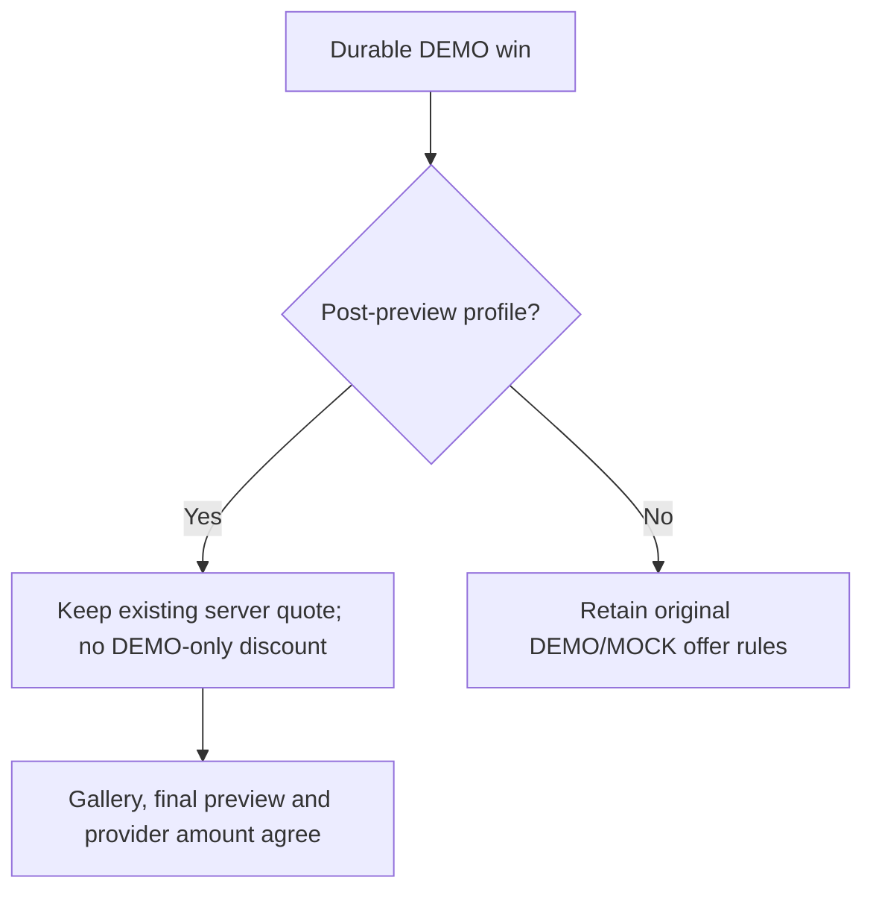
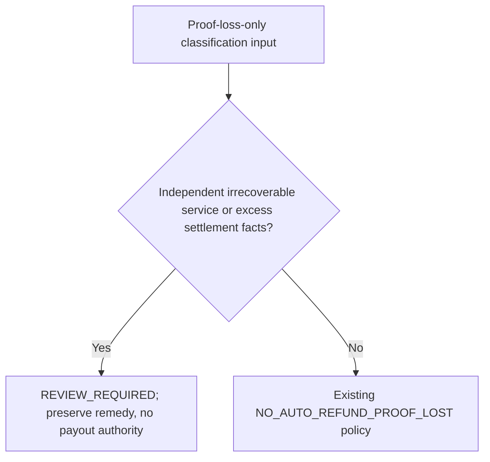

# Complete simulation campaign — 5 November 2026

**Owner request:** simulate the complete journey and failures, repair reproduced
problems, then finish software simulations before asking the owner to test.
**EXECUTABLE SOFTWARE SIMULATIONS COMPLETE / PASS.** All available synthetic
software checks below were executed; full provider/device/legal acceptance and
unimplemented refund protocol cases remain separate. Dates use Asia/Jakarta.

Authorized existing branch: `feature/post-preview-qris-checkout`.
Starting source: `9ae4ec1874c43c56325bf4254679e7feaca2ba77`.
Final verified runtime/test source: `acbac15842b59d5005075f2fbc7e87978323b158`.
Original attached local `work` branch/index remains untouched. Exact-source
snapshot and external Git index retain the already verified delivery procedure.

## Final campaign checkpoint — all executable software checks PASS

Both reproduced defects are repaired and pushed: BUG-041 at `7ad68ee` and
BUG-042 at `acbac15`. Each completed increment was immediately pushed to the
existing authorized branch and its remote SHA read back. No branch creation,
switch, force push or master merge. No unrelated checkout/user data was changed.

| Executed scope | Exact source | Result |
| --- | --- | --- |
| Complete all-opt-in Python discovery | acbac15 | **1,744 PASS**, zero failures/errors/skips; 476.832s |
| Windows backend / retained original prepaid guards | acbac15, CI job 126844155709 | **546 PASS**, zero failures/errors/skips; 542.463s |
| Ubuntu backend / original regression | acbac15, CI job 126844155593 | **546 PASS**, zero failures/errors/skips; 124.219s |
| Native Kivy registered customer journeys | acbac15, CI job 126844155221 | **62 PASS**, zero failures/errors/skips; 115.252s |
| Real event-loop/timer complete replay | acbac15 runtime, versioned evidence harness | **PASS**, 73.362s total; eight real five-second countdowns and **30.033s** genuine ticket visibility before automatic private-card wipe |
| Apps Script syntax / offline Node VM | acbac15 | PASS; no account, deployment or deletion |
| Two-size private preview render | 7ad68ee; GUI files identical in acbac15 | Both processes exit 0; eight synthetic PNGs, final previews visually inspected at 800x1280 and 452x900 |

**[CI 41906929920](https://github.com/pratikto/PhotoBooth/actions/runs/41906929920)
COMPLETED 3/3 SUCCESS.** All three completed job logs were independently
inspected, including N27 and both new proof-loss conflict cases. This is 1,154
CI platform executions; local full discovery contains 1,654 normalized distinct
test IDs within 1,744 executions due existing imported fixture classes. Do not
add overlapping runs or call those totals unique customer acceptance scenarios.
Superseded run `41906166693` was cancelled by the necessary BUG-042 push and is
neither PASS nor FAIL.

The full run enables GUI, native SDL audio with a dummy output driver, generated
video and the actual pinned MediaPipe 0.10.32 recognizer/public sample images.
There are **no remaining skips** in that executed run. Model size/SHA-256 and all
public fixture provenance were independently verified; samples, weights, real
photos and raw credentials are not committed. Dependency validation reports no
broken requirements. Camera acquisition, merchant, printer and cloud stay fake.

### Actual-time application replay

The [versioned replay harness](evidence/run_timed_synthetic_journey.py) runs the
actual Kivy `App.run()` loop with a fresh temporary synthetic fixture. It goes
Advertising -> tutorial -> two templates/2+1 copies -> six initial captures +
one selected-slot retake per design -> final Rp25,000 preview -> genuinely
rendered CCP -> one simulated PAID -> original ticket -> automatic 30-second
wipe -> original receipt/paid Drive fixture -> two exact virtual print batches.
The replay never rewinds a clock, forces a countdown deadline or presses NEXT.
It observes one charge, one receipt, eight private JPEGs, 2+1 copies and retained
OWED/`physical_paper_verified=False`. It does not mark simulated paper delivered.

The final visibility stopwatch starts at the original genuine-visible monotonic
ACK and stops at the original `_ticket_next` card wipe. A preliminary stopwatch
included subsequent worker time and was refined before final evidence; an early
harness-only navigation literal was corrected to the shared constants. Neither
was called an application defect or a passing original visibility measurement.
No private CCP/ticket screenshots are produced.

```bash
KIVY_HOME=work/simulation-kivy KIVY_NO_ARGS=1 KIVY_NO_FILELOG=1 SDL_VIDEODRIVER=offscreen SDL_AUDIODRIVER=dummy LIBGL_ALWAYS_SOFTWARE=1 python docs/qa/portrait-v2-sandbox/evidence/run_timed_synthetic_journey.py
```

Actual code/CI behavior, render dimensions/hashes, public model provenance and
allowlisted counts/timings are recorded in [machine-readable execution evidence](evidence/pp07-full-simulation-2026-11-05.json)
and [timed replay evidence](evidence/pp07-timed-synthetic-journey-2026-11-05.json).
The existing private-preview renderer does not mount paid checkout; paid UI
behavior is exercised by actual native N27 and the timed replay, without saving
private proof. Rendered black input pixels are deliberate synthetic camera data.

### All 112 acceptance scenarios reviewed without inflating coverage

The [112-row case review](evidence/pp07-simulation-case-review-2026-11-05.json)
records canonical expectations, concrete source/test references, observed
software status, partial scope, full-acceptance status and remaining boundaries.
Every referenced method was checked against the successful final full-run IDs.
**103 rows have executed partial software evidence; 9 remain non-executable in
the present implementation/external scope. No full acceptance row is marked PASS.**

| Remaining case | Precise missing scope |
| --- | --- |
| PP-101 | Real refund-window/issuer/acquirer/balance eligibility is not modeled or merchant-verified |
| PP-104 | Durable original refund-intent preparation and financial worker are not implemented |
| PP-105 | Original refund-key reconciliation after lost POST/duplicate webhook is not implemented |
| PP-106 | Refund request/processing/provider-confirmed state transport is not implemented |
| PP-107 | Completed-refund versus stale fulfillment callback protocol is not implemented |
| PP-108 | Actual refund-action/print/Drive worker fencing protocol is not implemented |
| PP-109 | Refund completion with an independently held booth is not implemented/tested as a refund protocol |
| PP-110 | Authenticated customer refund-status/reference UI is not implemented |
| PP-112 | Final commercial copy and legal/merchant approval require independent review |

Existing guards/classifier coverage in other refund rows is explicitly partial,
not a substitute for these missing protocols. No fake refund provider or insecure
vault/key fallback was invented merely to make every row appear simulated.

### State and authority corrections





### Independent readiness and exact next action

| Gate | Status after simulation |
| --- | --- |
| A supervised synthetic device candidate | READY_FOR_SUPERVISED_SYNTHETIC_DEVICE_TEST after owner preflight; executable software campaign complete |
| B actual post-preview merchant Sandbox | BLOCKED: integrated real-provider launch/merchant configuration and actual account evidence incomplete |
| C protected original restart/worker recovery | NOT_IMPLEMENTED as a complete pilot path; Windows DPAPI protected-byte process CI passes, Ubuntu facility unavailable here; no insecure fallback |
| D comprehensive software acceptance | Executable 1,744-test campaign PASS; all 112 reviewed with partial/missing scope, no full acceptance PASS |
| E owner hardware acceptance | Still NOT_RUN/HARDWARE_PENDING; owner was not asked to test during this campaign |
| F production/refunds | NOT_APPROVED / NOT_ENABLED |

No reproduced failure remains in the executed synthetic scopes. The next
implementation work is the separately guarded merchant/secure-original-worker
profile and, after verified provider/policy authority, missing refund protocols.
Relevant seams remain `post_preview_payments.py`, `credential_vault.py`,
`post_preview_claim.py`, `post_preview_isolation.py`, private checkout worker and
launcher. Actual merchant credentials/webhook/account contracts, supported
platform vault and independent owner physical observations remain external
requirements; full UAT/production is not declared complete by this campaign.

All sections below preserve delivery-time IN PROGRESS notes and earlier results;
this final checkpoint supersedes those historical pending statements.

## Phase 3 — BUG-042 conflicting proof-loss classification repaired

**BUG-041 push verified:** `7ad68eea14b269c307284aa95538f548111c7ee0`.
The untouched broad baseline on source 273cd80 completed **1,741 PASS,
0 failures/errors/skips, 465.436s**, with GUI/audio/video and all native public
model checks enabled. That pre-fix suite lacked the newly discovered seams;
its success is not proof that BUG-041 or BUG-042 was absent. Full verification
of the repaired sources is still pending.

**BUG-042 reproduction:** valid immutable assessment facts can carry
`reason=PROOF_LOST_ONLY` together with an independently irrecoverable service or
a distinct verified excess settlement. The nonbinding classifier incorrectly
returned `NO_AUTO_REFUND_PROOF_LOST`, hiding the independent issue behind loss
of proof. Two new regression methods initially FAIL (12 run: 10 PASS, 2 FAIL,
zero errors/skips). These tests assert RF-D07/21 and PP-089/097 behavior, not
actual merchant API capability.

The classifier now returns `REVIEW_REQUIRED`, no candidates and
`can_issue_refund=False` when that reason contradicts irreversible-service or
excess-settlement facts. Genuine proof loss alone retains its existing
`NO_AUTO_REFUND_PROOF_LOST` policy. No payout, refund intent, new transaction,
private-media grant, debt erasure or occupancy release is introduced.

**Focused corrected regression:** refund assessment + payments + original claim
**64 PASS, zero failures/errors/skips, 8.750s**, including both new cases.

```text
python tools/run_kiosk_unittests.py test_post_preview_refund_assessment test_post_preview_payments test_post_preview_claim
```

**Next:** run the complete all-opt-in suite on this source (expected count must
be measured), classify all 112 PP rows without confusing software partial
assertions with full acceptance, and inspect the final Windows/Ubuntu/native
CI. The current campaign remains IN PROGRESS; owner hardware UAT stays deferred.

## Phase 2 — BUG-041 reproduced and repaired; campaign still IN PROGRESS

**Phase 1 push verified:** `273cd802c7b930515a34a41c029111a3080e9184`.
A new actual Meong Fly DEMO win -> photo gallery probe fails at both 800x1280
and 452x900: two designs/2+1 copies advertise **Rp22,500**, while the existing
post-preview final preview/provider quote requires **Rp25,000**. The payment
backend does not accept that DEMO discount; this is a reproduced customer-price
consistency bug, not evidence of an unauthorized real charge.

The original portrait gallery reused DEMO discount eligibility in the isolated
post-preview subclass, although that profile has no trusted promotion adapter.
A small policy seam retains the original DEMO/MOCK behavior in `kiosk_v2/app.py`;
`post_preview_app.py` rejects DEMO-only gallery eligibility, matching its existing
server quote. No pricing formula, real discount authority, game attempt,
payment guard, merchant flag or legacy checkout changes.

**N27 new connected regression:** at both portrait sizes, run the actual durable
DEMO game worker/recorded win and tutorial, select two designs/2+1 copies, take
six initial shots plus one selected-slot retake per design, reject another
retake, confirm final preview and original CCP, settle one synthetic Rp25,000
order, display original ticket and dispatch one receipt, then submit two virtual
strip batches with exact 2+1 copies. Gallery, preview and provider amount must
agree; the game code remains consumed and service remains OWED because virtual
submission is not physical paper. Original DEMO/MOCK discount regression remains.

**Focused execution:** N27 plus game-offer and existing game-followup modules
**17 PASS, 0 failures/errors/skips, 9.709s**. The initial price-only probe was
**1 method / 2 failed portrait subcases** before the fix. A new full journey
closes the previously absent game-to-post-preview quote seam, rather than
replacing an existing working test with a weaker assertion.

The broad all-opt-in baseline is still running on the untouched prior source in
an independent snapshot. Its result does not verify this fix. After inspecting
it, execute the complete all-opt-in suite on this repaired source, then inspect
matching Windows/Ubuntu/native CI. Keep this campaign IN PROGRESS until those
results and all remaining simulation classifications are recorded.

```text
python tools/run_kiosk_unittests.py test_post_preview_native_journeys.NativeCustomerJourneyMatrixTests.test_n27_demo_win_retakes_and_paid_delivery_keep_one_consistent_quote test_kiosk_v2_game_offer test_kiosk_v2_game_followup
```

Partial acceptance references: PP-002/004/010/020/033/041/048/068. No full
hardware/provider acceptance row is promoted to PASS.

## Phase 1 — complete synthetic journeys and interruption cases

Executed on Linux/Python 3.12.14 with real Kivy/SQLite/test HTTP and synthetic
camera, merchant, printer and Drive. SDL offscreen/software GL and dummy audio;
no actual charge, refund, paper, public upload or customer photographs.

```text
python tools/run_kiosk_unittests.py test_post_preview_journey_matrix test_post_preview_native_journeys test_post_preview_process_crash test_post_preview_payment_crashes test_post_preview_refund_assessment
```

**51 PASS, zero failures/errors/skips, 49.747s.** This includes existing imported
admission fixture tests; it is not 51 new acceptance scenarios.

| Executed group | Methods | Covered software behavior |
| --- | ---: | --- |
| J01–J21 | 21 | All 12 templates/36 captures before payment; 2+1+3 copies; final preview; original CCP/PAID/ticket; exact fake Drive folder; virtual strip dispatch; delayed/duplicate payment; corrupt media; uncertain paper; A/B return; 12 consecutive paid visits |
| N21–N26 | 6 | Actual Kivy navigation/buttons, three-design paid journey, offline Drive recovery, protected A/B admission and checkout, all 12 previews at two portrait sizes |
| P01–P02 | 2 | Real child exit during receipt/strip SENDING; independent SQLite reopen retains OWED and no guessed paper outcome |
| Payment process-death cases | 6 | PREPARED/SENT/create-response loss, interrupted PAID GET, lost cancel result and leased inbox worker recovery |
| Refund assessment | 10 | Nonbinding eligibility only; no proof-loss-only refund, no uncertainty-based payout, correct excess-attempt identity, mandatory capability/policy fences |
| Imported admission fixtures | 6 | Safe handoff/claim, pending and worker holds, exact ACK retry, wrong QR role denial |

No failure was reproduced in this phase. Existing source fixes are retained;
there is no speculative product patch or hardware readiness upgrade.

## Original phase plan — historical (final outcome above)

1. Full Python discovery with GUI/audio/video opt-ins; use only dummy/synthetic
   acquisition. Record every skip and resolve executable optional dependencies.
2. Actual MediaPipe model with the repository's pinned public sample fixtures;
   independently check model bytes/hash and keep samples outside Git.
3. Fill meaningful missing journey/failure coverage discovered by this campaign,
   repair reproduced defects, and push each tested increment immediately.
4. Review all 112 canonical PP scenarios against executed software evidence;
   distinguish automated partial coverage, absent implementation and externally
   blocked hardware/provider/security acceptance. Never turn a related unit test
   into full acceptance PASS.
5. Source-matched final regression, safe synthetic preview inspection and final
   simulation report. Owner physical UAT remains deferred until this software
   campaign finishes or identifies a precise external blocker.

The next broad command uses `tools/run_kiosk_unittests.py` with no module list,
`PHOTOBOOTH_TEST_GUI=1`, `PHOTOBOOTH_TEST_AUDIO=1`,
`PHOTOBOOTH_TEST_VIDEO=1`, SDL offscreen/dummy audio, and camera/face/palm/real
delivery disabled except for explicitly isolated fixture overrides. Native
model tests require a verified local public asset directory and the pinned
optional MediaPipe dependency before those cases are considered executed.

**Readiness remains separate:** synthetic candidate previously ready; merchant
Sandbox launch/credentials/webhook and full protected original-worker restart
remain incomplete/blocked; refunds disabled; owner hardware NOT_RUN; production
NOT_APPROVED. The [previous verified source checkpoint](PP07-CONTINUATION-2026-11-05.md)
retains Windows 544/Ubuntu 544/native 61 CI evidence at c20479d. This new campaign
must supply its own exact-source evidence and must not erase earlier failures
or assign new physical PASS results.
