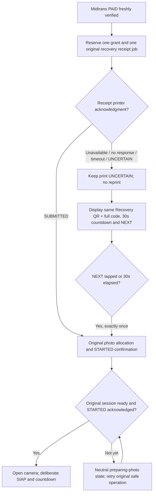

# Recovery Ticket delivery — mandatory screen + concurrent paper (post-preview); historical failure-only fallback

> **NEWER policy, 1 November 2026 — applies ONLY to NEW `feature/post-preview-qris-checkout` orders (DESIGN / NOT IMPLEMENTED).** Owner now favors **refund-first** for safely verified **irrecoverable PAID merchant-service failure** (full original payment for eligible MVP orders), plus **refund excess charge only** for independently proven duplicate-settled QRIS attempts, subject to merchant-specific Midtrans POS refund activation, one original `refund_key`, provider reconciliation, safe print/Drive fencing and consumer-law review. **Lost genuinely offered CCP/Recovery Ticket alone = NO_AUTO_REFUND_PROOF_LOST and no tokenless photo access**; if Meong never genuinely offered proof or separately failed delivery, maintain PAID/OWED and evaluate lawful recovery/refund independently. The live original Recovery Ticket **ALWAYS appears on the 30-visible-second screen + NEXT while one same-original paper receipt is dispatched concurrently**. Older unconditional "NO AUTOMATIC REFUND" and print-success-skips-ticket-screen instructions below are **historical/current source rules for legacy paid-first orders** and must **not** override the new future post-preview policy. Preserve their dated evidence and all AR/UAH safety invariants. **All PP-001..112 NOT_RUN, no real Refund API or application source change.**
>
> **Canonical:** [All decision crosswalk](POST-PREVIEW-QRIS-COMPLETE-DECISION-LEDGER.md) · [refund/proof loss](POST-PREVIEW-QRIS-REFUND-AND-LOST-PROOF-POLICY.md) · [operator escalation](POST-PREVIEW-QRIS-OPERATOR-AND-REFUND-ESCALATION.md) · [post-preview master flow](POST-PREVIEW-QRIS-OWNER-APPROVED.md) · [secure states](POST-PREVIEW-QRIS-SECURITY-STATE-CONTRACT.md) · [112 NOT_RUN PP QA](POST-PREVIEW-QRIS-ACCEPTANCE-MATRIX.md).

> **POST-PREVIEW QRIS BRANCH ADDENDUM (1 November 2026; APPROVED DESIGN, NOT IMPLEMENTED).** For *new* `feature/post-preview-qris-checkout` orders: each template 3 photos + max one retake, all previews -> permitted edits before immutable provider create -> single frozen checkout with original private pre-PAID CCP -> verified PAID -> original post-PAID Recovery Ticket -> purchased strips **only after exact Drive download URL verified**; pending uploads may retry. Distinct USER_CANCEL vs provider expiry (QR1→QR2→QR3 for actively continuing original customer only), encrypted crash-proof original credential escrow, adaptive true inactivity, late-PAID private OWED, safe machine fence/ACK and no blind print replay are binding. **Legacy source and old prepaid flow evidence below remain historical and valid in their original scope**; AR/UAH safety and AR-13 external gates remain unchanged. On THIS branch the future PP roadmap is active when separately authorized; the AR roadmap remains active on the parent branch. **84 PP test cases NOT_RUN; no source/production/actual cloud change.** [Owner flowcharts and 24 decisions](POST-PREVIEW-QRIS-OWNER-APPROVED.md) · [security contract](POST-PREVIEW-QRIS-SECURITY-STATE-CONTRACT.md) · [84 QA cases](POST-PREVIEW-QRIS-ACCEPTANCE-MATRIX.md) · [Codex roadmap](POST-PREVIEW-QRIS-CODEX-HANDOVER.md).

### Post-preview credential scope (target-only refinement)

The pre-PAID **Checkout Claim Proof** is a separate capability for late-settled original purchases. The original Recovery Ticket is given only after verified PAID. Existing memory-only/no-plaintext ticket safeguards still apply to ordinary files/DB/logs; **only protected ciphertext in an access-controlled escrow vault** is allowed for crash survival. A still-live PAID owner does not have to rescan CCP. Never redisplay an already SUBMITTED receipt merely on restart/poll; UNCERTAIN transport cannot be reprinted automatically. Genuine offer versus merely attempted paper submission is recorded separately. Prior prepaid ticket-before-camera flow stays legacy. New after-preview ticket proceeds to fulfillment, not new capture.

## 1 November 2026 — NEWER owner-approved rule for post-preview purchases: ALWAYS show ticket while printing

**Current authoritative rule for NEW `feature/post-preview-qris-checkout` orders only (DESIGN / NOT IMPLEMENTED):** After independently verified PAID and the original live customer owns the kiosk, **the Recovery Ticket screen MUST ALWAYS appear**, even when the printer is fully functional. At the **same time**, start exactly **one** authorized receipt print dispatch carrying **the identical original Recovery Ticket QR/code**. The screen is not a fallback for printing failures. It stays visible with the original QR, FULL code, "SIMPAN RECOVERY TICKET" guidance, **visible 30-second countdown and LANJUT/NEXT** regardless of SUBMITTED, failed, timeout, UNCERTAIN or printer not configured.

### Required parallel flow (new-order target)

~~~mermaid
flowchart TD
    A([Freshly verified PAID, original live customer]) --> B[Confirm exact original paid grant, original ticket and printer job identity]
    B --> C[Persist initial ticket presentation intent and one receipt-send reservation]
    C --> D[SCREEN TRACK: ALWAYS render exact original ticket QR + FULL code]
    C --> E[PRINTER TRACK: concurrently enqueue one exact SAME-ticket print]
    D --> F{QR and code visibly rendered to rightful owner?}
    F -->|No / ownership lost| X[No successful offer; privacy lock / PAID_OWED claim path]
    F -->|Yes| G[30 actual visible seconds + LANJUT]
    G --> H{LANJUT or zero?}
    H -->|Yes| I[Wipe original QR/code from UI and record one offer, never restart on polling]
    E --> J{Transport result?}
    J -->|SUBMITTED| K[Keep original screen; no second send]
    J -->|NOT_SENT / unavailable| L[Keep original screen; record hardware issue]
    J -->|SENDING / UNCERTAIN| M[Keep screen; original print job quarantined, no replay]
    K --> N[Original printer worker ordered, quiescent or safely fenced]
    L --> N
    M --> N
    I --> O{UI ticket dismissed AND original printer lane safely serialized?}
    N --> O
    O -->|No| H[Retain original owed state; no duplicate receipt or unsafe strip bytes]
    H --> O
    O -->|Yes| P[Bind verified Drive URL and print purchased strips as authorized]
~~~

This describes concurrency of **display and receipt dispatch**, not a guarantee that paper exits the thermal slot at the same millisecond. The 30-second timer starts **only when QR and complete code are actually visible**. Printer ACK must not suppress or delay opening the ticket screen. Printer failure must never trigger a separate new fallback screen or cause auto-reprinting. Screen NEXT/timeout does not void/duplicate an already submitted original receipt; one exclusive printer worker preserves ordered paper effects before photos. Screen/print credentials never appear while unpaid, PAID_UNCLAIMED without original proof, under another visitor's lease, in public Advertising, or automatically after restart. An original returning CCP claimant may see a first lawful presentation only after successful proof and free booth; a previously presented ticket is not silently reissued.

### Older policy below: strictly historical/legacy

The older 1 November text below describes the **legacy paid-before-camera version**, whose original receipt printer success bypassed the on-screen fallback and whose conditional fallback was displayed only when the receipt failed/was uncertain. It remains as a historical source/UAH reference and is **superseded for new post-preview purchases** by this newer owner instruction. New flow Codex must apply the mandatory parallel-screen contract above, [the master owner decision/Flow G](POST-PREVIEW-QRIS-OWNER-APPROVED.md), [state/security](POST-PREVIEW-QRIS-SECURITY-STATE-CONTRACT.md), and [PP-041/042/051/079/080 acceptance](POST-PREVIEW-QRIS-ACCEPTANCE-MATRIX.md). All new PP checks remain NOT_RUN; no source/hardware code changed.

---

## Historical 1 November 2026 — Supplemental owner policy: responsibility to keep ticket

**See the newer canonical whole-booth contract:** [Unattended session handoff and automatic isolation](UNATTENDED-SESSION-HANDOFF-OWNER-APPROVED.md). This existing 30-second fallback specification **remains valid**; the owner explicitly approved it again with a customer-accountability clarification:

- The kiosk must genuinely offer the **original** Recovery Ticket through its normal one-time printed receipt, or if that transport is unavailable, failed, timed out or uncertain, through the original QR/full code on screen with a visible **30s countdown and NEXT**. Continue original camera only through existing STARTED/readiness gates. No re-issued ticket, no reprint of uncertain jobs, no timer extension through polling.
- The customer must retain that genuinely offered ticket. If they ignore, lose or do not save it, **self-service private photo-session recovery is forfeited**, and the routine operator workflow must **not** bypass original proof to disclose old photos. Show prominent Indonesian warning: **"SIMPAN RECOVERY TICKET KAMU! Jika sesi foto terputus, tanpa tiket sesi terkunci tidak dapat dipulihkan."**
- This is **not** a payment reversal, refund, or assertion that an incomplete service was delivered; preserve paid OWED/PAID_UNFULFILLED claims and a separate non-media support/financial remedy process. A transport SUBMITTED status does **not** establish that paper physically left the printer. If Meong is known not to have offered a working receipt or screen fallback, do not blame the customer.
- All prior privacy, raw-token redaction, one-send/UNCERTAIN, QR separation, 24h Sandbox token expiry, and device acceptance requirements still apply. The fallback is **NOT IMPLEMENTED / NOT TESTED** in the current source. This note does not alter any code or create a device PASS.

**Status: OWNER-APPROVED UX REQUIREMENT / DOCUMENTATION ONLY / NOT IMPLEMENTED / NOT TESTED.**
Recorded from the owner's follow-up to the payment flowchart on 1 November 2026.
Target: existing `feature/portrait-kiosk-v2-next` dedicated Midtrans QRIS Sandbox
profile. This is a future extension of [BUG-027](BUG027-PAID-TO-PHOTO.md) and
[BUG-028](BUG028-PAID-STARTING.md), **not** evidence that the current UI has
already changed. The validated happy path remains PAID -> attempt one recovery
receipt print -> directly prepare the original camera session. Drive and
production remain OFF; AR-00 through AR-13 remain the top development priority.

## 1. Owner decision

If the **Recovery Ticket receipt printer does not respond** after a freshly
verified PAID transaction, show the **original Recovery Ticket on the kiosk
screen for 30 seconds**, with a **visible 30-second countdown** and an
immediately available **NEXT / LANJUT** button.

- Show the existing, original customer recovery QR **and the complete
  corresponding ticket code** in a legible, selectable/readable display. Do not
  substitute the short order reference, merchant payment QR, download QR,
  operator login QR, or any new/reissued token. The secret/code is for the
  current paid customer's recovery only.
- Display suggested customer guidance: "Printer tiket tidak merespons. Simpan
  tiket pemulihan ini dengan memfoto layar atau memindai QR. Jika sesi terputus,
  gunakan tiket ini untuk melanjutkan tanpa membayar lagi."
- Show the countdown clearly, for example **"Lanjut otomatis dalam 30 detik"**
  updating 30, 29, ..., 0. The **LANJUT / NEXT** button is visible and enabled
  throughout the display, so the customer can continue **before** 30 seconds.
- At zero, **automatically dismiss the ticket screen** and continue the same
  original paid session. If **LANJUT / NEXT** is tapped, perform the same guarded
  transition immediately; do not require an extra acknowledgment. Both exits
  must operate at most once (timer/tap race is idempotent).
- The 30 seconds is the **ticket display duration**, not a Midtrans payment QR
  expiration, payment polling delay, receipt printer wait timeout, or photo
  countdown. Begin it only after the failed/uncertain printer outcome qualifies
  for fallback and the authorized ticket view has actually appeared. A page
  rebuild/status poll must not restart or extend the original countdown.
- If the printer **acknowledges the one permitted submission**, retain the
  current happy path: no mandatory on-screen ticket page and no extra Next
  button before entering the camera.

## 2. Exact entry and exit guards

1. Enter fallback only after fresh authoritative settlement of the **same
   original PAID order**, its valid grant and current live customer ownership.
   The original raw credential must still be available securely in the current
   process. The existing printer submission can be absent/unavailable, throw an
   error, time out without acknowledgment, or end in `UNCERTAIN`; this qualifies
   for a screen fallback, **not** a second submission.
2. Preserve the original order ID, checkout key, grant, allocation operation,
   capture/fulfillment rights, receipt job, and print uncertainty state. Never
   create another payment, issue a fresh ticket, reprint the receipt, retry an
   uncertain transport job, or infer physical paper delivery from `SUBMITTED`.
3. The display runs as a bounded **current-visit privacy-sensitive overlay**
   rather than a general-purpose ticket viewer. Once NEXT is tapped or zero
   reached, wipe the displayed ticket QR/plaintext from live widgets and
   transient UI caches. Never show it to the next customer.
4. Enter camera only after the existing original allocation / local readiness /
   backend `STARTED` acknowledgment safety gates pass. If preparation remains
   pending when NEXT is tapped or countdown expires, hide the ticket and show
   the existing neutral **preparing photo permission** state until that exact
   transaction is safely ready. Do not leave a blocked camera or bypass guards.
   Permanent camera/storage failure retains PAID/OWED rights and uses existing
   recovery/remedy, not another payment.
5. A minimize, session privacy lock, expired ownership generation, app close or
   process restart immediately hides sensitive pixels and retires stale timer
   and NEXT callbacks. Never reopen an original private/restarted session or
   redisplay the ticket automatically without the existing valid ownership/proof
   rules. If the raw original ticket has been lost after a restart, do **not**
   mint a substitute or expose private media: retain the paid obligation and
   use the existing customer-proof/operator exception route.
6. The original ticket remains valid under the existing Sandbox **24 hours
   from order creation** policy; the 30-second view does not extend or reset
   this validity. A short numeric order label is never sufficient to redeem
   private media.

## 3. Revised PAID-to-camera flow

The QR is the **customer Recovery Ticket**, not the Midtrans QRIS payment QR.
The ordinary successful receipt submission should still transition directly to
camera as before. Auto-navigation after fallback does **not** trigger a shutter.

## 4. UI / privacy requirements

- Use the existing native portrait UI/theme and recovery QR encoder; adapt to
  800x1280 and 452x900. Keep code text fully readable or scrollable without
  clipping. The NEXT button and remaining seconds must remain obvious on both.
- The customer should have a practical chance to photograph/scan the ticket on
  their own phone before NEXT or countdown expiry. Make no claim that scanning
  alone stores a reusable link: the code is a private recovery capability.
- Do not automatically copy the secret to the operating-system clipboard.
  Never save raw token, QR bitmap, screen capture or rendered ticket payload to
  files, GitHub, logs, SQLite, crash dumps, UI diagnostic previews, screenshots
  or telemetry. QA screenshots must use **synthetic nonredeemable** tokens only.
- Keep QR identities separate (payment / recovery / operator / DEMO / download)
  and preserve full-ticket claim validation, hash-at-rest, proof expiry, rate
  limiting, pause/minimize privacy and one-owner camera controls.
- If printer acknowledgement is given but paper is physically missing, the
  current transport acknowledgment alone cannot prove paper delivery; physical
  printer/paper tests remain a separate acceptance item. Do not silently claim
  that every missing-paper event is detectable in software.

## 5. Required implementation tests (NOT RUN)

1. Printer unavailable before send, printer transport exception, delayed/no
   acknowledgment and after-send uncertainty: exactly one original paid order,
   one receipt intent, **no second print**, and on-screen fallback entered.
2. No fallback after a successfully acknowledged receipt; PAID-to-camera remains
   direct with no mandatory NEXT or additional consent.
3. QR decodes to the exact **original synthetic** Recovery Ticket; the matching
   complete code is readable; 30->0 countdown is visible at both portrait sizes.
4. NEXT at 29 seconds (and near zero) advances once; untouched timer expires at
   zero and advances once; no capture happens without deliberate SIAP/countdown.
5. Repeated polls, widget rebuild, delayed callbacks and animation do not reset
   or extend the original 30-second window.
6. NEXT/timeout while STARTING or allocation acknowledgment is delayed keeps
   exactly the original operation and neutral readiness hold, then admits the
   original camera once safe. No second allocation or fee.
7. Minimize, lock, session-owner change, restart and late timer/print callbacks
   cannot expose the ticket or previous customer photos; old private/restarted
   sessions still require existing customer proof.
8. No fallback/token exposure for PENDING/EXPIRED/UNKNOWN, refund, mismatched,
   previously held or unproved reopened orders. Saved unpaid QR1/QR2/QR3 behavior
   stays unchanged.
9. Raw secret never reaches files, persistent journals, logs or exported QA
   evidence; one-time print semantics and PAID/OWED preservation remain intact.
10. Owner Windows + real configured 80 mm printer + Sandbox simulator trial must
    separately confirm the visible 30-second fallback, phone readability,
    NEXT behavior and successful camera admission. These are **NOT RUN**.

## 6. Handoff and scope

- **Requested now:** document the new requirement, its updated flow, and tests.
  **No application, tests, GUI, printer service, launcher or cloud deployment
  changes are authorized by this documentation-only request.**
- **Implementation later:** reuse current BUG-027 receipt worker and original
  in-memory customer ticket, native Kivy widget/QR rendering and BUG-028
  same-operation admission. First add failing focused tests, then a narrowly
  scoped runtime change, test native portrait views, one applicable full
  regression and matching Windows/Linux CI, and capture owner laptop/manual
  acceptance separately.
- Do not create a branch, merge to master, alter production payments, change
  Midtrans amount/renewal, weaken privacy/recovery, enable Drive or redo earlier
  verified AR/BUG work. Keep this item queued alongside active BUG-028 and
  existing AR-00–13 release gates; historical test results do not certify it.
