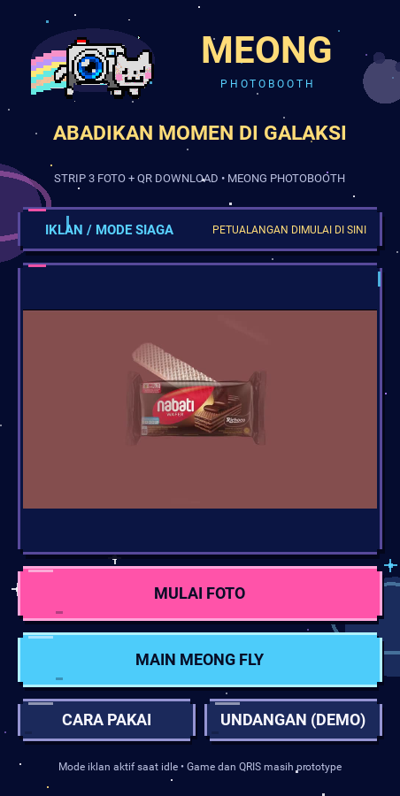
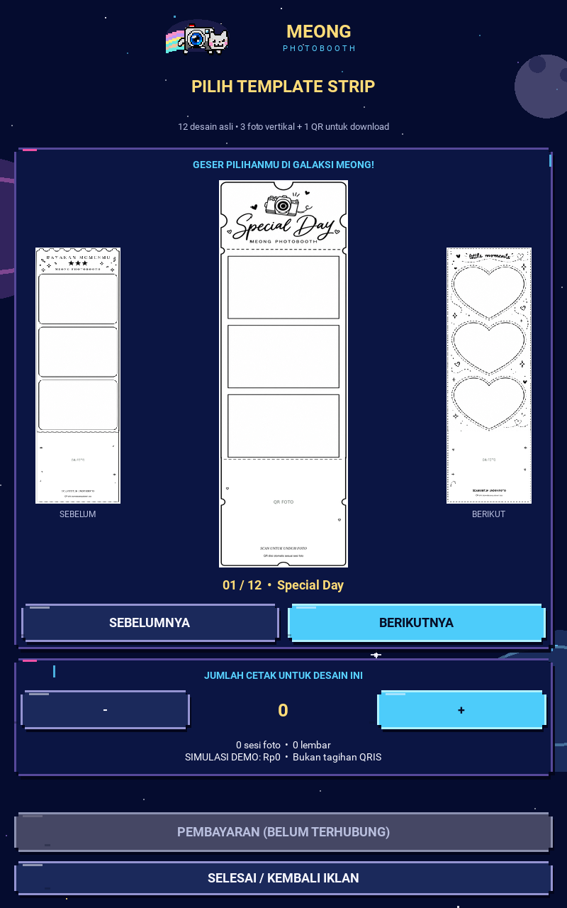

# Windows audit follow-up — 2026-10-22

> **Dated source/QA record, retained for traceability.** Results, “latest/current”,
> OPEN/PENDING labels, next actions and authorization limits below apply to this
> package's recorded source and report date. Later owner reports and source work
> can supersede its status; they do not rewrite these test results. Use
> [current status](../../FEATURE_STATUS.md), [test ledger](../../test_checklist.md)
> and [current handover](../../DEVELOPMENT_HANDOVER.md) for continuation. Historical
> checklists are not an instruction to repeat already accepted tests.

Branch: `feature/portrait-kiosk-v2-next` only. Original Windows owner audit:
[29/38 at 3cfa9d2](../portrait-v2-windows-acceptance-3cfa9d2.md).
Those device checks do not automatically become PASS on repaired code.

## Source checkpoints

- Pre-fix Windows audit / rollback: `3cfa9d2efc1060405db86d51627a8406ab86e2bb`.
- Input/audio fix: `37c0024e002d2a809ddb9267dc874653d389a8b5`.
  [Exact-SHA CI 39710969312](https://github.com/pratikto/PhotoBooth/actions/runs/39710969312)
  completed SUCCESS; both jobs SUCCESS (metadata preserved here).
- Visual branding: `faa1c7d7aa6fb6f87ad10a7d686ad0b0baa3005d`.
  [Exact-SHA CI 39711930820](https://github.com/pratikto/PhotoBooth/actions/runs/39711930820)
  completed SUCCESS; both jobs SUCCESS, verified separately from the input/audio run.
- Pre-brand rollback is input/audio checkpoint `37c0024`; pre-fix Windows rollback
  is `3cfa9d2`. No reset, force-push or master change was performed.

## Input/audio evidence

Initial regressions failed for missing click dispatch, missing pointer grabs at
both viewports, and absent Windows minimize event binding. Repaired behavior:

- One click per enabled button release on advertising, invitation, tutorial,
  gallery/cart and game preview. No duplicate arrow/copy clicks; stale/disabled
  callbacks stay silent. Navigation cannot immediately cut its own click.
- Gallery grabs the native pointer stream, computes normalized window movement,
  rejects short/vertical/out-of-bounds drags and releases/disposes ownership once.
- Desktop Window minimize/restore binds to application suspend/resume, and unbinds
  on exit. Background time does not prematurely expire a browsing visit.
- Owner's latest policy: GUI music on image/fallback ads, source audio on video;
  the optional player callback yields GUI music before a decoder can start.
  Image-to-image music and tutorial-to-template music do not restart unnecessarily.

50 targeted tests PASS for this correction; complete suite 285 run, 283 PASS,
2 opt-in native-model skips. Native SDL2 dummy-device smoke PASS. Transcripts
are retained here. This is provider/lifecycle evidence, not audible Windows output.

## Visual branding evidence

The transparent camera-cat is the **unchanged PNG byte stream** decoded from the
read-only Meong Fly reference at `672e3f7089bb40940e5b41644ceb656aa63aafbb`.
No gameplay/scanner/receipt modules were imported or integrated. Original v1 and
QR logo files are unchanged. Asset hash/provenance is documented with the asset.

One shared native Meong lockup appears on each page. Compact gallery branding
leaves the strip previews and every CTA accessible; the game preview uses one
large hero brand without a duplicate header. Pixel textures retain nearest
filtering. New layout is arranged after parent geometry settles.

Final complete regression: **287 run, 285 PASS, 2 opt-in native-model skips,
zero failures/errors** (branding-full-tests.txt).

52 targeted tests PASS, no failures/errors/skips: include artwork integrity,
transparent alpha, one logo per route, child/CTA bounds at both viewports and the
four numbered tutorial steps in the correct order. Renderer verifies actual
gold wordmark pixels on **every captured page**, not just widget existence.

All twelve PNGs in [screens](screens/) were inspected at 800×1280 and 452×900:
transparent brand on idle/tutorial, inline invitation, gallery/cart and game hero;
readable labels and active CTAs; three-slot/QR strip aspect ratio preserved.
Compact tutorial remains scrollable through step four. No clipped main CTA or
new layout blocker was found. Source hashes at capture are preserved here.
The original local manifests honestly record input/audio HEAD with tracked
branding edits; they are local evidence, not clean-checkout CI artifacts.

## Windows retest and boundaries

Recheck D04, F01–F06, G05 and C02 at the new HEAD. Hear single clicks on ads and
preview, image-ad soundtrack, video source audio only, and no orphan sound after
minimize/restore/close. Also review the new transparent logo in each page on the
10.1-inch display. Record exact SHA and per-case observations before updating
owner acceptance. The existing 29 checks remain attached to the audited version.

Payment is intentionally unavailable; scanner/discounts/game/production payment
and real capture/print/Drive integrations remain outside this fix. No master
change, merge or release is performed.
