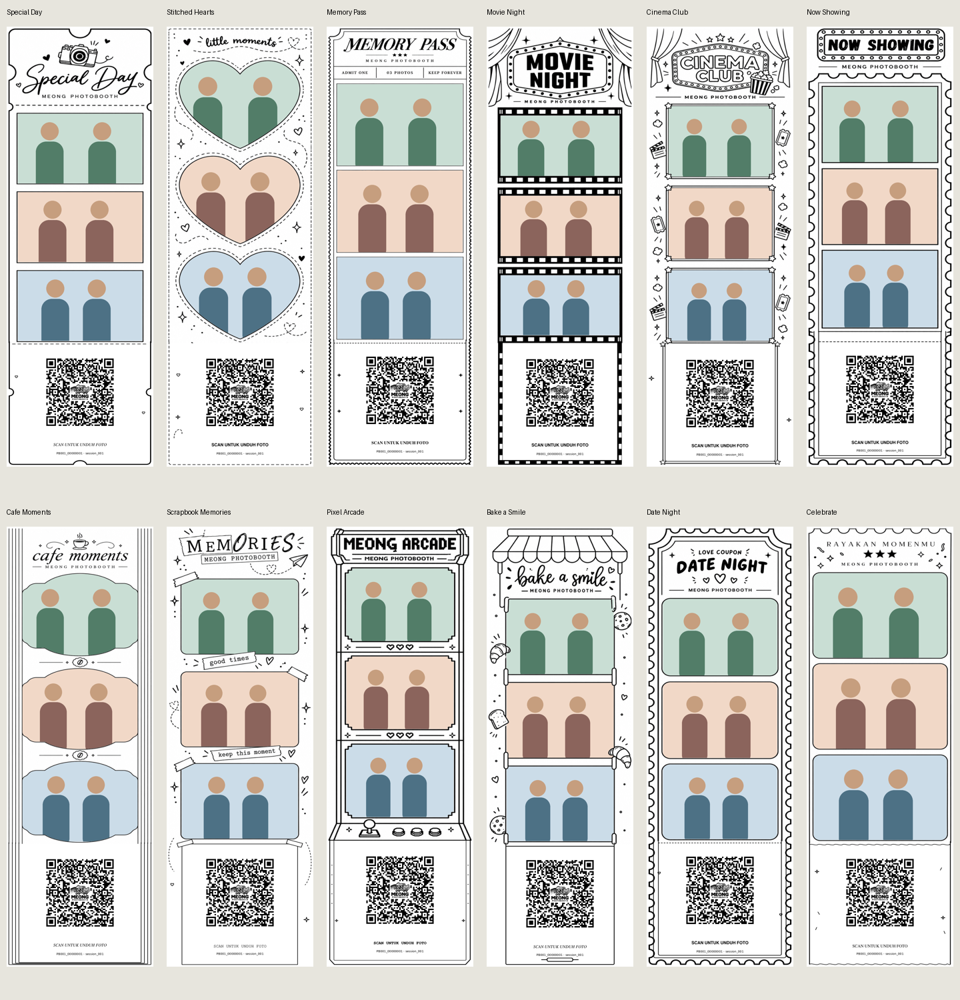
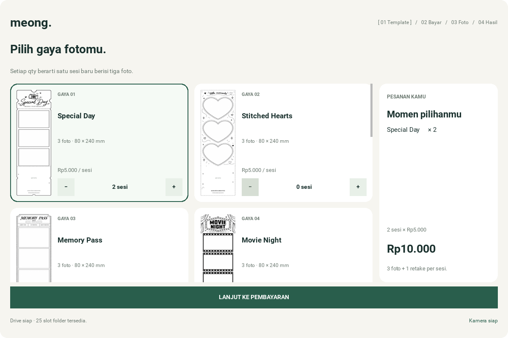
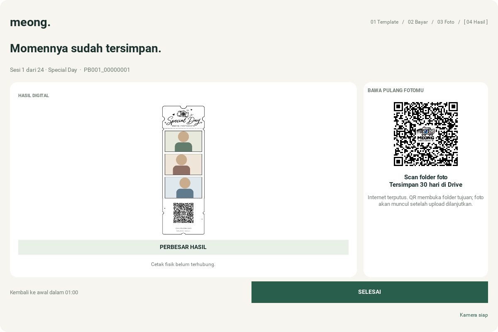
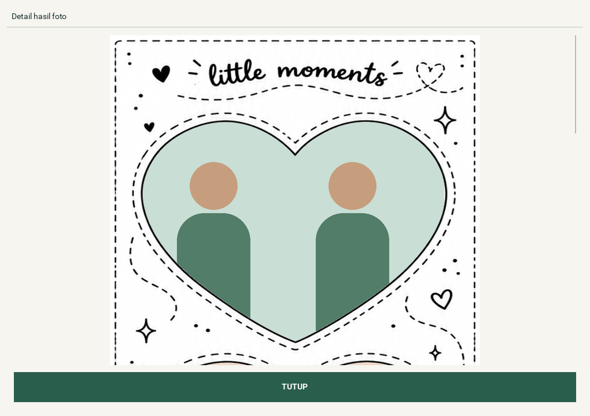

# Approved receipt templates in the Kivy workflow

> **Historical QA snapshot.** This record retains its original source, date,
> fixtures and owner-report limits. Its branch, price/session, “current” and
> pending instructions do not override [current GUI v2 status](../FEATURE_STATUS.md)
> or the [current test ledger](../test_checklist.md). No new test pass is claimed
> by adding this context.

> **2026-10-19 v1 SOURCE FOLLOW-UP:** `feature/kivy-gui` has been promoted to `master` and tagged as the immutable [v1.0.0 source pre-release](https://github.com/pratikto/PhotoBooth/releases/tag/v1.0.0) (`07ce51d`). The findings/tests dated below remain **historical snapshots**; current source/bug/physical-device status is tracked in [FEATURE_STATUS.md](../FEATURE_STATUS.md), [bug_tracker.md](../bug_tracker.md) and [release notes](../releases/v1.0.0.md). Linux synthetic CI is not production hardware certification. QRIS remains DEMO and BUG-009 Drive cleanup is OPEN.


> **HISTORICAL QA SNAPSHOT (template rollout): This document records the approved 12-template 80 mm layout and its initial 48-render synthetic verification. **CURRENT:** the same template system is used on `feature/kivy-gui` with FEAT-001 copy pricing and integrated thermal printing; do not interpret earlier 'printer transport separate' language as current implementation status. Owner-tested paper-copy PASS is documented [here](FEAT-001-BUG-011-acceptance.md).**

The application now loads the twelve approved revision-3 80 mm designs instead
of four illustrative cards. Each session's selected template determines its
three aspect-preserving crops, explicit masks, and QR footer. The same rendered
frame pixels appear during review and in the saved result, including retakes.

The master geometry is 640 × 1920 pixels at 203.2 dpi, or 80 × 240 mm. The original
eight-dot paper margins are retained. The complete QR placeholder is replaced,
using an integer dot size per module within its 384-dot/48 mm allocation. The
approved full logo is centered and monochrome in this receipt QR.









## Validation

- Full Python suite with GUI checks enabled: **100 passed, 2 skipped**; 122 subtests passed. The two native gesture-model checks require optional test assets and remain skipped.
- Real Kivy screenshot renderer: **48 renders passed** at 1200 × 800 and 800 × 600. [Machine-readable report](receipt-report.json).
- All twelve saved PNGs decode to the exact synthetic Drive-folder URL. QR checks use the final PNG pixels, not just encoder metadata.
- All 36 photo windows contain the intended photo in the correct position. Pixels outside their explicit clip masks retain the original paper, borders, and ornaments. All four paper margins are unchanged.
- Landscape, portrait, square, and EXIF-rotated images preserve their aspect ratio and source bytes. All twelve previews are distinct and independent of their cached originals.
- The real controller is driven through heart selection, capture, a third-photo retake, saving, advancing to an arcade session, and completion. Review uses each session's own apertures. Retake initially waits for its shutter.
- The new result viewer was additionally checked after its final styling change: full-resolution texture, proportional vertical scrolling, source bytes unchanged, and automatic dismissal when the result page retires.
- The command-line compositor was exercised with three fixture files and the arcade template. `git diff --check` passed.

Repeat the suite and screenshots from the repository root using the application's
environment. Offscreen SDL is for this Linux validation environment:

```bash
PHOTOBOOTH_TEST_GUI=1 SDL_VIDEODRIVER=offscreen KIVY_NO_ARGS=1 python -m pytest -q
SDL_VIDEODRIVER=offscreen KIVY_NO_ARGS=1 python tools/render_gui.py --output-dir /tmp/receipt-gui
```

Photo fixtures are geometric illustrations. Folder URLs are test fixtures; no
real customer photos, Google credentials, uploads, QRIS charges, or printer jobs
were used. Physical printable width, thermal photo dithering, printer transport,
and phone-camera scanning on an actual paper print need device testing.
